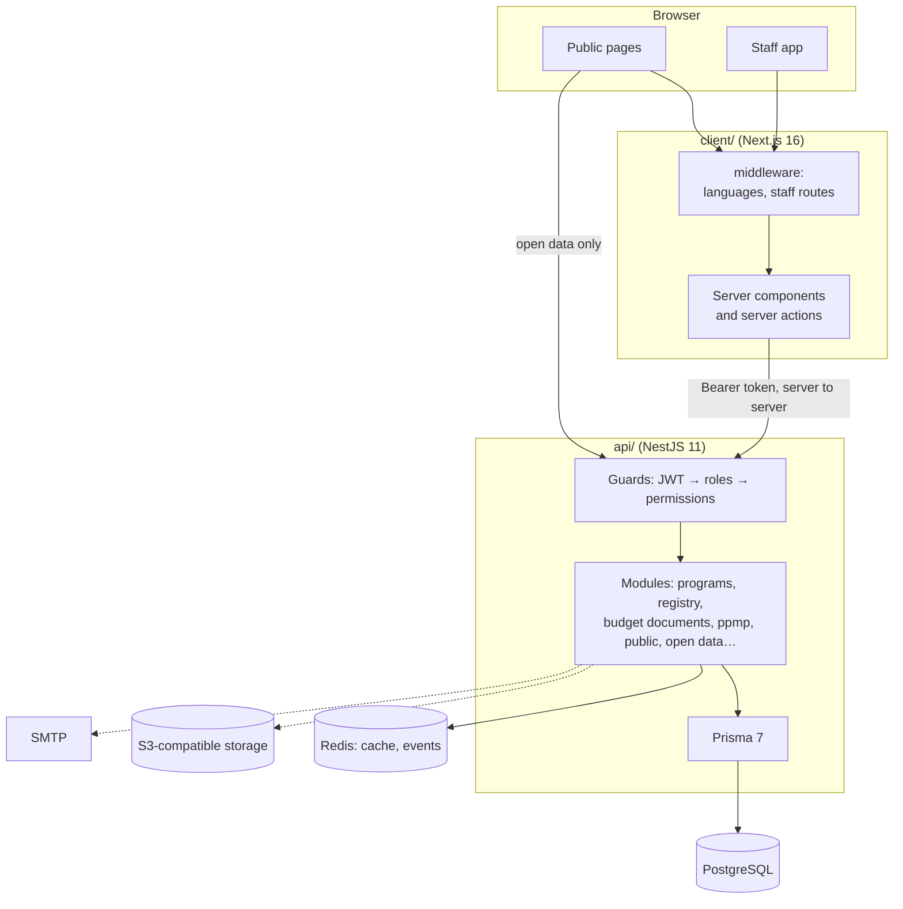

# Architecture

How the portal is put together and how it runs. The rules that are easy to break are in
[`ARCHITECTURE-ESSENTIALS.md`](ARCHITECTURE-ESSENTIALS.md); the data model, lifecycles and each
module are in [`docs/`](docs/README.md).

## Shape

A pnpm monorepo with two deployable workspaces.

- **The browser never calls the API directly**, except the open-data routes. Pages are rendered by
  the Next server, which holds the session in httpOnly cookies and calls the API with a bearer
  token.
- **The API owns every rule.** The client validates for convenience only.
- **One origin in production.** nginx sends `/api/v1/*` to the API and everything else, including
  the client's own `/api/*` route handlers, to the client.

## Stack

| Layer | Technology |
|---|---|
| API | NestJS 11, TypeScript (ESM), Prisma 7, PostgreSQL 15+ |
| Client | Next.js 16 (App Router), React 19, Tailwind CSS v4, shadcn/ui on Base UI |
| Cache and live updates | Redis (optional on one instance) |
| Files | S3-compatible object storage, or a local folder in development |
| E-mail | SMTP or Azure Communication Services |
| Production | Docker Compose: api, client, nginx, redis, postgres (`docker-compose.yml`) |

## Identity

A deployment belongs to one LGU. Its names come from `LGU_*` variables, derived the same way on
both sides: `api/src/common/brand.ts` and `client/src/lib/brand.ts` (keep them in step; each has a
test). Public copy is written with slots (`{placeName}`, `{lgu}`, `{council}`, `{Goals}`) that
`messageVars` fills, so no page names a place or a kind of LGU outright.

## Environments

| Where | Database | How it starts |
|---|---|---|
| A laptop | Postgres in Docker (`docker-compose.dev.yml`) | `pnpm dev:api`, `pnpm dev:client` ([quick start](docs/quick-start.md)) |
| A server | Postgres in Compose, or managed | `docker compose up -d` ([deployment](docs/deployment.md)) |

`NEXT_PUBLIC_SITE_ENV=production` is what makes a deployment indexable; every other value serves
`noindex`. `NODE_ENV=test` and `AUTH_FIXED_OTP=1` are for laptops and are refused in production.

## Data

- **Migrations** are Prisma's, in `api/prisma/migrations/`. `prisma migrate deploy` applies them;
  no extension is required.
- **Reference data** is seeded from `api/prisma/data/` (national lists) and a city folder
  (`SEED_CITY_DIR`: offices, clusters, goals).
- **Money** is `Decimal(18, 2)` end to end and travels as strings.
- **Publishing** snapshots a program into a `ProgramVersion`; the public site and open data read
  snapshots, never live rows.

## Releases

Tagged versions (`v0.1.0`), with notes in [`CHANGELOG.md`](CHANGELOG.md). CI
(`.github/workflows/ci.yml`) runs lint, type checks, both test suites and both builds on every
pull request. There is no hosted deployment pipeline in this repository: a deployment updates by
checking out a tag and rebuilding ([deployment](docs/deployment.md#updating)).
