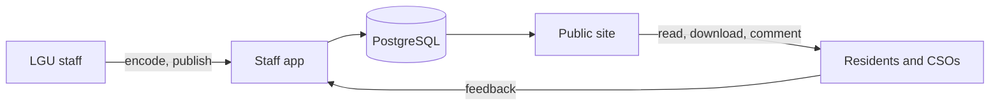

# People's Budget Portal

A local government's budget, prepared by its staff and explained to its residents. Staff encode the
Annual Investment Program (AIP), the proposed and enacted budget and the procurement plans; residents
read them on a plain-language public site, download the data and send feedback.

Built for Philippine LGUs: cities, municipalities and provinces. It follows the Local Government Code
budget cycle and the DBM Budget Operations Manual's forms and codes.



## Try it

```bash
git clone https://github.com/Stride-Technologies/peoples-budget-portal.git
```

A working portal with a sample city, on your own machine. Needs Node 22, pnpm 10 and Docker.
The steps are in [`docs/quick-start.md`](docs/quick-start.md): about ten minutes.

## Run it for your LGU

| Step | Read |
|---|---|
| Put it on a server with its own address and TLS | [`docs/deployment.md`](docs/deployment.md) |
| Name it: the LGU, its seal, colours, contact details | [`docs/configuration.md`](docs/configuration.md) |
| Load your offices, goals and AIP | [`docs/loading-your-data.md`](docs/loading-your-data.md) |
| Teach staff to use it | [`docs/manual/`](docs/manual/README.md) |
| Review the privacy policy and terms before going live | [`SECURITY.md`](SECURITY.md) |

## What is in it

| Part | What it does |
|---|---|
| Staff app | AIP registry, programs with projects and activities, costs by expense class and fund, publish and revise, versions and history, comments, exports (DBM-format AIP, LBP Forms 4 and 7), budget documents (proposed and enacted), procurement plans, users and permissions |
| Public site | The AIP, the Annual Budget and procurement plans by year, each with an overview, a browsable list and a methodology page; a guide to the budget cycle and a glossary; feedback forms |
| Open data | Per-year zip (CSV, JSON, a data dictionary) and a read-only API |
| Languages | English and Filipino; other languages can be added (Bikol is included as an example) |
| Data Explorer | A public chart builder with an optional AI question box. Off by default |

The full list, with what is partial, is in [`FEATURES.md`](FEATURES.md).

## For developers

| You want… | Read |
|---|---|
| How it is built | [`ARCHITECTURE.md`](ARCHITECTURE.md) |
| The rules that are easy to break | [`ARCHITECTURE-ESSENTIALS.md`](ARCHITECTURE-ESSENTIALS.md) |
| How to contribute | [`CONTRIBUTING.md`](CONTRIBUTING.md), and [`AGENTS.md`](AGENTS.md) for AI agents |
| How the system behaves | [`SPEC.md`](SPEC.md), [`CONTEXT.md`](CONTEXT.md) for the vocabulary |
| Modules, data model, manual | [`docs/`](docs/README.md) |

Stack: NestJS 11 and Prisma 7 on PostgreSQL (the API), Next.js 16 and React 19 (the client), Redis,
nginx, Docker Compose. A pnpm monorepo: `api/` and `client/`.

## Where it came from

The portal was first built by Stride Technologies for the Naga City People's Budget Reform Project,
led by WeSolve Foundation with the City Government of Naga and the Naga City People's Council. This
repository is that portal without Naga's data and identity, so any LGU can run it.

## Licence

GNU Affero General Public License v3: see [`LICENSE`](LICENSE) and [`NOTICE`](NOTICE). If you run a
modified copy as a public site, the licence asks you to offer its source to the people who use it;
the site's "Source code" page is where that link goes. An LGU's own data is not covered by the code
licence: it belongs to the LGU.
