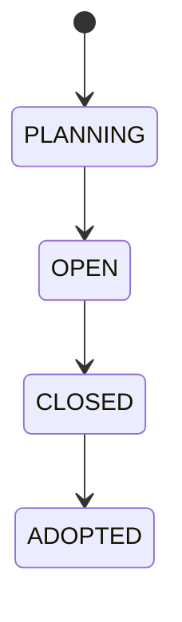
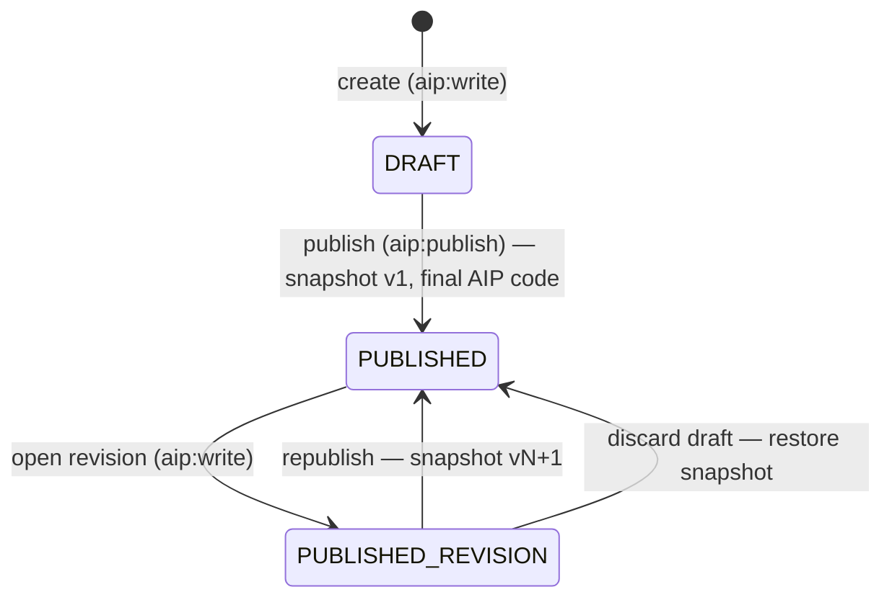
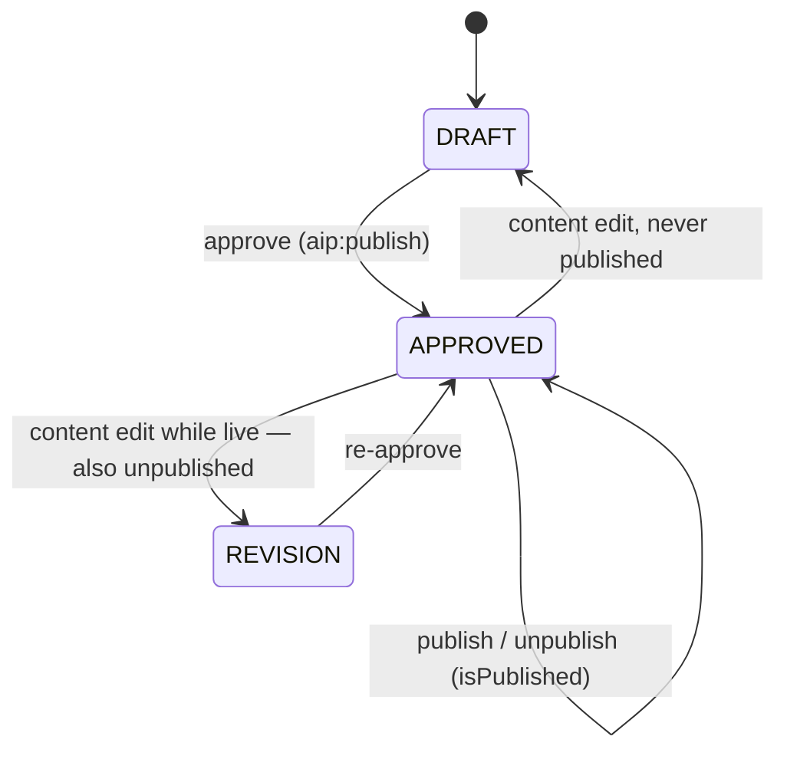

# Specification — current behaviour

How the portal behaves. Feature status is in [`FEATURES.md`](FEATURES.md). This page is
terse on purpose — each section links to the page that owns the detail, and the
code wins any disagreement.

## 1. Vocabulary

| Term | Meaning |
|---|---|
| **AIP** | Annual Investment Program — the city's list of programs, projects and activities (PPAs) for a fiscal year, with proposed costs |
| **Annual Budget (AB)** | The enacted budget for a year; it is the year's enacted Appropriation Ordinance |
| **Cycle** | One fiscal year's container (`AIPCycle`) |
| **Program → Project / Activity** | The PPA hierarchy. A program holds root PAs; a PA may hold child PAs (`ProjectActivity.parentId`) |
| **Cost mode** | `DIRECT_COSTS` — the row states its own PS/MOOE/CO; `ACTIVITY_CHILDREN` — the row's cost is the sum of its root PAs. A program's figure is always `Program.proposedTotal` |
| **PS / MOOE / CO** | Personal Services · Maintenance & Other Operating Expenses · Capital Outlay |
| **PAP class** | `GAS` (General Administration & Support) · `STO` (Support to Operations) · `OPERATIONS` |
| **Finish line** | One of the city's eight visions (FL1–FL8); every program is tagged to one |
| **PAP sector** | DBM sector code, taken from the program's office |
| **Fund source** | GF, SEF, LDF, LDRRMF, SPA, PPP, NGA, Donations/Grants, GAD, Trust Fund, SHF (Special Health Fund), EDF, CCN, Joint Venture, Borrowings — multi-valued; amount-less unless the row is split by fund (§5) |
| **AIP code** | Tentative code (derived from rank among siblings, rewritten on every reorder) → final code (issued once, at first publish) |
| **Publish model** | The live program lifecycle (§4) |
| **Approval workflow** | The archived submit → head review → LFC chain on `archive/full-approval-workflow`; to be replaced, not restored |
| **Project (PPMP)** | A Project Procurement Management Plan — product-named "Project" (§8) |

Full glossary: [`api/docs/aip-reference.md`](api/docs/aip-reference.md) §2 and
[`docs/manual/glossary.md`](docs/manual/glossary.md).

## 2. Who can do what

Access is **named permission keys + office scope**, checked by a global
`PermissionGuard`. The role enum (`STAFF`, `HEAD`, `SUPER_ADMIN`) still gates a few
admin routes; `SUPER_ADMIN` passes every permission check.

- **Grants are explicit.** Each `UserPermission` row is one key. A template only
  pre-fills rows; nothing is inherited at runtime.
- **Office scope** (`UserOfficeScope`, or `User.allOfficesScope`) limits which
  offices' programs and Projects a user can act on.

| Template (`permission-catalog.ts`) | `aip` | `comments` | `public_comments` | cycles · ceilings | reference | users |
|---|---|---|---|---|---|---|
| CPDO Head | read · write · delete · **publish** · export · audit | read · write · resolve · moderate | view · reply · moderate | read · write · ceilings | read | read · write |
| CPDO Secretariat | read · write · export · audit | read · write · resolve | view | — | read | — |
| Intern / Authorized Encoder | read · write | read · resolve | — | — | read | — |
| CMO, CBO | read · export · audit | read · write | view | — | — | — |
| Office Head / Representative | read | read · write · resolve | view | — | — | — |
| NCPC | read | read · write | — | — | — | — |

- `aip:publish` is isolated to CPDO Head on purpose: publishing makes a figure
  public and issues the final AIP code.
- **Reserved, not enforced:** `line_items:read/write`, `approvals:decide`,
  `endorsements:record`.
- **Role-only:** cycle create and status changes, ceiling writes and reference-data
  writes need `SUPER_ADMIN`; user admin needs `SUPER_ADMIN` or `HEAD` (delete:
  `SUPER_ADMIN`); `/lgu/*` feedback analytics needs `HEAD` or `STAFF`.

Details: [`docs/manual/staff-and-permissions.md`](docs/manual/staff-and-permissions.md),
[`docs/modules/auth.md`](docs/modules/auth.md), [`docs/modules/users.md`](docs/modules/users.md).

## 3. Cycles

- `SUPER_ADMIN` only. Finish-line budget ceilings are set per cycle, with history.
- **Which public section a year appears in is computed by the API** (`computeSections`,
  returned as `sections` on `GET /public/cycles`): the AIP section once it has a published program,
  the Annual Budget section once its Appropriation Ordinance is enacted (or, for a past year with
  none on file, once its LEP is submitted). A year can be in both. Adopting an AIP does not move it.

## 4. Programs — the publish model

- **Editable:** `DRAFT`, `FOR_REVISION`, `PUBLISHED_REVISION`. **Deletable (soft):** `DRAFT`, `FOR_REVISION`.
- **Publish readiness** blocks on: `INCOMPLETE_IMPORT` (unacknowledged
  `importWarnings`), `INCOMPLETE_DATA` (a PPA missing fund source, dates or
  output; a climate tag with an amount but no CCET code), `EMPTY_PARENT_PPA`,
  wrong status.
  Advisory `warnings` are derived on every read and never block.
- **The public reads the last published snapshot** (`ProgramVersion`), keyed on
  `publishedVersionId` — a revision in progress never leaks.
- Every field change, publish, revision and discard is written to
  `ProgramAuditLog` (History tab); versions can be compared side by side.
- Enum values `SUBMITTED`, `HEAD_REVIEWED`, `PENDING_APPROVAL`, `APPROVED`,
  `REJECTED`, `FOR_REVISION` remain for archived data; no live code moves a
  program into them.

Details: [`docs/architecture/workflow.md`](docs/architecture/workflow.md),
[`docs/modules/programs.md`](docs/modules/programs.md),
`docs/design/phase-1-publish-scope.md`.

## 5. Costs, codes and tags

- Money is `Decimal(18,2)`, never a float; it travels as a string.
- PAs carry PS/MOOE/CO estimates and roll up to their program (`proposedTotal`).
  Line items (UACS-coded cost rows) exist but are a later-stage feature.
- **AIP codes:** tentative codes are re-derived inside the same transaction as any
  change to an office, sector, PAP class, or sibling order; final codes come from
  `AIPCodeCounter` at first publish. Rules: `api/docs/aip-reference.md` §7.
- **Climate tags** sit on a PA **or** a program (one per owner), carry 0..n CCET
  codes from the **local** typology (`docs/design/ccet-typology-local.md`), and
  CCA + CCM may not exceed the owner's proposed amount. A tag with money and no
  code blocks publishing.
- **Split by fund:** a row that states its own costs may carry one PS/MOOE/CO
  line per fund (`FundAllocation`); the rollup derives the row's totals and fund
  sources from those lines. Rules: `api/docs/aip-reference.md` invariant 21.
- **Source links:** an imported row records where it came from (`SourceDocument`
  + `sheet!row`), and the staff registry links straight to that row in the
  city's Google Sheet.
- Programs also carry SDG goals, an SGLG indicator, supporting offices and fund sources.

## 6. Comments and feedback

| Channel | Who | Rules |
|---|---|---|
| **Internal comments** on a program | users with `comments:*` | Threaded; resolve / moderate / restore; accepted in both published states; unresolved threads never block publishing |
| **Public feedback** on a published program or PA | anyone, no login | Throttled (5 per 10 min), honeypot, reCAPTCHA v3; staff reply / moderate with `public_comments:*`; analytics on `/dashboard/feedback` |
| **Project feedback** on a published Project | anyone, no login | Same guards; staff reply from the Project's Public Feedback tab |

Real-time: new comments and status changes push an SSE "nudge"
(`comment.posted`, `comment.resolved`, `program.status`). No workflow emails are
sent — email covers invites, verification codes and password resets only.

## 7. Public site

No login. Every route outside the staff app is public: the middleware sends a
logged-out visitor to `/login` only on the prefixes in
`client/src/lib/protected-routes.ts`, and an unknown URL is a 404.

| Route | Content |
|---|---|
| `/` | Home: headline figures, finish lines, entry points |
| `/aip/<year>/{overview,browse,methodology}` | A cycle not yet enacted |
| `/annual/<year>/{overview,browse,methodology}` | A year whose Ordinance is enacted |
| `/aip`, `/annual` | Redirect to the newest year in that section |
| `/budget`, `/budget/<programId>`, `/budget/<programId>/<paId>` | Program and PA detail with feedback forms (not in the nav) |
| `/ppmp`, `/ppmp/<id>` | Published Projects with feedback |
| `/learn`, `/visions` | How the budget works; the eight finish lines |
| `/privacy-policy`, `/terms`, `/license` | Legal |
| `/docs`, `/open-data-policy` | **Placeholders** ("under maintenance") |

`/registry/*` and uuid-shaped `/aip/<programId>` redirect (308) to `/budget/*`.
Every public figure is `proposedBudget` / `Program.proposedTotal`, labelled
"Proposed Budget". Non-production hosts send `X-Robots-Tag: noindex` and can sit
behind HTTP Basic auth. Design rules: [`DESIGN.md`](DESIGN.md).

## 8. Projects (PPMP)

- One office, one classification, a free-text name and a free-text
  `fundingProgram` (no foreign key to `Program`).
- Line items follow the GPPB Annex A PPMP form: UACS object, quantity × unit cost,
  fund source, expense class, procurement dates, optional mode/type/delivery
  period, an optional supporting document (PDF, Word, Excel, JPG, PNG ≤ 10 MB).
- No snapshot layer: edits apply immediately. History is synthesised from timestamps.
- Staff list `/ppmp-registry`; export `GET /ppmp/exports/all`.

Details: [`docs/modules/ppmp.md`](docs/modules/ppmp.md).

## 9. Exports (xlsx)

| Export | Route | Shape |
|---|---|---|
| Cluster | `/aip-registry/exports/cluster` | The city's AIP cluster template |
| Annual budget | `/aip-registry/exports/annual-budget` | AB layout |
| Complete | `/aip-registry/exports/complete` | Cover sheet + four sector sheets + fund-source summary |
| Projects | `/ppmp/exports/all` | Every Project with line items |

All need `aip:export`. Downloads go through same-origin client route handlers.
Details: [`docs/modules/aip-registry.md`](docs/modules/aip-registry.md).

## 10. Getting an LGU's data in

A first load comes from a city folder of JSON files (`db:seed:city`); after that, staff work in the
app. See [`docs/loading-your-data.md`](docs/loading-your-data.md).

## 11. Accounts

Invite-only. An admin invites by email → the user verifies a code and sets a
password → signs in. Forgot/reset password, change password, and an Account area
(profile, security, activity). Sessions: 15-minute access token + 7-day rotating
refresh token in httpOnly cookies. Security detail: [`SECURITY.md`](SECURITY.md).
