# Data Model

The schema is defined in [`api/prisma/schema.prisma`](../../api/prisma/schema.prisma) —
**that file is the source of truth**. This page is an orientation map. For the
invariants enforced on top of the schema, see
[`api/docs/aip-reference.md` §6](../../api/docs/aip-reference.md).

## Domain at a glance

The model has four clusters of tables:

1. **Identity & access** — users, their organisation memberships, and the
   one-time tokens that drive invitations, email verification, and resets.
2. **Reference data** — DBM/DILG-sourced catalogs (PAP sectors, UACS objects,
   climate codes, SGLG indicators, SDG goals) plus the LGU's strategic framework (clusters,
   finish lines, offices, CSOs).
3. **AIP cycle & ceilings** — the annual container and its per-finish-line
   budget ceilings.
4. **The Program tree** — programs, their project/activity children, line
   items, and the versioning/verdict/endorsement/comment/export records around
   them.

## Entity-relationship diagram

```mermaid
erDiagram
    User ||--o{ LGUUser : "is"
    User ||--o{ NCPCUser : "is"
    Office ||--o{ LGUUser : employs
    CivilSocietyOrganization ||--o{ NCPCUser : employs
    Cluster ||--o{ Office : groups
    PAPSector ||--o{ Office : "default sector for"
    Cluster ||--o{ CivilSocietyOrganization : groups
    Cluster ||--o{ FinishLineCluster : ""
    FinishLine ||--o{ FinishLineCluster : ""

    BudgetCycle ||--o| AIPCycle : "AIP stage (specs/012)"
    BudgetCycle ||--o{ BudgetDocument : "LEP, Ordinance"
    BudgetDocument ||--o| LepDetail : "allocable total"
    BudgetDocument ||--o| OrdinanceDetail : ""
    BudgetDocument ||--o{ BudgetItem : "by-PPA"
    BudgetDocument ||--o{ BudgetObjectLine : "by-object"
    BudgetDocument ||--o{ BudgetReceiptLine : "receipts (specs/017)"
    BudgetDocument ||--o{ BudgetIndebtedness : "LBP Form 5"
    BudgetDocument ||--o{ BudgetStatutoryObligation : "LBP Form 6"
    BudgetDocument ||--o{ BudgetPrintedTotal : "checked, never summed"
    BudgetDocument ||--o{ BudgetOfficeHeader : "each office's header, as this book prints it"
    BudgetReceiptLine ||--o{ BudgetReceiptLine : "heading / rows"
    ChartAccount ||--o{ BudgetObjectLine : "account"
    ChartAccount ||--o{ BudgetReceiptLine : "account"
    BudgetDocument ||--o{ BudgetDocumentAuditLog : "history"
    BudgetItem ||--o{ BudgetItem : "parent / root"
    BudgetItem ||--o{ BudgetItemThematicTag : ""
    BudgetItem ||--o{ ProgramComment : "comments"
    SourceDocument ||--o{ BudgetItem : "read from (page, row)"
    SourceDocument ||--o{ BudgetObjectLine : "read from (page, row)"

    AIPCycle ||--o{ FinishLineBudgetCeiling : "has"
    FinishLine ||--o{ FinishLineBudgetCeiling : "capped by"
    FinishLineBudgetCeiling ||--o{ FinishLineBudgetCeilingHistory : "audited by"

    AIPCycle ||--o{ Program : contains
    Office ||--o{ Program : proposes
    PAPSector ||--o{ Program : classifies
    FinishLine ||--o{ Program : "tagged with"
    SGLGIndicator ||--o{ Program : "optionally tagged"
    Program ||--o{ ProgramSDGGoal : "tagged with"
    SDGGoal ||--o{ ProgramSDGGoal : "tags"

    Program ||--o{ ProjectActivity : "parent of"
    ProjectActivity ||--o{ LineItem : "holds"
    ProjectActivity ||--o| ClimateChangeTag : "optionally tagged"
    Program ||--o| ClimateChangeTag : "optionally tagged"
    UACSObject ||--o{ LineItem : classifies
    ClimateChangeTag ||--o{ ClimateChangeTagCode : "0..n codes"
    ClimateTypologyCode ||--o{ ClimateChangeTagCode : classifies
    ProjectActivity ||--o{ FundAllocation : "optionally split by fund"
    Program ||--o{ FundAllocation : "optionally split by fund"
    AIPCycle ||--o{ FundStatedAmount : "special fund's stated amount"

    Program ||--o{ ProgramVersion : "snapshots"
    Program ||--o{ ProgramVerdict : "adjudicated by"
    Program ||--o{ ProgramEndorsement : "endorsed via"
    Program ||--o{ ProgramApproval : "committee-approved via"
    Program ||--o{ ProgramComment : "discussed in"
    Program ||--o{ ProgramReadState : "seen by"
    AIPCycle ||--o{ AIPExportLog : "exported from"
    Cluster ||--o{ AIPExportLog : "scoped to"
    Office ||--o{ ProgramEndorsement : "endorses (LGU)"
    CivilSocietyOrganization ||--o{ ProgramEndorsement : "endorses (NCPC CSO rep)"
    Office ||--o{ ProgramApproval : "approves"
    Office ||--o{ CommitteeMembership : "sits on"
    Committee ||--o{ CommitteeMembership : "has members"
    Committee ||--o{ ProgramApproval : "votes via"
```

## Enums

| Enum | Values | Used by |
|---|---|---|
| `Role` | `STAFF`, `HEAD`, `SUPER_ADMIN` | `User` — drives RBAC |
| `IdentityType` | `LGU`, `NCPC`, `LFC`, `DEVELOPER` | `User`, `UserInvite` — LGU proponent/LFC (office), NCPC reviewer (CSO or umbrella), or Developer (no office, no CSO: access is permissions + office scope only) |
| `OfficeType` | `MANDATORY`, `OPTIONAL`, `OTHERS` | `Office` — AIP code office-type segment (1/2/3) |
| `AipSectorGroup` | `GENERAL_PUBLIC`, `ECONOMIC`, `ENVI_INFRA`, `SOCIAL` | `Office` — which sheet it prints on in the complete-AIP workbook |
| `ExpenseClass` | `PS`, `MOOE`, `FE`, `CO` (FE = Financial Expenses, specs/008) | `LineItem`, `UACSObject`, `PPMPLineItem` |
| `PpmpKind` | `INDICATIVE`, `FINAL` (specs/012 P5; the Final copy is made after the Ordinance is enacted, `PPMP.sourcePpmpId`; its lines link to Ordinance PPAs, an Indicative one's to AIP programs/PAs) | `PPMP` |
| `Form7Column` | `GENERAL_PUBLIC`, `SOCIAL`, `ECONOMIC`, `ECONOMIC_ENTERPRISE` | `Office.form7Column` — the LBP Form 7 column; not an AIP code segment |
| `ClimatePillar` | `ADAPTATION`, `MITIGATION`, `CROSSCUTTING` | `ClimateTypologyCode` |
| `AIPCycleStatus` | `PLANNING`, `OPEN`, `CLOSED`, `ADOPTED` (`LOCKED` = old name, removed in specs/012 P8) | `AIPCycle` |
| `ProgramStatus` | `DRAFT`, `PUBLISHED`, `PUBLISHED_REVISION` (live — the publish model); `FOR_REVISION`, `SUBMITTED`, `HEAD_REVIEWED`, `PENDING_APPROVAL`, `APPROVED`, `REJECTED` (archived approval workflow — kept for existing data, nothing moves a program into them) | `Program` |
| `PPAType` | `PROJECT`, `ACTIVITY` | `ProjectActivity` |
| `PapClass` | `GAS`, `STO`, `OPERATIONS` | `Program` — the AIP form's three appropriation sections; export grouping only, **not** an AIP-code segment |
| `FundSource` | `GF`, `SEF`, `LDF`, `LDRRMF`, `SPA`, `PPP`, `NGA`, `DONATIONS_GRANTS`, `GAD`, `TRUST_FUND`, `SHF` (Special Health Fund), `EDF`, `CCN`, `JOINT_VENTURE`, `BORROWINGS` | `Program`/`ProjectActivity.fundSources` — an enum **array** naming the funds of one total; `FundAllocation.fundSource` when a row is split by fund |
| `EndorserType` | `LGU`, `NCPC` | `ProgramEndorsement` — polymorphic endorser |
| `VerdictType` | `APPROVE` | `ProgramVerdict` |
| `ApprovalStatus` | `PENDING`, `APPROVED`, `RETURNED`, `REJECTED` | `ProgramApproval` |
| `CommentStage` | `GENERAL`, `PUBLIC_FEEDBACK` (live); `SECTOR_FEEDBACK`, `HEAD_REVIEW`, `ENDORSEMENT`, `APPROVAL` (archived workflow) | `ProgramComment` |
| `CommentTarget` | `PROGRAM`, `PROJECT_ACTIVITY`, `LINE_ITEM` | `ProgramComment` (only `PROGRAM` used in MVP) |
| `ExportType` | `CLUSTER`, `AB_OFFICE`, `AB_BOOK`, `COMPLETE_AIP`, `LBP4_OFFICE`, `LBP4_BOOK`, `LBP7` | `AIPExportLog` |
| `ExportStatus` | `PENDING`, `GENERATED`, `FAILED` | `AIPExportLog` |
| `UserAuditAction` | `ROLE_CHANGED`, `OFFICE_CHANGED`, `ACTIVATED`, `DEACTIVATED`, `PROFILE_UPDATED` | `UserAuditLog` |

## Key tables

### Identity

- **`User`** — one row per person. `role` drives RBAC; `identityType` records
  the track. `password` is null until an invite is accepted. `isActive`
  gates login — a deactivated user cannot authenticate.
- **`LGUUser` / `NCPCUser`** — junction rows linking a `User` to an `Office`
  or a `CivilSocietyOrganization`. A user's *organisation* (and therefore
  cluster) is resolved through these. Office reassignment swaps the junction row.
  `NCPCUser.civilSocietyOrganizationId` is **nullable**: a set CSO is that CSO's
  representative, while **null** marks the **NCPC umbrella head** (endorses "as
  NCPC as a whole"). See endorser pivot §3.3.
- **`UserInvite`** — holds all invite data; the `User` row is created only when
  the invite is accepted. `EmailVerification`, `RefreshToken`, and
  `PasswordResetToken` are one-time-token tables (tokens stored hashed).
- **`UserAuditLog`** — append-only trail of admin changes to a user account
  (role/office reassignment, (de)activation, name edits). One row per changed
  field, recording actor, action, a human-readable summary, and before/after
  metadata.

### Reference data

`Cluster`, `FinishLine`, `FinishLineCluster`, `Outcome`, `OutcomeIndicator`,
`Office`, `CivilSocietyOrganization`, `PAPSector`,
`UACSObject`, `ClimateTypologyCode`, `SGLGIndicator`, `SDGGoal`. Seeded from
DBM/DILG/UN sources and the LGU's strategic plan; maintained by `SUPER_ADMIN`. See
[`api/docs/aip-reference.md` §8](../../api/docs/aip-reference.md).

`Office` additionally carries the four fields that head every printed Annual
Budget sheet — `mandateLegalBasis`, `vision`, `mission` and
`organizationalOutcomes` (a `String[]`, one row each). All optional, backfilled
from AB 2026, edited in the control panel under `reference:write`. They are not
code segments, so writing them triggers no AIP-code resync.

`Office.form7Column` is the LBP Form 7 column its money prints in (null =
unassigned, listed on Form 7's notes). Seeded from the FY2026 ordinance for 38
offices and from the PAP sector for the rest; a reseed only fills a blank column.
Special funds are fund sources, not offices (specs/016): the `LDF`, `SPAF` and
`LDRRMF` offices are retired. **`FundStatedAmount`** holds one stated amount per
special fund and cycle — staff-only, never read by public or open-data code
(`aip-reference.md` invariant 22). **`FundRule`** holds each fund's legal basis
and legal minimum from a fiscal year on (LDF 20% of NTA, LDRRMF 5% of regular
revenue, GAD 5% of the budget; SPA, SEF and SHF have none); rule checks read it
and are never stored; the public `/annual/<fy>/funds/<fund>` page states the
rule and leaves the check for spec 017's receipts. `SpecialFundAmount` and
`Office.isSpecialFund` are read by nothing and go in specs/016 phase 6.

`Office.aipSectorGroup` decides which sheet the office prints on in the
complete-AIP workbook. **Nullable and normally null** — the export derives the
group from `papSector`, so a newly added office is never silently dropped from
the city total. It records only the nine offices the budget office files against
their sector (CENRO/SWMO/CEO/CPRFMO → `ENVI_INFRA`, NCGH/OLLI/OSCA/PDAO →
`SOCIAL`, NCCDO → `ECONOMIC`), seeded from `offices.json` and pinned in
`prisma/data/offices.check.ts`. Also not a code segment.

### The Program tree

- **`Program`** — the AIP entry. Carries the proponent (exactly one of
  `officeId` / `civilSocietyOrganizationId`), the `papSector`, `finishLine`,
  optional `sglgIndicator`, the two AIP reference codes (tentative + final), the
  `status`, `orderIndex`, the nullable `papClass` (which export section it
  prints under), **denormalised rollups** (`psTotal`, `mooeTotal`, `feTotal`,
  `coTotal`, `grandTotal`), and `importWarnings` — the decisions the 2027 workbook
  import had to make on the program's behalf, in plain sentences. Non-empty blocks
  publishing (`INCOMPLETE_IMPORT`); empty on everything authored in the portal.
  It stores **only** what cannot be recomputed (an inferred finish line, a
  duplicate merge, a synthesised heading) and is cleared by
  `POST /programs/:id/acknowledge-import`. Missing *fields* are deliberately not
  stored: they are derived per read by `src/programs/import-data-warnings.ts`, so
  fixing the data clears them. Storing them meant the sentence outlived the fix.
  It also carries `hostOfficeId` — the office whose printed AB sheet this
  program appears under, in that sheet's COMPONENT PROGRAMS band. Nullable, and
  **may equal `officeId`** (the city's `004` bucket). The program keeps its own
  `officeId` and its own code; `hostOfficeId` decides only where it prints.
  Imported rows also carry **provenance**: `sourceDocumentId` → `SourceDocument`
  (the city file: its name, its Google Sheets URL, and a worksheet → `gid` map)
  plus `sourceRef` (`ECON!r305`). `ProjectActivity` carries the same pair. Null
  on anything authored in the portal; read only by the staff registry's "open
  in sheet" link. **Staff-only**: published snapshots carry it too, so the
  public module strips it (`stripProvenance`) wherever it spreads a row.
- **`ProjectActivity`** — a child of a Program (`type: PROJECT | ACTIVITY`). Has
  **no status column** — it inherits the parent Program's status. Carries its
  own rollups, its own `orderIndex`, and `fundSources` — the funds it draws on,
  stored without per-fund amounts, so it never has to reconcile against the
  PS/MOOE/FE/CO estimates.

Both models carry the three columns the AB sheet prints per row:
`majorFinalOutput`, `expectedOutput` (the **Performance Indicator**) and
`targetForBudgetYear`.

> **`orderIndex` is not just display order.** On both models it is the
> user-controlled rank (tie-broken by `createdAt`) that the tentative AIP code's
> ordinal segment is **derived** from — `Program` within
> `(aipCycleId, officeId, papSectorId)` and restarting inside each `papClass`,
> `ProjectActivity` within
> `(programId, parentProjectActivityId)`. Writing it without rerunning the
> resync leaves codes disagreeing with the order they encode. See
> [`api/docs/aip-reference.md` §7](../../api/docs/aip-reference.md).
- **`LineItem`** — the unit of budget: `quantity × unitCost = lineTotal`,
  classified by `expenseClass` and a `UACSObject`. UACS code/description are
  snapshotted onto the row at write time.
- **`ClimateChangeTag`** — at most one per `ProjectActivity` or per `Program`, never
  both (DB CHECK); its CCET codes live in `ClimateChangeTagCode`, 0..n per tag.
- **`FundAllocation`** — a row's money split by fund: one line per fund (unique
  per owner) with its own PS/MOOE/FE/CO, owned by exactly one of a `ProjectActivity`
  or a `Program` (DB CHECK). Optional: a row without any is one total over its
  `fundSources`. With some, the estimate rollup sets the owner's PS/MOOE/FE/CO and
  `fundSources` from them. Only `DIRECT_COSTS` rows hold any.

### Workflow records

> `ProgramVerdict`, `ProgramEndorsement` and `ProgramApproval` belong to the
> **archived approval workflow** (`archive/full-approval-workflow`). The tables and
> their rows are kept; no live code writes them. The live lifecycle is the publish
> model — see [workflow.md](workflow.md).

- **`ProgramVersion`** — an immutable JSON snapshot of the full Program tree,
  written on every publish (v1 at first publish, vN+1 on each republish).
  `Program.publishedVersionId` points at the one the public sees. A discarded
  revision restores the live rows from it.
- **`ProgramVerdict`** — the final approval record (append-only). Written only by
  the committee path's `finalizeApproval` (`PENDING_APPROVAL → APPROVED`, the last
  LFC office's approval), always with `verdict = APPROVE`. (The SUPER_ADMIN
  verdict was removed, and the now-unused `INCREASE`/`DECREASE`/`REJECT` enum
  values were pruned — `VerdictType` is `APPROVE`-only.)
- **`ProgramEndorsement`** — advisory, **affirmative-only** concurrence with a
  **polymorphic endorser** (`endorserType`): an `LGU` city office
  (`endorserOfficeId`), an `NCPC` CSO representative (`endorserCsoId`), or the
  `NCPC` umbrella head (both FKs null). Per-type partial unique indexes enforce
  one row per endorser per version, plus a CHECK on the right FK per type. A
  row's existence is the concurrence (there is no status column); `endorsedAt`
  records when.
- **`ProgramApproval`** — at most one row per `(programVersion, committee,
  member office)` — the LFC committee gate. Rows are created **sequentially** by
  `CommitteeMembership.sequenceOrder` (one office at a time, not all upfront);
  status flows `PENDING → APPROVED | RETURNED | REJECTED`. A program reaches
  `APPROVED` only when the **last** office approves; a `RETURNED` row sends it to
  `FOR_REVISION` (recoverable) and a `REJECTED` row to `REJECTED` (terminal).
- **`ProgramComment`** — threaded discussion (root + one level of replies);
  resolution is stamped on the root.
- **`ProgramReadState`** — per-user "last seen" marker driving the unread dot.
- **`AIPExportLog`** — append-only audit trail for registry workbook export
  attempts: export type, selected cycle/cluster, requesting user, file name,
  timestamp, lifecycle status (`PENDING → GENERATED | FAILED`), and failure
  message when generation does not complete.

### Data Explorer log (specs/018)

- **`ExplorerQuestion`** (`explorer_questions`) — one row per Ask: question text (null when
  `EXPLORER_LOG_QUESTIONS=0` or after 12 months), language, normalised-text hash, which rung
  answered, the view, catalogue and prompt versions. Personal data; no IP, user agent or user id.
- **`ExplorerModelCall`** (`explorer_model_calls`) — each model call behind an answer: model,
  prompt hash, user turn, raw and validated output, latency, tokens. `ON DELETE SET NULL` to its question.
- **`ExplorerFeedback`** (`explorer_feedback`) — a verdict on an answer, one per hashed device key, with a copy of the spec it rates and that spec's hash (`spec`, `spec_hash`; specs/020 B1.1). `ExplorerQuestion.spec` is what each answer was, cache hits included.
- **`ExplorerTrainingQuestion`** (`explorer_training_questions`) — a resident question kept for model training (specs/020 B4): only with the LGU's and the resident's opt-in and a clean scrub; text, language, the answered spec, the scrubber's verdict and the consent time; no device key. Deleted after 12 months. Personal data.
- **`ExplorerTopic`** (`explorer_topics`, id = slug) — a subject people ask about: label,
  description, aliases per language, `draft`/`approved`. **`ExplorerTopicRule`**
  (`explorer_topic_rules`, cascade) — one way a row belongs: `kind` office / cluster / sector /
  finishLine / fund / theme / keyword, and a catalogue code or name pattern. Membership is
  derived per read, never stored per row. Public reference data, not personal.
- **`ExplorerSnapshot`** (`explorer_snapshots`, id = 12-character hash of the state) — a shared
  workspace workbook (sheets, each a query and a mark). Immutable, no expiry; the same workbook
  always has the same id. Holds no personal data: no device key, IP or chat text.
- **`ExplorerLabel`** (`explorer_labels`, id `infrastructure` or `infrastructure.roads`) — what a
  budget row is, in residents' words (redesign P5): two levels (`parent_id`, cascade), a
  definition the labelling model reads, aliases per language, `maps` to the functional group,
  COFOG and finish line, `draft`/`approved`. **`ExplorerRow`** (`explorer_rows`, id = the labelled
  row's own id, no foreign key: programs, PAs, book items, account lines and Projects share it) —
  the row's assembled budget text, its hash, its vector (`real[]`), `root_id` (a PA's program, a
  book item's top-level PPA), when it was labelled and when Stride reviewed it.
  **`ExplorerAnnotation`** (`explorer_annotations`, unique row + label, label cascade) — one label
  on one row: confidence, a one-line reason, `decided_by` model/stride, `in_review` (counts
  nowhere). All public budget data, not personal.

### Committees

- **`Committee`** — a standing committee (e.g. the LFC). One row per committee,
  identified by a unique `code`.
- **`CommitteeMembership`** — many-to-many join: which `Office` sits on
  which `Committee`. Membership is data (not a boolean on the office) so
  adding new committees later is a data change rather than a schema migration.

## Invariants you must respect

These are enforced in the **service layer** (Postgres `CHECK` constraints are
auxiliary). The full list is
[`api/docs/aip-reference.md` §6](../../api/docs/aip-reference.md); the ones that
shape the schema:

- **LGU-only proponent** — every Program is an LGU submission; `officeId` is
  the proponent. (The `proponentType` / `civilSocietyOrganizationId` columns and
  the `ProponentType` enum were dropped with the NCPC proponent track.)
- **Rollup truth** — `Program`/`ProjectActivity` totals are caches; they are
  correct only because every line-item mutation goes through services that call
  `BudgetRollupService` in the same transaction.
- **Line total derivation** — `lineTotal` is always recomputed server-side.
- **Soft delete** — only `Program` has `deletedAt`; reads filter it out.
  `ProjectActivity` and `LineItem` are hard-deleted, and only while the parent
  Program is editable (`DRAFT`, `FOR_REVISION` or `PUBLISHED_REVISION`). A
  published program itself is never deletable.
- **Committee unanimity (sequential)** — *archived workflow.* The committee path ran `HEAD_REVIEWED →
  PENDING_APPROVAL → APPROVED`: LFC offices approve one at a time in
  `sequenceOrder`, each approval creating the next office's row. The program
  reaches `APPROVED` only when the last office approves; a `RETURNED` row sends it
  to `FOR_REVISION` and a `REJECTED` row to `REJECTED` (terminal) — either stops
  the chain.
- **Public reads the snapshot** — the public site renders `publishedVersionId`'s
  snapshot, never the live rows, so a revision in progress cannot leak.

## Money & numeric conventions

- Monetary columns: `Decimal(18,2)`. Quantities: `Decimal(14,2)`.
- Prisma returns `Decimal.js` instances — operate with `.plus`/`.minus`/`.mul`,
  never coerce to `Number`.
- JSON serialises `Decimal` as a string; the client must use a decimal library.
