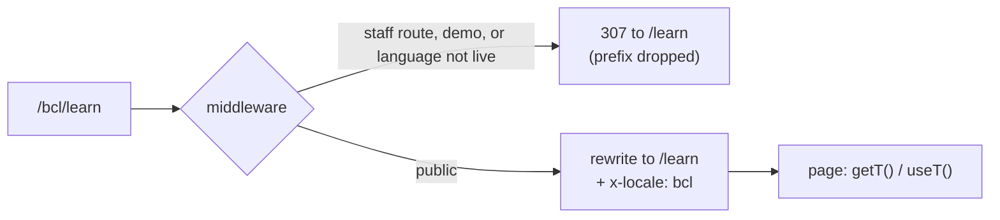
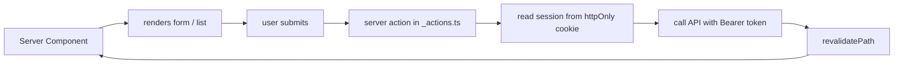

# Frontend Architecture

The client is a Next.js 16 application using the **App Router**, React 19, and
server components. It renders the UI and brokers every call to the NestJS API —
it holds no business logic and never touches the database.

> Next.js 16 differs from earlier versions in meaningful ways. See
> [`client/AGENTS.md`](../../client/AGENTS.md) for the conventions that apply
> specifically to this workspace.

## Routing

Routes live under `client/src/app/`.

### Public (no session needed)

Everything here is in the `(public)` route group. Nothing needs registering: the
middleware protects only the staff prefixes in `client/src/lib/protected-routes.ts`
(a new top-level **staff** route goes there — `protected-routes.test.ts` fails until
it does), lets every other path through, and an unknown URL is a real 404.

| Route | Purpose |
|---|---|
| `/` | Landing page — hero figures for the open cycle, the budget cycle's current stage, the eight finish lines |
| `/aip` | Redirects to the newest cycle still in preparation |
| `/aip/[year]/overview` | Editorial overview of a proposed year: coverage, finish lines, clusters, offices, expense mix, fund sources |
| `/aip/[year]/browse` | The registry table, cycle pinned by the route |
| `/aip/[year]/methodology` | Written framing over figures derived from the same request the overview uses |
| `/annual` | Redirects to the most recently enacted year |
| `/annual/[year]/{overview,browse,methodology}` | The same three, for an enacted Annual Budget |
| `/learn` | The budget cycle, AIP versus Annual Budget, how to read an entry, and the glossary |
| `/visions` | The eight 2028 finish lines and their indicators |
| `/budget` | The combined registry table with a cycle switcher. **Not in the nav** — it is the parent of the program deep links below, and where `/registry` and pre-rename `/aip/<programId>` links land |
| `/budget/[programId]`, `/budget/[programId]/[paId]` | Program and project/activity detail |
| `/license`, `/privacy-policy`, `/terms`, `/open-data-policy`, `/docs` | Policy and reference pages |

Which section a cycle belongs to is **derived from its status**, not stored: a
`LOCKED` cycle is an enacted Annual Budget, anything earlier is the AIP being
prepared for that year (`client/src/lib/public-sections.ts`). A year belonging to
the other section 404s rather than rendering under the wrong heading.

`next.config.ts` keeps 308s from `/registry` and from **uuid-shaped**
`/aip/<programId>` paths to `/budget`. The uuid constraint matters: Next matches
redirects before routing, so a broad `/aip/:path*` would shadow every page under
`/aip/<year>/`.

### The editorial layer

The public pages above (excluding `/budget` and the tables) share a design
language in `client/src/components/public/editorial/`: `EditorialPage` (paper
ground), `SectionShell` (numbered section, two-column with a pinned claim from
`lg`), `BarTable`, `StackedBar`, `StatBand`, `HandOff`, `Methodology`,
`SectionChrome`.

Four rules worth knowing before editing them:

- **A figure is a `<table>` with the bar inside the cell whose number it
  depicts.** There is no chart library on these pages. One artifact serves both a
  screen reader and a sighted reader, so they cannot drift apart the way a chart
  and a shadow data table do — and it prints, works with JS off, and costs no
  hydration.
- **Colour is redundant, and its foreground is measured.** Row colour reinforces a
  text label rather than replacing it. Where a finish-line hex becomes a
  *background* under text, use `readableOn()` from `lib/finish-lines.ts`: white
  fails AA on four of the eight (amber is 1.79:1).
- **Sections are one screen tall and snap, with no script.** `[data-snap-figure]`
  is its own scroll container, so native scroll *chaining* means the page advances
  only once that pane has been read to its end. Scoped to `lg`+ and to
  `prefers-reduced-motion: no-preference`, at `proximity` not `mandatory`. Lenis is
  deliberately absent — it would break both the snap and the nested panes.
- **Motion is a CSS floor plus an AnimeJS layer**, switched between by
  `html.anime-motion`. `<html>` is the gate because React never touches it; an
  earlier IntersectionObserver version wrote to React-owned attributes and was
  silently reset on re-render.

### Languages (specs/014)

The home page, the three Overviews and Learn are in English, Filipino and Bikol.
A language is a URL prefix — `/fil/learn`, `/bcl/aip/2027/overview` — never a
cookie or the browser's language, so every page in every language is a
shareable, crawlable URL.

- **Copy lives in `client/src/i18n/messages/en.json`**, key → English. `fil.json` /
  `bcl.json` hold key → `{ text, src }`; `src` is the English the translation was
  made from, and a translation whose `src` no longer matches is not shown — the
  English is. A missing key falls back the same way, so a page never shows a key.
- **Copy kept in code** (the budget cycle, the glossary, the 2027 reading guide)
  stays in the module that owns it; `i18n/code-copy.ts` names its catalogue path
  and which fields are not copy (`term`, `href`, …).
- **Never translated:** budget terms (`tools/translate/protected-terms.txt`), office,
  program and PPA names, codes, amounts, dates and glossary terms. They come from
  the API or sit in skipped fields.
- **Links:** `LocaleLink` (client) and `localeRedirect` (server) add the prefix;
  a plain `next/link` or `redirect()` drops it.
- **Live:** a language shows in production only once `i18n/review.json` records
  its city reviewer. Dev and staging always show it, for review in place.
- **Drafting:** `pnpm translate` drafts only new or changed English (DeepSeek on
  Stride's Foundry, or Claude with `ANTHROPIC_API_KEY`). Terms, numbers and slots
  are masked before sending and must come back exactly, or the string stays
  English. `tools/translate/review_sheet.py` exports a CSV per language for the
  reviewer and applies the returned corrections. `i18n/catalogue.test.ts` fails on
  any translation that drops a term, number or slot.

### Public (authentication)

| Route | Purpose |
|---|---|
| `/login` | Email + password sign-in |
| `/verify-email` | Email 2FA code entry |
| `/set-password` | Set a password from an invitation link |

### Protected (require a session)

| Route | Purpose |
|---|---|
| `/dashboard` | Role-specific home — systemwide for admins, office-scoped otherwise |
| `/aip-registry/<year>[/program/<programId>[/<paId>]][/edit]` | One URL per fiscal year and per open PPA, same shape as the public `/<section>/<year>/…` pages (`client/src/lib/registry-paths.ts`). The path is the source of truth for which drawer is open: opening, closing, editing and changing FY push a history entry (`history.pushState`, no server round-trip), so Back closes a drawer and a URL can be shared. The registry itself is `app/aip-registry/[year]/layout.tsx` (a layout, so it survives the path changing under it); `[[...ppa]]/page.tsx` only checks the path. A wrong year redirects to the PPA's real one; a malformed tail falls back to the year. Bare `/aip-registry` redirects to the remembered year, else the open cycle, and translates the older `?program=<id>` / `?open=&kind=&mode=view|edit` links. Create drawers have no URL (`?kind=&mode=create&open=<parent>`). |
| `/aip-registry` (contents) | The master list of programs/projects/activities, with tabs, filters, search (now including thematic tags, specs/011), and a role-gated export menu scaffold. Create and edit for a program, project or activity all happen in place here, via drawers (`NewProgramDrawer`, `NewProjectActivityDrawer`, and the overview drawers' edit mode) |
| `/finish-lines` | Browse the eight strategic finish lines and their budget utilisation |
| `/programs/new`, `/programs/[id]/edit`, `/programs/[id]/add-project`, `/projects/[id]/edit`, `/projects/[id]/add-activity`, `/activities/[id]/edit` | Retired (specs/011) — thin server redirects: edit routes go to the PPA's own registry path (`…/edit`), add routes to the parent's year with the create drawer open. `/programs/new?demo=1` is kept as a real page: the demo's guided Create step prefills a program the drawer has no way to seed |
| `/programs/[id]/compare` | Side-by-side version comparison |

### Control panel (`SUPER_ADMIN` only)

`/control-panel` and its children: `aip-cycles` (and `new`, `[id]`), `users`,
`clusters`, `finish-lines`.

### API route

`/api/events` — a Server-Sent Events endpoint the browser subscribes to for
real-time program updates.

## Data flow: server actions

The client uses **server actions** rather than a client-side data layer. The
pattern, per feature, lives in `_actions.ts` files:

A server action reads the session, calls the API helper, and revalidates the
affected paths so the next render reflects the change. Components track
in-flight state with `useTransition`; there is no Redux/Zustand store.

## The API client

`client/src/lib/api.ts` is the **real** API client — it calls the live NestJS
API at `/api/v1` (port 8000 in local dev). Two helpers underpin it:

- `apiFetch` — unauthenticated calls (login, password reset)
- `apiFetchAuth` — attaches the Bearer access token

It exposes typed functions grouped by domain: auth, users, reference data, AIP
cycles, programs, budget ceilings, activity stream/comments, and endorsements.

> **Legacy note:** `client/src/lib/api-client.ts` is an empty stub. The mock
> data that used to live in `client/src/data/` is gone; every screen reads the API.

## Sessions & authentication

- Login posts to `/auth/login` and receives an **access token** (~15 min) and a
  **refresh token** (~7 days).
- Both are stored in **httpOnly cookies** — never exposed to client JS.
- `client/src/lib/session.ts` decodes the JWT (`getSession`, `setSession`,
  `deleteSession`). The session exposes `sub`, `email`, name, `role`,
  `identityType`, and the proponent organisation id.
- Middleware checks token expiry on protected routes, refreshes transparently,
  and redirects to `/login` when there is no valid refresh token.
- `client/src/lib/proponent.ts` (`resolveProponentContext`) maps the user to
  their LGU office or NCPC CSO and resolves the names shown in the navbar.
- The AIP registry export menu resolves the caller's cluster from reference
  data. LGU/NCPC users are limited to their own cluster; `LFC` and
  `SUPER_ADMIN` users can choose a cluster before export. The "Complete" export
  (`GET /aip-registry/exports/complete`, six-sheet sector workbook) is shipped.

## Remembered view preferences (non-httpOnly cookies)

The AIP registry remembers its filters between visits in a **plain, readable
cookie** — `pbp.aip-registry.filters`, owned by `client/src/lib/filter-cookie.ts`:

```mermaid
flowchart LR
    C[cookie] -->|cookies&#40;&#41; in page.tsx| S[server shell]
    S -->|initialFilters prop| K[_registry-client.tsx]
    K -->|useState seeds| U[first paint, already filtered]
    K -->|writeRegistryFilters on change| C
```

| Remembered | Not remembered | Why |
|---|---|---|
| tab, cycle, cluster, office, finish lines, search, Full/Compact, page size | `page` | Returning to page 5 of a list whose contents may have changed is disorienting |
| | `view`, `officeId` | Already in the URL, so already shareable and reload-proof |

Rules this follows, and the reasons:

- **Read on the server, written on the client.** `page.tsx` is a thin server
  component so the markup arrives already filtered. Seeding that state in the
  client instead would either mismatch hydration (no `document` during prerender)
  or need a post-mount effect that repaints the list.
- **`parseRegistryFilters` is a trust boundary.** The cookie is user-writable,
  outlives deploys, and names ids that may be gone; every field falls back
  independently, so a hand-edited tab or page size can never reach a query.
- **Stale ids are derived, never written back.** A deleted finish line is
  filtered out of the *effective* filter once the option lists load, rather than
  triggering a state write — no cascading renders, and no filter silently
  narrowing the list with no active chip to explain it.
- **View preferences only.** Not httpOnly, so readable by any script on the
  origin and shared by everyone using the browser profile. Auth stays in the
  httpOnly session cookies described above.

## Real-time updates

`client/src/lib/sse-client.ts` exposes a `useProgramEvents()` hook. It opens an
SSE stream (authorised by a single-use ticket from `POST /events/ticket`) and,
on each "activity nudge", refetches the affected data. The registry surfaces
this as unread dots and a brief highlight on recently changed rows. See the
[events module](../modules/events.md).

## Component layout

`client/src/components/` mixes feature components with shadcn/ui primitives
under `ui/`. Notable feature areas:

- **`aip/`** — registry list, header, controls, tabs, and the program /
  project-activity overview drawers
- **`project-activity/`** — the program/project/activity forms: details, cost &
  budget proposal, climate-change tagging, entry-type selection, line-item rows,
  UACS object selector
- **`finish-lines/`** — finish-line browsing and strategic-alignment views
- Layout — `navbar.tsx`, `footer-actions.tsx`, `spinner.tsx`

## Validation

Forms validate with **Zod** schemas in `client/src/lib/schemas.ts`
(`newProgramSchema`, `addProjectActivitySchema`, …), which also house the
TypeScript types for API responses. Monetary values arrive from the API as
strings and are kept as strings / decimal types — never coerced to `Number`.

## Related reading

- [overview.md](overview.md) — how the client fits the whole system
- [`client/AGENTS.md`](../../client/AGENTS.md) — workspace conventions
- [manual/](../manual/README.md) — the user-facing view of these screens
