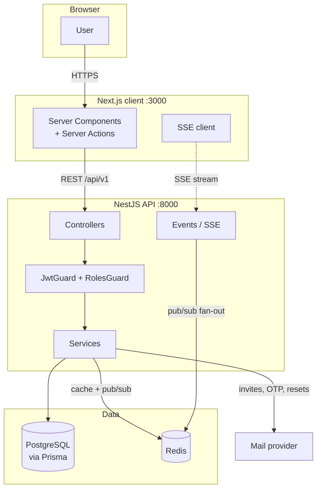

# Architecture Overview

The People's Budget Portal is a pnpm monorepo with two deployable workspaces:

- **`api/`** — a NestJS 11 REST API (TypeScript, ESM), backed by PostgreSQL via
  Prisma 7. Redis is optional: with `REDIS_URL` it backs the cache and
  cross-replica SSE fan-out; without it both fall back to in-process.
- **`client/`** — a Next.js 16 application (React 19, App Router) that renders
  the UI and brokers all calls to the API.

The product supports the LGU's AIP (Annual Investment Program) cycle. CPDO
encoders enter each city office's programs and **publish** them to the public
site (the *publish model*); offices and reviewers comment, and encoders open a
revision to change a published program. The older multi-stage approval chain is
archived and will be replaced — see [workflow.md](workflow.md). Environments and
hosting are in the root [`ARCHITECTURE.md`](../../ARCHITECTURE.md).

## System components



The client never talks to the database. It calls the API over `/api/v1`, and
the API is the sole owner of business logic, persistence, and auth.

## Tech stack

| Layer | Technology |
|---|---|
| API framework | NestJS 11 on Node 22+ (ESM, `.js` import extensions) |
| ORM | Prisma 7 — client generated to `api/src/generated/prisma/` |
| Database | PostgreSQL 15 or later: in Docker on a laptop or the server, or a managed service |
| Cache & pub/sub | Redis (optional; in-process fallback) |
| Auth | RS256 (asymmetric) JWT — access + refresh token pair |
| API docs | Swagger UI at `/api/v1/docs` |
| Client framework | Next.js 16, React 19, App Router |
| Styling | Tailwind CSS v4, shadcn/ui (Base UI) |
| Package manager | pnpm workspaces |

## Request lifecycle

Every API request flows through the same pipeline:

```mermaid
flowchart LR
    A[HTTP request] --> B[ValidationPipe<br/>whitelist + transform]
    B --> C{JwtGuard}
    C -->|@Public| E
    C -->|valid Bearer| D{RolesGuard}
    C -->|invalid| X1[401 Unauthorized]
    D -->|@Roles satisfied| PG{PermissionGuard}
    PG -->|@RequirePermission + office scope ok| E[Controller]
    PG -->|missing grant| X2
    D -->|role denied| X2[403 Forbidden]
    E --> F[Service<br/>business logic + RBAC]
    F --> G[Prisma / Redis]
    F -->|throws| H[HttpExceptionFilter]
    H --> R[Normalized error response]
    F --> R2[Success response]
```

- **`ValidationPipe`** (registered in `main.ts`) validates DTOs with
  `class-validator`, strips unknown properties (`whitelist`), and coerces types.
- Three global guards run in order: **`JwtGuard`** → **`RolesGuard`** →
  **`PermissionGuard`** (named permission keys + office scope).
- **`JwtGuard`** is registered as a global `APP_GUARD`. Every route requires a
  valid Bearer token unless decorated `@Public()`.
- **`RolesGuard`** is also global. Routes decorated `@Roles(...)` are restricted
  to those roles; the rest allow any authenticated user. Fine-grained
  ownership/peer/endorser checks happen in the **service layer**, not the guard.
- **`HttpExceptionFilter`** (in `api/src/common/filters/`) normalises every
  thrown NestJS exception into the consistent API error shape.

## Module organisation

The API is organised into feature modules, each a folder under `api/src/`.
See [modules/README.md](../modules/README.md) for the dependency graph and
links to each module's reference page.

## Cross-cutting concerns

| Concern | How it is handled |
|---|---|
| **Money** | All monetary values are `Decimal(18,2)`; quantities `Decimal(14,2)`. Never coerced to `Number`. Serialised as strings on the wire. See [data-model.md](data-model.md). |
| **Transactions** | Multi-table mutations run inside `prisma.$transaction`. Helper services (e.g. `BudgetRollupService`) accept the `tx` client so they join the same transaction. |
| **Caching** | `CacheService` wraps Redis with `getOrSet`/`del`/`delByPrefix`. Used for read-heavy reference and AIP-cycle data; invalidated on write. |
| **Real-time** | `EventsModule` pushes lightweight "activity nudge" events over SSE; Redis pub/sub fans them out across API replicas. |
| **Auditability** | Decision events (`ProgramVerdict`, `ProgramEndorsement`, ceiling history) are append-only. Only `Program` is soft-deleted. |

## Related reading

- [data-model.md](data-model.md) — entities and relationships
- [workflow.md](workflow.md) — the AIP lifecycle state machines
- [frontend.md](frontend.md) — the client architecture
- [`api/docs/aip-reference.md`](../../api/docs/aip-reference.md) — domain reference
