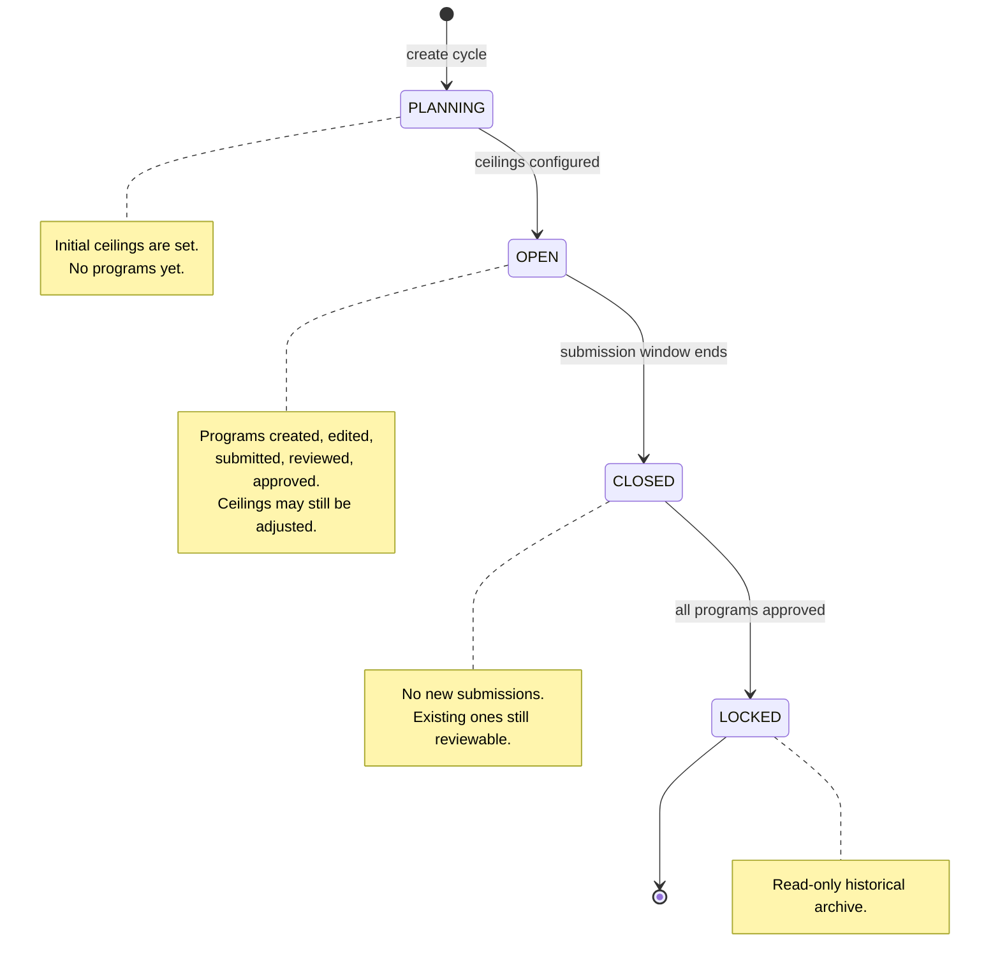
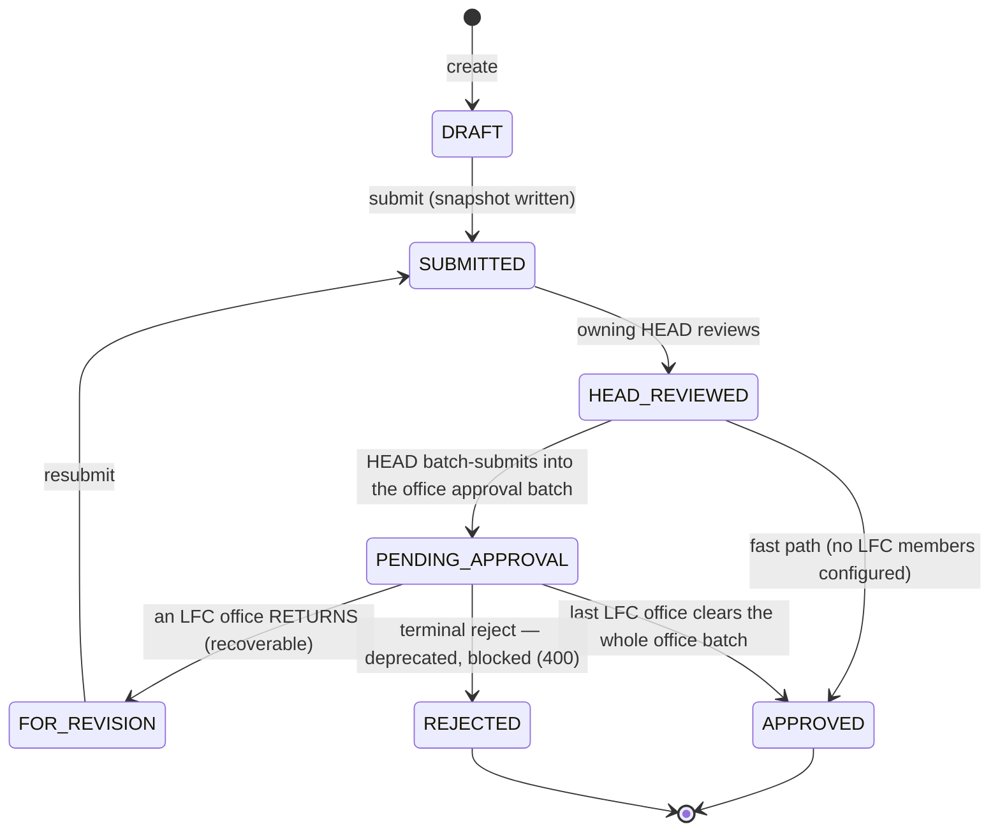

# AIP Workflow

The portal models two nested lifecycles: the **AIP cycle** (one fiscal year)
and the **program** (one submission). This page is the canonical diagram set;
the prose authority is
[`api/docs/aip-reference.md` §3–§4](../../api/docs/aip-reference.md).

> ## ⚠️ Phase 1: the program lifecycle below is not what currently ships
>
> The gate chain documented on this page — `SUBMITTED → HEAD_REVIEWED →
> PENDING_APPROVAL → APPROVED` with the sequential per-office LFC batch — is
> **retired for Phase 1**. The write routes and the whole `lfc` module have been
> removed; the implementation is preserved on **`archive/full-approval-workflow`**
> (tag `archive/full-approval-workflow-v1`, cut at `cde4254`) as reference only:
> it will be **replaced by a redesigned review flow**, not restored
> (`PLAN.md`). The diagrams below document the archived design.
>
> **What ships today:**
>
> ```mermaid
> stateDiagram-v2
>     [*] --> DRAFT : create
>     DRAFT --> PUBLISHED : publish (v1 snapshot, final AIP code assigned)
>     PUBLISHED --> PUBLISHED_REVISION : open a revision (explicit, aip:write)
>     PUBLISHED_REVISION --> PUBLISHED : republish (vN+1 snapshot)
>     PUBLISHED_REVISION --> PUBLISHED : discard draft
> ```
>
> - A small set of CPDO encoders enter every office's AIP on its behalf, with
>   **proposed cost estimates only** (PS / MOOE / CO per PPA). Line items are a
>   later phase.
> - `PUBLISHED` is publicly visible and **not structurally editable** — that is
>   what guarantees live rows equal the published snapshot. Editing means opening
>   a revision, which is explicit, permissioned, and logged.
> - The public reads the **last published snapshot**, so a mid-revision working
>   copy never reaches the registry. Visibility keys on `publishedVersionId`,
>   never on status.
> - Comments and public feedback are accepted in **both** published states, and
>   unresolved threads never block publishing.
> - Authorization is **named permission keys + office scope**, not the role enum.
>
> Full design: `docs/design/phase-1-publish-scope.md`.
> Open follow-ups: root `PROGRESS.md`.

## AIP cycle lifecycle

An `AIPCycle` is the annual container. `SUPER_ADMIN` owns every transition.



- **`PLANNING → OPEN`** requires at least one finish-line ceiling configured.
- Budget ceilings can be created or updated while the cycle is `PLANNING` or
  `OPEN`. Changes are audited and apply immediately to later approval checks.
- **`OPEN → CLOSED`** blocks new program creation and `DRAFT → SUBMITTED`;
  programs already in flight can still be reviewed and approved.
- **`CLOSED → LOCKED`** is blocked while any non-rejected, non-deleted program
  is not yet `APPROVED`.

## Program lifecycle

A `Program` is one submission. The `ProgramStatus` enum has exactly seven states
(`DRAFT`, `FOR_REVISION`, `SUBMITTED`, `HEAD_REVIEWED`, `PENDING_APPROVAL`,
`APPROVED`, `REJECTED`). Endorsement is an **advisory, non-gating** signal off
the state machine, so the former `PENDING_ENDORSEMENT` and `ENDORSED` states were
dropped from the enum (NCPC endorser pivot Phase 4b; see the design doc).



**Endorsement is parallel and advisory** — not part of the state machine above.
At any point from `SUBMITTED` through `PENDING_APPROVAL`, a designated endorser
(`canEndorse` office HEAD) may record an affirmative `ProgramEndorsement`. It
never changes the program's status and never blocks submission for approval.
Concerns are raised as `ENDORSEMENT`-stage comments, not a rejection.

| Transition | Trigger | Side effects |
|---|---|---|
| `DRAFT \| FOR_REVISION → SUBMITTED` | Owner submits | Requires ≥1 PA with ≥1 line item **and every comment thread resolved**. Writes a new `ProgramVersion` snapshot. |
| `SUBMITTED → HEAD_REVIEWED` | HEAD of the proponent's own org | Pure status flip — **no** side effects. |
| `HEAD_REVIEWED → PENDING_APPROVAL` | HEAD batch-submits (`POST /aip-cycles/:id/submit-for-approval`) | Programs enter a persisted `ProgramApprovalBatch` (one open batch per office+cycle). First submission is all-or-nothing and opens at the first LFC office; later submissions (resubmitted returns, new programs) join the active batch at its current office and inherit earlier offices' approvals. Fast path: no LFC members → straight to `APPROVED`. Endorsement is **not** a precondition. |
| `PENDING_APPROVAL → APPROVED` | The **last** LFC office clears the whole office batch | The batch advances office-by-office only when **every** in-scope program clears the current office; the last office's clearance finalizes them all together. Hard ceiling check runs here; assigns the final `aipReferenceCode` and PA codes. |
| `PENDING_APPROVAL → FOR_REVISION` | An LFC office **returns** the program (`ApprovalStatus.RETURNED`) | Recoverable. Spawns an `APPROVAL`-stage comment thread the proponent must resolve before resubmitting. Pauses the batch at the returning office. |
| `PENDING_APPROVAL → REJECTED` | *(deprecated)* terminal LFC rejection | Blocked: `REJECTED` decisions and `reject-all` return `400`. `REJECTED` remains in the enum for legacy rows only; normal flow uses a recoverable **return**. |
| *(advisory, off the state machine)* `endorse` | A `canEndorse` office HEAD (`POST /programs/:id/endorse`) | Creates/refreshes one affirmative `ProgramEndorsement` for the caller's office on the current version. **Never** changes the program's status. Allowed while `SUBMITTED…PENDING_APPROVAL`. |

The **LFC committee is the sole authority** over a program's fate. Review is
**sequential by office** (`sequenceOrder`) **and gated per proponent-office
batch**: member offices (CPDO, CBO, CTO, CMO) act in order, but the batch advances
to the next office — and finalizes at the last — only once **every** in-scope
program has cleared the current office. An approved program waits at
`PENDING_APPROVAL` for its siblings; a **return** drops one program to
`FOR_REVISION` (recoverable) and pauses the batch until it is revised and
resubmitted. Terminal rejection is **deprecated** (blocked). There is **no
`SUPER_ADMIN` verdict override** — the SUPER_ADMIN configures the system but does
not approve, reject, or stand in for a committee office (it retains read/view of
the LFC board). See
[modules/lfc.md](../modules/lfc.md)
and the `archive/full-approval-workflow` branch for the implementation.

> **Children inherit status.** `ProjectActivity` and `LineItem` rows can only be
> created or edited while the parent Program is `DRAFT` or `FOR_REVISION`. Once
> it leaves those states the whole tree is locked until the program returns to
> `FOR_REVISION`.

## End-to-end submission flow

How a proposal travels from a proponent's desk to an approved AIP entry:

```mermaid
sequenceDiagram
    actor Staff as Proponent Staff
    actor Head as Proponent HEAD
    actor Endorser as Endorsing HEAD(s)
    actor LFC as LFC HEAD(s) (CPDO/CBO/CTO/CMO)
    actor Admin as SUPER_ADMIN
    participant API

    Staff->>API: Create program (DRAFT)
    API-->>Staff: tentative AIP code assigned
    Staff->>API: Add projects/activities + line items
    Staff->>API: Submit program
    API->>API: snapshot ProgramVersion, status → SUBMITTED
    Head->>API: Head review (status → HEAD_REVIEWED)
    opt advisory, any time SUBMITTED…PENDING_APPROVAL
        Endorser->>API: Endorse (affirmative; no status change)
    end
    Head->>API: Batch submit for LFC approval
    API->>API: status → PENDING_APPROVAL, open the office batch at the first LFC office
    loop LFC offices in sequence (sequenceOrder)
        LFC->>API: Approve each program (or return)
        API->>API: advance the batch only once EVERY program clears this office
    end
    alt last LFC office clears the whole batch
        API->>API: ceiling check, final codes, all programs → APPROVED, batch closed
    else an LFC office RETURNS a program
        API->>API: that program → FOR_REVISION, open APPROVAL thread, batch paused
        Staff->>API: Resolve feedback, revise, resubmit into the active batch
    end
    Note over Admin: SUPER_ADMIN configures cycles/ceilings/committees<br/>and observes — no per-program verdict
```

## The feedback gate

`DRAFT → SUBMITTED` is rejected while **any** unresolved root comment thread
exists on the program. Because an LFC return spawns an `APPROVAL`-stage thread, a
bounced-back program cannot be resubmitted until the proponent resolves that
feedback. This makes review feedback a hard gate, not a suggestion. See
[`api/docs/aip-reference.md` §6 invariant 11](../../api/docs/aip-reference.md).

## Budget ceiling enforcement

The hard ceiling check runs once, at final approval (`PENDING_APPROVAL →
APPROVED`, or the no-LFC-members fast path from `HEAD_REVIEWED`). For the
program's `(cycle, finishLine, proponentType)`, the sum of already-approved
grand totals plus this program's grand total must not exceed the applicable
LGU or CSO ceiling partition. A violation returns `409 Conflict` with a
structured breakdown (available, requested, deficit). See
[budget-ceilings module](../modules/budget-ceilings.md).

## Related reading

- [modules/programs.md](../modules/programs.md) — the workflow service implementation
- [modules/aip-cycles.md](../modules/aip-cycles.md) — the cycle state machine
- [manual/](../manual/README.md) — what each transition looks like to a user
