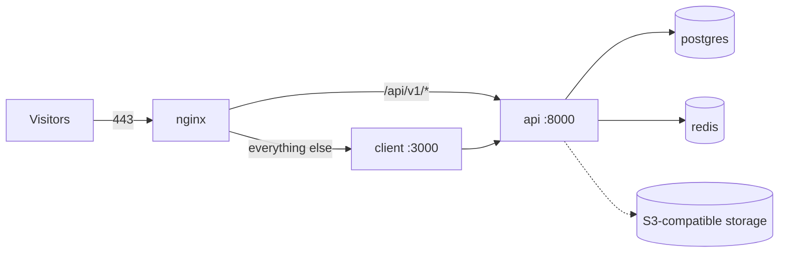

# Deploying the portal

One server runs everything with Docker Compose: the API, the client, nginx with a Let's Encrypt
certificate, Redis, and Postgres (or point it at a managed database).



## What you need

| | |
|---|---|
| A server | Ubuntu 22.04 or later, 2 vCPU and 4 GB of memory (the images are built on it), 40 GB of disk |
| Docker | Docker Engine with the Compose plugin |
| A domain name | An A record pointing at the server, e.g. `budget.example.gov.ph`. Ports 80 and 443 open |
| E-mail | An SMTP account (or Azure Communication Services): the portal e-mails invitations and sign-in codes |
| Object storage | An S3-compatible bucket for uploaded procurement documents and database backups. Optional for a trial: see step 2 |

## 1. Get the code onto the server

The scripts in `deploy/` expect the checkout at `/opt/budget-portal`.

```bash
sudo mkdir -p /opt/budget-portal && sudo chown "$USER" /opt/budget-portal
```

```bash
git clone https://github.com/Stride-Technologies/peoples-budget-portal.git /opt/budget-portal && cd /opt/budget-portal
```

Check out the release you want (`git checkout v0.1.0`), not the tip of `main`.

## 2. Settings

```bash
cp .env.production.example .env && chmod 600 .env
```

Fill in every value. The ones that matter most:

| Setting | What to put |
|---|---|
| `SITE_HOST` | The site's address, no scheme: `budget.example.gov.ph`. The only place it is set |
| `LGU_SHORT_NAME`, `LGU_TYPE`, `LGU_PROVINCE` | Whose portal this is. The rest of the `LGU_*` list is in [configuration.md](configuration.md) |
| `POSTGRES_PASSWORD` | A long random password (`openssl rand -hex 24`) |
| `JWT_PRIVATE_KEY`, `JWT_PUBLIC_KEY` | A key pair; the two `openssl` commands are in the file |
| `MAIL_*` | Your SMTP account, with `MAIL_PROVIDER="smtp"` |
| `SEED_ADMIN_EMAIL`, `SEED_ADMIN_PASSWORD` | The first administrator. Remove both after step 5 |
| `RECAPTCHA_SECRET_KEY`, `NEXT_PUBLIC_RECAPTCHA_SITE_KEY` | reCAPTCHA v3 keys for your domain. Without them the public feedback forms reject every submission |
| `DO_SPACES_*` | Your bucket. Any S3-compatible service works, not only DigitalOcean |
| `CERTBOT_EMAIL` | Where Let's Encrypt sends expiry notices |

No bucket yet? Add `STORAGE_PROVIDER="local"`. Uploaded documents then stay inside the API
container and are **lost when it is rebuilt**: fine for a trial, not for a live site.

`NEXT_PUBLIC_*` values are baked into the client when it is built. After changing one, rebuild
(step 4).

## 3. The certificate

```bash
bash deploy/setup-server.sh
```

It installs Certbot and issues the certificate for `SITE_HOST`. nginx must not be running yet.
The script ends with a list of next steps; its step 5 (moving renewals to webroot) is required, or
the certificate will not renew.

## 4. Build and start

```bash
docker compose --profile local-db build
```

```bash
docker compose --profile local-db up -d
```

Leave out `--profile local-db` when `DATABASE_URL` points at a managed database. The build takes
about five minutes.

## 5. The database, and your data

Migrations only (an empty portal; you add offices and programs in the control panel):

```bash
bash deploy/init-db.sh
```

Or migrations, then a city folder: offices, goals, one year's AIP and the first administrator
([loading-your-data.md](loading-your-data.md)). The folder must be inside `api/prisma/data/`
before the build, so it is in the image:

```bash
bash deploy/init-db.sh --load-city prisma/data/sample-city
```

`--load-city` works on an empty database only. To try the portal first, load `sample-city`, then
start over with your own: `docker compose --profile local-db down -v` deletes the database.

## 6. Check it

- `https://<SITE_HOST>/` shows the home page with your LGU's name.
- `https://<SITE_HOST>/api/v1/health` answers `200`.
- Sign in at `/login` with the administrator from step 2. The sign-in code arrives by e-mail.
- `/privacy-policy` and `/terms` say they are templates. Have them reviewed, then set
  `LEGAL_TEXT_EFFECTIVE` and restart the client.

Search engines are told to stay away (`robots.txt`, `noindex`) until `NEXT_PUBLIC_SITE_ENV` is
exactly `production` and the client is rebuilt.

## Backups

`deploy/backup-db.sh` dumps the database every night, uploads it to your bucket (private) and keeps
14 daily and 8 weekly copies. Install it in the deploy user's crontab:

```text
15 18 * * * /opt/budget-portal/deploy/backup-db.sh >> /opt/budget-portal/backups/backup.log 2>&1
```

`deploy/restore-check.sh <dump>` restores a dump into a throwaway container and compares row counts
with the live database. Run it after the first backup, and now and then after: a backup nobody has
restored is not a backup. The dump holds personal data.

## Updating

```bash
cd /opt/budget-portal && git fetch --tags && git checkout <new version>
```

```bash
docker compose --profile local-db build && bash deploy/init-db.sh && docker compose --profile local-db up -d
```

Read the release's notes in [`CHANGELOG.md`](../CHANGELOG.md) first. After a change to
`nginx/nginx.conf`, recreate nginx or it keeps the old file:
`docker compose up -d --force-recreate nginx`.

## Things that go wrong

| Symptom | Cause |
|---|---|
| nginx restarts in a loop | No certificate yet for `SITE_HOST` (step 3), or `SITE_HOST` differs from the certificate's name |
| A page shows a bare "Not Found" on `/api/...` | `nginx/nginx.conf` was changed to send all of `/api/` to the API. Only `/api/v1/` belongs to it |
| Every feedback form says it could not verify the submission | reCAPTCHA keys missing, for another domain, or `RECAPTCHA_EXPECTED_HOSTNAME` differs from `SITE_HOST` |
| The name or goal word did not change after editing `.env` | `LGU_*` needs a restart (`docker compose up -d`); `NEXT_PUBLIC_*` needs a rebuild |
| No sign-in code arrives | Mail settings; `docker compose logs api` shows the send error |
