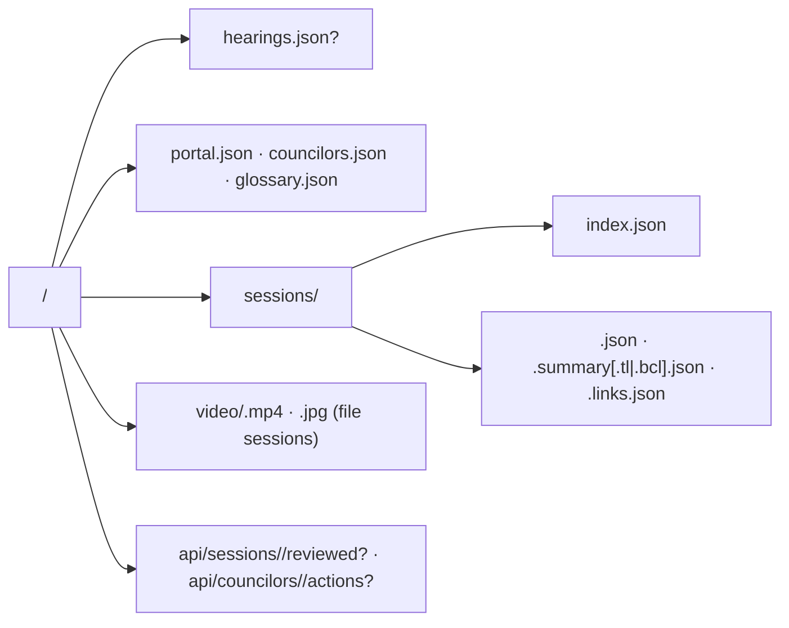

# Hearings API, contract v1

What the portal's hearings pages read. It is **a folder of JSON files and two JSON endpoints**, public and
read-only, with no key: any web server that serves the folder is a hearings API. The portal reads it from
`NEXT_PUBLIC_HEARINGS_API_URL` ([`modules/hearings.md`](modules/hearings.md)). A made-up example is in
[`services/hearings/sample/`](../services/hearings/sample).

A `?` marks what an API may leave out: the pages show what they are given. Only `sessions/index.json` and each
listed session's `sessions/<id>.json` are required. Ids and slugs are 1 to 64 letters, digits, `_` or `-`; the
pages ignore any other.

## Files

| Path | Shape |
|---|---|
| `sessions/index.json` | `[{ id, title, date?, durationSec, body?, source? }]`, in the order to show them. `date` is `YYYY-MM-DD`. `body` is an id from `hearings.json`; absent means the first body. `source` is `youtube` (the id is the YouTube video's) or `file` (the API holds the video); absent means `file` when the id starts with `fb`, else `youtube` |
| `sessions/<id>.json` | `{ segments: [{ start, end, text, skip?, words? }] }`. Times are seconds from the start. `skip` marks broadcast audio that is not part of the session (an ad, a jingle); the pages hide those lines unless asked. `words` is `[[start, end], …]`, one pair per space-separated word of `text` |
| `sessions/<id>.summary.json` | `{ headline?, glance: [item], sections: [{ title, items: [item], finishLines? }], issues: [{ topic, summary, offices?, refs, finishLines?, cluster?, at? }], meta?: { model? } }`, where an `item` is `{ lead, text, refs }`. **`refs` are indexes into the session's segments**: where a reader checks the claim. `finishLines` are goal numbers (1 to 8); `cluster` is a name from `portal.json`; `at` is seconds |
| `sessions/<id>.summary.tl.json`, `.bcl.json` | The same summary in Filipino or Bikol, same shape and same `refs` |
| `sessions/<id>.links.json` | `[{ seg, kind, no?, title, url }]`: a document named at segment `seg`. `kind` is `ordinance`, `resolution`, `proposed`, or your own label. Only `http(s)` links are shown |
| `portal.json` | `{ finishLines: { "1": name, … }, clusters: [name] }`: the LGU's goals and clusters, as the issues are tagged |
| `councilors.json` | `[{ slug, name, role? }]` |
| `glossary.json` | `[{ term, short?, definition, url? }]`: terms the session page looks for in the transcript |
| `hearings.json` | `{ bodies: [{ id, name, about? }] }`: the bodies whose sessions are here (a council, a people's council). Absent: one unnamed body |
| `video/<id>.mp4`, `video/<id>.jpg` | A `file` session's video and its poster |

## Endpoints

| Path | Answers |
|---|---|
| `api/sessions/<id>/reviewed` | `[{ seg_idx, text }]`: lines a person has corrected. The page shows that text in place of the machine's and marks it reviewed |
| `api/councilors/<slug>/actions` | `[{ session_id, kind, text, at }]`: what the member did on the floor, each confirmed by a reviewer |

## Rules

- Every path answers `GET` with JSON, or 404 when there is nothing. The portal reads server-side and caches
  each answer for five minutes, so the API needs no CORS headers for the pages. Posters and `file` videos are
  loaded by the visitor's browser straight from the API.
- Nothing personal beyond what was said in a public session and the members' names and roles.
- A later version adds fields; it does not rename or remove these.
