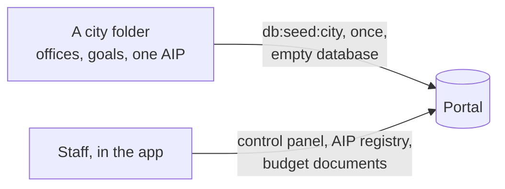

# Loading your LGU's data

There are two ways in. Most LGUs use both: the folder for the first load, the app from then on.



## 1. A city folder (the first load)

A folder of JSON files: your offices, clusters, goals and one year's AIP.
[`api/prisma/data/sample-city/`](../api/prisma/data/sample-city/README.md) is a complete example,
and its README says what each file holds.

1. Copy `api/prisma/data/sample-city/` to `api/prisma/data/<your-lgu>/`.
2. Replace `offices.json`, `clusters.json` and `goals.json` with yours. Each office needs its code
   and type from your AIP coding sheet (DBM Budget Operations Manual, Annex D). The AIP code's
   level-of-government digit follows `LGU_TYPE`: 1 for a province, 2 for a city, 3 for a
   municipality.
3. Replace `aip-<year>.json` with your AIP and set `aipYear` in `manifest.json`. Start small: one
   office's programs are enough to see how they print.
4. Load it into an **empty** database:

```bash
pnpm --filter api db:seed:city -- --dir prisma/data/<your-lgu>
```

On a server: `bash deploy/init-db.sh --load-city prisma/data/<your-lgu>` (the folder must be in the
checkout before `docker compose build`).

The loader creates the reference data, the first administrator (`SEED_ADMIN_*`), the AIP as drafts,
and then publishes every program that passes the readiness check. `--draft` skips the publishing.
It refuses a database that already has offices.

**What an AIP entry holds.** One entry per program: the office (by acronym), the goal (by number),
the name and description, the cost by expense class (PS, MOOE, FE, CO) and fund source, and the
projects and activities under it, nested. The exact fields are the `ProgramSeed` type at the top of
`api/prisma/seed-aip.ts`. Amounts are strings with two decimals (`"32235000.00"`).

Your AIP is probably a spreadsheet. There is no general importer yet: every LGU lays its workbook
out differently. Convert it to the JSON with a script of your own, load it with `--draft`, and check
the totals per office in the staff dashboard against your workbook before publishing.

## 2. In the app (every day after)

| To add or change | Where |
|---|---|
| Offices, clusters, goals and sub-goals | Control panel |
| Users, their offices and permissions | Control panel → Users (accounts are by invitation) |
| A new fiscal year | Control panel → AIP Cycles |
| Programs, projects and activities | AIP registry. Each office encodes its own |
| The proposed budget (LEP) and the enacted budget (Appropriation Ordinance) | Budget cycles → the year → Documents. The LEP starts from the AIP; the Ordinance from the LEP |
| Procurement plans (PPMP) | Projects |

The year appears on the public site's **AIP** section when its programs are published, and in the
**Annual Budget** section when its Ordinance is enacted (or, for a past year with no ordinance on
file, when its LEP is submitted). Until then those sections say that nothing has been posted yet.

The staff guides are in [`manual/`](manual/README.md).

## Loading a printed budget book

`pnpm --filter api db:seed:document` loads an enacted budget from a "book" file (JSON read from the
LGU's printed Annual Budget) and `db:verify:document` checks it against the book's totals. The
reader that produces that JSON was written for one city's book layout (`api/prisma/ab-2026-book.ts`)
and is not general yet. Treat it as a worked example of the approach: parse, verify against printed
totals, review flagged rows, then enact.

## Reference lists that come with the portal

National lists are seeded for you from `api/prisma/data/`: PAP sectors, UACS expense objects, the
LGU chart of accounts, the local climate-change expenditure typology, SDG goals and SGLG indicators.
Update them there when the national government reissues one.
