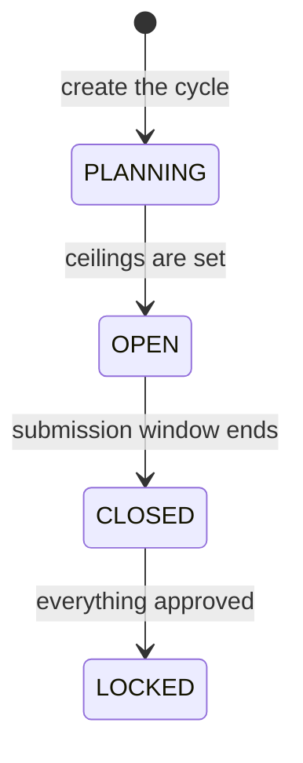

# Administrator Guide — Super Admin

> ### ⚠️ Phase 1 notice
>
> Cycles, ceilings, users, and reference data all work as described. Two things
> have changed for Phase 1:
>
> - **[Grant permissions and office scope](#grant-permissions-and-office-scope)**
>   is new, and is how the portal is now set up. Read it first.
> - **Issue verdicts** and the approval chain are retired while the review process is redesigned.
>
> The workflow users actually follow: [phase-1-encoding.md](phase-1-encoding.md).
>
> Want to see the screens? [staff-and-permissions.md](staff-and-permissions.md)
> and [configuring-offices.md](configuring-offices.md) cover the same ground
> with screenshots.

This guide is for **Administrators** (the Super Admin role). You run the portal
city-wide: you open and close the annual cycle, set budget ceilings, manage
users, curate reference data, and issue the final verdict on every submission.

> New to the portal? Read [getting-started.md](getting-started.md) first.

## Your tools — the Control Panel

Everything administrative lives under **Control Panel** in the top navigation:

| Section | Purpose |
|---|---|
| **AIP Cycles** | Create the yearly cycle and move it through its stages |
| **Edit History** | Every change to every program you can audit, newest first — filter by office or by kind of change |
| **Finish Lines** | Configure the strategic finish lines |
| **Clusters** | Maintain the strategic clusters |
| **Users** | Invite, update, and remove users |
| **Civil Society Orgs** | Add, update, or remove CSOs, and mark a CSO as an **endorser** (so its representative can endorse) |
| **PAP Sectors** | Manage DBM BOM Annex 2 sector codes |
| **UACS Objects** | Manage UACS account codes (updated annually) |
| **Climate Codes** | Manage CCET climate typology codes |
| **SGLG Indicators** | Manage DILG SGLG indicator framework |
| **SDG Goals** | Manage the UN Sustainable Development Goals list |

## Run the annual cycle

An **AIP Cycle** is one fiscal year of activity. It has four stages:

1. **Create the cycle** (Control Panel → AIP Cycles → New). It starts in
   **Planning**.
2. **Set the initial budget ceilings** while in Planning (next section). You
   cannot open the cycle until at least one ceiling exists.
3. **Open** the cycle — proponents can now create and submit programs.
4. **Close** the cycle when the submission window ends — no new programs or
   submissions, but in-flight ones can still be reviewed and approved.
5. **Lock** the cycle once every program is approved — it becomes a read-only
   archive. You cannot lock while any program is still unapproved.

## Choose what the public site shows

Each year's page (Control Panel → AIP Cycles → the year) has a **Public
Overview** box with three switches:

| Switch | Starts | What it does |
|---|---|---|
| **AIP Overview** | Hidden | The summary page for a year still being planned |
| **Annual Budget Overview** | Shown | The summary page once the year's budget is enacted (locked) |
| **PPMP Overview** | Hidden | The summary page of the offices' procurement plans |

While an Overview is hidden, visitors do not see its tab and land on **Browse**
instead, where every published entry is still listed. Show an Overview once
enough offices have published that its totals describe the year fairly. A year
is either an AIP or an Annual Budget at a time, so only one of the first two
switches is in use; the other can be set in advance.

Below them, **Show the comparison** adds a year-on-year comparison to the AIP
Overview.

### Open a year's data to the public

On the cycle's page (Control Panel → AIP Cycles → the year), the **Open data**
control under *Public Overview* makes that year's published budget downloadable
from the [Developers page](https://<your-site>/developers/open-data) and
readable through the public API. Until you switch it on, the year reads **"Coming
soon"** there and nothing is shared.

- It publishes only what the public site already shows: published programs and
  Projects. Drafts, feedback and anything about people are never included.
- Switch it on once the year's published entries are ready to be reused, for
  example after the city publishes its AIP. Changes offices publish afterwards
  appear in the download within five minutes.
- Switching it off takes the download and the API offline for that year at
  once. Copies people already downloaded stay with them.

Only a super administrator can change it.

### Special funds' stated amounts

Further down the cycle's page, **Special funds** lists each special fund with
the entries charged to it, under whichever office runs them, and the amount
LBP Form 7 will print for it. When a fund
lists no programs — the 2027 plan gives the 20% Development Fund an amount but no
projects — type its **stated amount** and **Save**. It is marked *stated, no
PPAs* on the dashboard and the AIP Registry, and it is never shown on the public
site or in open data. If the fund does list programs, their total is used and a
different stated amount is marked so someone can reconcile the two. Leave the box
empty and save to remove the amount.

### Fill indicators and targets from an AIP-Extended sheet

Each office's PPMP workbook has an **AIP-Extended** sheet with a performance
indicator, a target and SDG goals for every program. To bring them in:

1. Open the cycle and choose **Upload an AIP-Extended sheet**.
2. Choose the office's workbook (.xlsx) and **Read sheet**. Nothing is saved yet.
3. Each row of the sheet shows what it says and which AIP entry it belongs to.
   A row whose code is in the AIP is matched for you. A row marked **Code not in
   the AIP** needs you to pick the entry: use a suggestion, or search by code,
   office or name. Check the name — a suggested code can point at a different
   program. The parts of the code that differ are highlighted.
4. Once an entry is chosen, its current indicator, target and SDG goals show
   below it, with what will happen to each. Use **Skip row** to leave a row out.
5. **Fill** saves. Only blank fields are filled and SDG goals are only added; if
   the office already typed something different, theirs is kept and listed.

You can upload the same sheet again safely — nothing already filled changes.
Offices can correct the target afterwards in the program's **Target for the
Budget Year** field.

## Set budget ceilings

Each **Finish Line** carries a single yearly budget ceiling that all of its
programs draw against. Set the initial ceilings while the cycle is in
**Planning**; after the cycle is **Open**, Administrators can still add missing
ceilings or update existing ceilings before the cycle is Closed:

1. Open the cycle and add a **Finish Line ceiling**.
2. Enter the **total ceiling** for that finish line.

> The old LGU/CSO ceiling split no longer applies (the NCPC proponent track was
> retired); the whole total is the cap for the finish line.

Every update is recorded in the ceiling's **history** for tracking. Ceiling
changes apply immediately to later approval checks. A ceiling can only be
deleted while the cycle is in Planning and no program references it.

The cycle detail page also shows a **Recent ceiling changes** section with
plain-language entries such as "Updated a finish line from one amount to
another", including who made the change and when.

These ceilings are enforced at **approval time** — see
[Issue verdicts](#issue-verdicts).

## Manage users

In **Control Panel → Users** you can:

- **Invite a user** — enter their name, email, and role (Staff / Head / Super
  Admin). Staff and Head users also need an identity type — LGU, LFC, NCPC or
  **Developer** — and, for LGU/LFC, an office, or for NCPC, an organisation (or
  none, for the NCPC umbrella head). A Developer belongs to no office or
  organisation: it sees and comments on exactly what its permissions and office
  scope allow, and nothing until you grant some. Super Admin users need none of
  this.
- **NCPC reviewers** — invite with the *NCPC* template. A CSO representative
  reads and comments on their CSO's cluster; the umbrella head (a Head with no
  organisation) the whole city. Any active CSO can be chosen. They receive an invitation email that
  shows the role and office/organisation for the account.
- **Resend** or **revoke** a pending invitation.
- **Edit** a user (the pencil button on each account):
  - Change their **role** (Staff ⇄ Head).
  - Reassign their **office** (for LGU/LFC users).
  - **Deactivate** or **reactivate** the account. A deactivated user keeps their
    record but can no longer log in, and their active sessions are ended
    immediately; reactivating restores access.
  - Every change is recorded in the account's **Change history**, shown in the
    edit dialog — who made it, when, and the before → after value.
- **Delete** a user. (Only Administrators can delete users.)

Office Heads can also invite and manage users — but only within their own
office: they can change a Staff member's role and activation, but only an
Administrator can reassign someone to a different office. You cannot deactivate
or change the role of your own account.

## Grant permissions and office scope

> **Phase 1 — this is how the portal is set up.** Roles no longer decide what
> someone can do. Two independent things do, and **both** must allow an action:
>
> | | Question it answers | Where you set it |
> |---|---|---|
> | **Permissions** | *Can this person do this kind of thing?* | Users → key icon → Permissions |
> | **Office scope** | *Whose AIP records can they do it to?* | Users → key icon → Office scope |
>
> A user with `aip:write` but no scope on the City Agriculture Office cannot edit
> CAgO's entries. A user scoped to CAgO without `aip:write` can only read them.
> When someone reports "I can't edit this", check both.

Open **Control Panel → Users** and click the **key icon** on the account.

### Permissions

Tick the actions the person needs. Grouped by area, and the description under
each key says what it allows. The ones that matter most:

| Key | Lets them |
|---|---|
| `aip:read` | See AIP entries |
| `aip:write` | Create and edit entries and their cost estimates |
| `aip:publish` | **Publish** — makes figures public and assigns the final AIP code |
| `aip:audit` | See the edit history (who changed which figure) |
| `comments:write` | Post comments |
| `comments:resolve` | Resolve comment threads |
| `users:write` | Invite and manage users, and grant permissions |

Keys badged **"not enforced yet"** belong to features that haven't shipped.
They're safe to grant — nothing checks them until the feature arrives.

**Templates** apply a sensible starting set for a role. They are a starting
point, not a rule: after applying one, every checkbox stays editable. Applying a
template **replaces** the current set rather than adding to it.

> **`aip:publish` is deliberately narrow.** Publishing is what makes a figure
> public and locks in the AIP reference code. Give it to the people accountable
> for that decision. Encoders can prepare and save everything without it.

### Office scope

Either:

- **All offices** — the whole city, including offices added later. Right for
  CPDO leadership and city-wide reviewers such as CMO and CBO.
- **Specific offices** — tick them individually. The list is grouped by cluster,
  and ticking a cluster header selects its offices for you.

> Only individual offices are stored, never "the cluster". So if an office is
> later moved to a different cluster, nobody's access changes as a side effect —
> which is what you want, because access decisions and cluster reorganisations
> have nothing to do with each other.

Everyone keeps access to their **own** office automatically; you only need to
grant scope for offices *beyond* it.

### It's all recorded

Every permission and scope change writes to the account's **Change history** with
what was added and removed. Nothing changes silently.

You cannot remove your own user-management permission — that would lock you out
of the screen you're standing on.

## Curate reference data

You maintain the data proponents pick from. All reference management pages are
under **Control Panel → Reference**.

### Strategic framework

- **Clusters** — rename strategic clusters and add city offices to them.
- **Finish Lines** — update the strategic finish lines (vision numbers, names).
- **City Offices** — add, update, or remove city offices, and assign each to a
  cluster.

### Reference Data Management

The six tables below are used throughout the AIP submission form. You can create,
edit, and deactivate records at any time. **Inactive records** are hidden from
proponents but remain in the database so existing submissions still display
correctly. Use the **Restore** button to reactivate them.

| Page | What it contains | When to update |
|---|---|---|
| **Civil Society Orgs** | All CSOs that participate as NCPC proponents — `code`, name, cluster, and endorsement flag | When a new CSO joins or an existing one leaves NCPC |
| **PAP Sectors** | DBM BOM Annex 2 sector classification codes (e.g. `1000 – General Public Services`) | When DBM revises the BOM (rare) |
| **Offices** | Offices with their `officeCode`, `officeType` (Mandatory / Optional / Others), cluster and PAP sector | When the city reissues its AIP codes |
| **UACS Objects** | Unified Accounts Code Structure chart of accounts, tagged by expense class (PS / MOOE / FE / CO) | Annually when DBM publishes the updated UACS |
| **Climate Codes** | CCET climate typology codes, tagged by pillar (Adaptation / Mitigation / Crosscutting) | When the DBM-CCC CCET joint memo is revised |
| **SGLG Indicators** | DILG Seal of Good Local Governance indicator framework | Annually before the SGLG assessment cycle opens |
| **SDG Goals** | The 17 UN Sustainable Development Goals | Rarely — the list is fixed until 2030 |

> **Tip:** For large annual updates (e.g. a new UACS catalog), re-run the seed
> (`pnpm --filter api exec prisma db seed`) against updated JSON files in
> `api/prisma/data/` — it upserts by `code` and is safe to run repeatedly.

#### Office codes

An office's **code** and **type** are both part of every AIP reference code
beneath it, so editing either on the **Offices** page rewrites submission codes
across the portal.

1. Open **Control Panel → Offices**. Code, type, cluster and PAP sector are
   editable inline; the full form is behind **Edit**.
2. **Office code** is free text. Type it exactly as the city's coding sheet has
   it — including a suffix like `11 (1)` where two offices share a base code.
3. Changes are staged, not live. The bar at the bottom counts what you have
   changed; **Save changes** applies them and renumbers the affected
   submissions. **PAP sector** is the exception — it is not part of the code, so
   changing it renumbers nothing.

Codes do **not** have to be unique. Several offices legitimately share one — the
sub-offices under the City Mayor's Office all carry `01`. If you enter a code
and type already in use, the form names the office using it and lets you save
anyway; both offices' submissions will then carry the same AIP reference code.

> **Approved submissions and closed cycles keep their existing codes.**
> Only unapproved work in an open cycle is renumbered.

## Review the whole portal

Unlike proponents, you can see **every** submission across all offices,
organisations, and clusters. The **Dashboard** gives you a city-wide overview;
the **AIP Registry** lets you filter and drill into any submission.

**Control Panel → Edit History** is the same record each program's History tab
keeps, across every program at once: who changed what, when, and for which office.
Each entry names its office and program. It needs the *See the edit history*
permission, and shows only the offices in your scope — all of them if you have
all-offices scope.

## Issue verdicts (override path)

> **Retired for Phase 1.** There is no approval chain to override — publishing
> replaces it. The approval chain is paused and will be redesigned.

> **Who approves normally?** The **Local Finance Committee (LFC)** — CPDO, CBO,
> CTO, CMO — is the AIP's standing approving body. An endorsed program is
> finalized when all LFC offices approve it (paused — see
> [workflow.md](../architecture/workflow.md)). The Administrator verdict described
> below is an **override path**: you can approve, reject, or return any
> endorsed program directly, without waiting for the committee. Use it for
> exceptions; the committee path is the norm.

When a submission has been fully endorsed it reaches status **Endorsed** and
lands in your **Needs Action** tab. Open it, review it, and (if overriding)
issue one verdict:

| Verdict | Effect |
|---|---|
| **Approve** | The submission is accepted into the AIP. The budget-ceiling check runs; if it passes, the submission becomes **Approved** and receives its permanent AIP reference code. |
| **Reject** | The submission is declined. It becomes **Rejected** and stays visible, but never receives a final code. |
| **Increase** / **Decrease** | The submission needs a budget change. It returns to **For Revision**, and the portal opens a comment thread describing the requested change. |

### The ceiling check

When you **Approve**, the portal checks the relevant finish-line ceiling. If the
already-approved programs in that finish line and track, plus this one, would
exceed the ceiling, approval is **blocked** with a breakdown of how much budget
is available, requested, and short. Resolve this by adjusting ceilings (in a
Planning cycle) or by requesting a decrease from the proponent.

### Returning a submission for changes

An **Increase** or **Decrease** verdict sends the program back to **For Revision**
with an attached comment thread. The proponent must make the change *and resolve
that thread* before they can resubmit — so always state clearly what you need.

## Comment and collaborate

You can comment on any submission at any stage, and resolve or reopen any
comment thread. Comments are the primary channel for telling proponents and
endorsers what needs to happen.

## Glossary

Unfamiliar term? See the [glossary](glossary.md).
