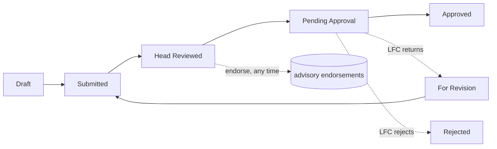

# Getting Started

> ### ⚠️ Phase 1 notice
>
> The submit-and-approve workflow this guide refers to is retired for Phase 1.
> Signing in, your profile, and navigation all work as described; what you *do*
> once you're in has changed. See
> **[phase-1-encoding.md](phase-1-encoding.md)**.

This guide is for **everyone**. It covers getting into the portal and finding
your way around. After this, continue to the guide for your role — see
[which guide is for me](README.md#which-guide-is-for-me).

## 1. Accept your invitation

You do not create your own account. An Administrator (or your office Head)
invites you, and you receive an **invitation email**.

1. Open the email and click the invitation link.
2. You land on the **Set Password** page. Confirm the displayed account name,
   role, and office or organisation, then choose a password and confirm it.
3. Your account is now created. You can sign in.

> Invitation links expire. If yours has expired, ask whoever invited you to
> **resend** it.

## 2. Sign in

1. Go to the portal and open the **Login** page.
2. Enter your email and password.

### Email verification (2FA)

The first time you sign in — and every 30 days after that — the portal sends a
**6-digit code** to your email. **Administrators get a code every time they sign
in.** The code works for 15 minutes, and only the newest one works.

If a password or code is entered wrong five times, the account waits **15
minutes** before it can try again.

1. Check your inbox for the code.
2. Enter it on the **Verify Email** page.
3. Didn't get it? Choose **Resend code**.

Once verified, you are taken to your dashboard.

### Forgot your password?

On the Login page choose **Forgot password**, enter your email, and follow the
reset link sent to you.

## 3. Find your way around

After signing in you land on the **Dashboard**. The top navigation bar is the
same on every page:

| Where | What you find |
|---|---|
| **Dashboard** | Your home view — a summary of your work (or, for Administrators, a city-wide overview) |
| **AIP Registry** | The master list of every program, project, and activity you are allowed to see |
| **Finish Lines** | The eight strategic outcome areas and how budget is tracking against each |
| **Control Panel** | Administrators only — cycles, ceilings, users, reference data |
| **Your name (top-right)** | Your office/organisation, and the **Sign out** option |

## 4. The AIP Registry

The Registry is where most work happens. It lists submissions and organises
them into **tabs**:

| Tab | Shows |
|---|---|
| **Needs Action** | Items waiting on *you* right now |
| **In Progress** | Items moving through review and endorsement |
| **Completed** | Items that are approved or rejected |
| **All** | Everything you can see |

You can also filter by cycle, by finish line, by office, and search by name.
Click any row to open its **detail drawer** — overview, budget, activities,
comments, and endorsements.

> A blue dot on a row means there is activity you haven't seen yet. The portal
> updates the Registry **live** — when someone else acts on a submission, you
> see it without refreshing.

## 5. Understand the AIP workflow

Every submission ("program") moves through the same stages:

- **Draft** — the proponent office is still preparing a brand-new submission.
- **Submitted** — sent in; waiting for the office's own Head to review.
- **Head Reviewed** — the Head signed off and can submit the program for
  approval.
- **Pending Approval** — with the **LFC committee** (CPDO, CBO, CTO, CMO), which
  reviews office-by-office in sequence; the program is approved only when **all**
  of them approve.
- **For Revision** — the program was submitted and returned for changes by the
  LFC committee. Editable and resubmittable, just like Draft.
- **Approved** — accepted into the AIP, with a permanent reference code.
- **Rejected** — the LFC committee declined it (terminal).

**Endorsements** are advisory and run *alongside* this flow: an endorser (the
NCPC head, an endorsing CSO's rep, or an endorsing office Head) can concur at any
point from Submitted through Pending Approval. Endorsement never changes a
program's status and is never required to advance — concerns are raised as
comments. (Endorsement is paused while the review process is redesigned.)

The next guide for your role explains your part in this. Continue to
[phase-1-encoding](phase-1-encoding.md), [proponent-lgu](proponent-lgu.md), or
[administrator](administrator.md).

## Need a term defined?

See the [glossary](glossary.md).
