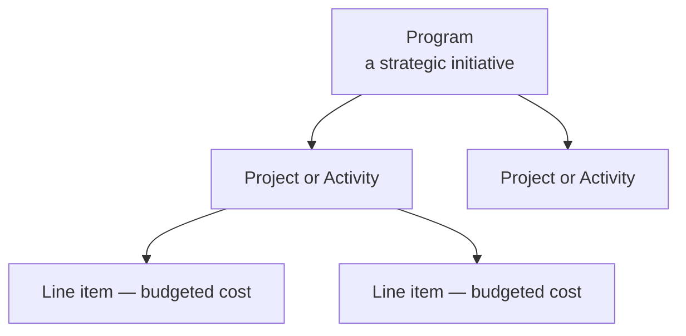
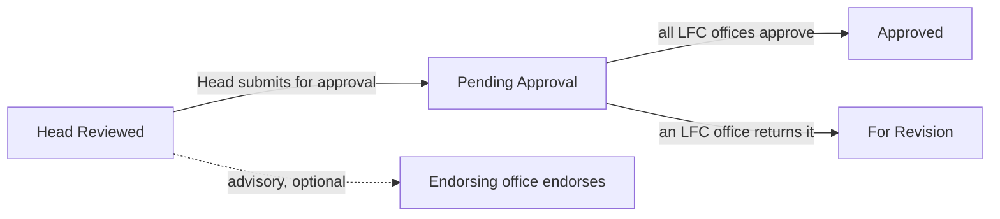

# Proponent Guide — LGU City Offices

> ### ⚠️ Phase 1 notice
>
> Most of this guide describes the **full approval workflow**, which is retired
> for Phase 1 — submit-for-review, head review, endorsement, and LFC approval are
> not available right now. It returns in Phase 2.
>
> **Read the "Phase 1" section below for what applies today**, or
> [phase-1-encoding.md](phase-1-encoding.md) for the whole current workflow.

This guide is for **Staff** and **Heads of city government offices**. It walks
through preparing and submitting an Annual Investment Program (AIP) on the
**LGU track**.

> New to the portal? Read [getting-started.md](getting-started.md) first.
>
> LFC offices and NCPC: approval and endorsement are paused while the review
> process is redesigned; this guide applies to you too.

## Phase 1 — your office's AIP is encoded for you

Right now you are **not** entering or submitting your own AIP. CPDO encoders do
that on your office's behalf, then publish it. Your job is to check what was
published and say so if something is wrong.

**What you do:**

1. **Open your office's AIP.** AIP Registry → filter to your office. Published
   entries carry a green **Published** chip. Entries imported from the city's
   AIP workbook show a small sheet link beside the code (e.g. **ECON r305**) —
   click it to open that exact row in the city's spreadsheet and compare.
2. **Read the figures.** Each Project/Activity shows a proposed amount split
   across PS (personnel), MOOE (operating), and CO (capital outlay). The Proposed
   Budget is the sum of those three.
3. **Comment on anything that looks wrong** — a figure, a description, a missing
   activity. Comments work on published entries; that is the point of the phase.
   Be specific about which PPA and which number.
4. **Watch for the reply.** An encoder who acts on your comment resolves the
   thread and can leave a reply saying what they changed. If the figures needed
   to change, they'll republish and you'll see the new version.

**What you cannot do in this phase:** create entries, edit figures, or submit
anything for approval. If your office needs edit access, an Administrator can
grant it per person — but the phase is designed so you don't need it.

> Amounts you disagree with are worth raising **before** the AIP is finalised.
> A published entry is already on the public registry, so the sooner a mistake is
> flagged, the less time it is visible.

Full detail: **[phase-1-encoding.md](phase-1-encoding.md)**.

---

## What you are building
> *(Phase 2 — the sections below describe the full submission workflow, which
> returns when offices encode their own AIPs.)*

An AIP submission has three levels:

- A **Program** is the container — one strategic initiative for the year.
- Under it you add **Projects** and **Activities** — the concrete things you
  will do.
- Under each, you add **Line items** — the individual budgeted costs.

The program's total budget is **added up from the line items** — you never type
a top-line figure. This bottom-up rollup is automatic.

## Staff and Head — who does what

| Task | Staff | Head |
|---|:---:|:---:|
| Create and edit a Draft program | ✓ | ✓ |
| Add projects/activities and line items | ✓ | ✓ |
| Submit a program | ✓ | ✓ |
| **Head-review** a submitted program | — | ✓ |
| Manage your office's users | — | ✓ |

Heads do everything Staff do, plus the **Head review** step (below).

## Step 1 — Create a program

1. From the Dashboard or the AIP Registry, choose **New Program**.
2. Fill in:
   - **Office** — your city office.
   - **Program name** and **description**.
   - **Finish Line** — the strategic outcome this program serves.
   - **PAP Sector** — the DBM expenditure classification.
   - **Expected output (MFO)** — the major final output the program delivers.
   - **Sustainable Development Goals** *(optional)* — pick every SDG the program
     contributes to; there is no limit.
   - **SGLG indicator** *(optional)* — if the program supports a Seal of Good
     Local Governance indicator.
3. Save. The program is created in **Draft**, and the portal assigns it a
   **tentative AIP reference code** straight away.

> **The tentative code is provisional, and it moves.** It is built from the
> program's implementing office, PAP sector, and its position in your office's
> list — so it is renumbered whenever any of those change. Deleting a program
> closes the gap it leaves, so the numbering stays continuous rather than
> skipping a slot. The **final code** is assigned only when the program is
> approved, and never changes afterwards.
>
> Quote the final code in documents. Use the tentative code for working
> reference only.

## Step 2 — Add projects and activities

Open your Draft program and add the work under it:

1. Choose **Add Project** (or **Add Activity**).
2. Pick the **entry type** — Project or Activity.
3. Fill in the name, description, and expected output.
4. Save. You can add as many as you need.

### Changing the order

New items go to the bottom of the list. To put them in the order you want, open
the program and choose **Reorder** above the sub-items:

- **Drag** a card by its handle, or use the **▲ / ▼** arrows.
- Choose **Save order** when you are done, or **Cancel** to discard.

The AIP code of every item in the list is renumbered to match the new order, so
the numbering always reads top to bottom. Activities under a project reorder the
same way — open the project and use its own **Reorder** button.

Reordering is only available while the program is editable (Draft, For Revision,
or an open revision), for the same reason editing is.

### Changing the order of programs

Programs are ordered inside their office's section — **General Administrative
Services**, **Support to Operations** or **Operations**. In the AIP Registry, open
your office and choose **Reorder** on the right of a section heading:

- **Drag** a program, or use the **▲ / ▼** arrows, then choose **Save order**.
- If the section holds programs from more than one PAP sector, each sector is
  listed separately: a program moves only among programs of its own sector,
  because each sector is numbered on its own.

Saving renumbers the AIP codes of that sector's programs in that section,
everywhere they appear — including programs already published on the public site.

## Step 3 — Add the budget (line items)

Inside each project or activity, add **line items** — one per budgeted cost:

1. Choose **Add Line Item**.
2. Pick the **UACS object** — the standard account code for this cost. You can
   search and filter by expense class.
3. Choose the **expense class**:
   - **PS** — Personnel Services (salaries, wages)
   - **MOOE** — Maintenance & Other Operating Expenses
   - **CO** — Capital Outlay (equipment, infrastructure)
4. Enter the **quantity**, **unit**, and **unit cost**.
5. The **line total** is calculated for you (quantity × unit cost).

As you add line items, the totals roll up automatically — the project/activity
total, and the program total.

### When more than one fund pays

Usually you list the funds and enter one PS / MOOE / CO amount. If each fund
pays a different amount — for example the General Fund, the Special Health
Fund and a national grant each paying part of a hospital project — tick
**Split by fund source** and enter PS / MOOE / CO for each fund. The total is
added up for you. The same option is on a program that states its own costs.

## Step 4 — Climate change tagging (optional)

If a project or activity contributes to climate adaptation or mitigation, open
it and add a **Climate Change Tag**:

- Pick one or more **CCET codes** — pick a code, then pick another to add it;
  click the × on a code to remove it.
- Enter the **adaptation** and/or **mitigation** amounts.

A program can carry its own tag too — for a program with no projects under it,
or where the climate amount is stated on the program itself. Edit the program
and use **Program climate change tag** at the bottom of the page.

The tagged amounts cannot exceed the row's own proposed amount. A climate
amount with **no code** (some imported rows have one) stops the program from
being published until you add a code.

## Step 5 — Submit

When the program is complete:

1. Open the program and choose **Submit**.
2. The portal checks two things before accepting it:
   - The program has at least one project/activity with at least one line item.
   - **Every comment thread on the program is resolved.** If reviewers left
     feedback, you must resolve those threads first (see
     [Handling feedback](#handling-feedback)).
3. On success, the program moves to **Submitted** and a snapshot ("version") is
   saved.

## Step 6 — Head review

> This step is for **Heads**.

A submitted program waits for its **own office's Head** to review it:

1. Open the program from the **Needs Action** tab.
2. Review the details, budget, and activities.
3. Choose **Head Review** to forward it.

The program moves to **Head Reviewed**. From there the Head clicks **Submit for
Approval** to send the office's reviewed programs to the LFC committee — this is
the only submit step (endorsement is no longer a gate). Endorsing offices may
record an advisory endorsement at any time, but it isn't required and doesn't
hold the program up.

## After Head review

Once submitted, you don't act during committee review — but watch the Registry.
If the LFC committee returns the program, it goes to **For Revision** and lands
back in your **Needs Action** tab.

## Handling feedback

Reviewers — endorsing offices, the LFC committee, and the Administrator —
leave **comments**, organised into threads.

- A program **cannot be resubmitted while any internal comment thread is
  unresolved**. (Public feedback never blocks you.)
- When the LFC committee returns a program, the reason opens a comment thread you
  must resolve. Other LFC offices may also have added comments while the program
  sat in **For Revision** — those count too. (The LFC decides; the Administrator
  configures the system and observes but does not approve or return programs.)
- To resolve a thread, open it in the program's **Comments** and choose
  **Resolve**. You can reopen it if needed.

## Tracking your work

- The **Dashboard** summarises your office's programs and their budgets.
- The **AIP Registry → Needs Action** tab always shows what's waiting on you.
- The **Activity Stream** on each program is a timeline of comments,
  endorsements, and verdicts.
- A **blue dot** marks unseen activity; opening the program clears it.

## Glossary

Unfamiliar term? See the [glossary](glossary.md).
