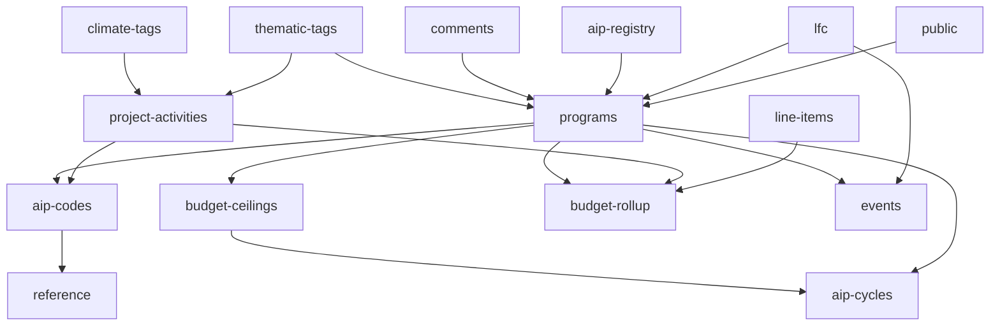

# Module Reference

The API is built from feature modules, each a folder under `api/src/`. Every
module follows the same shape (`*.controller.ts`, `*.service.ts`,
`*.module.ts`, `dto/`); cross-cutting services with no controller live in their
own module and are imported where needed.

This page is the index and dependency map. Each module below has its own page
covering purpose, endpoints, services, DTOs, and the tables it touches.

## Modules

### Foundational

| Module | Page | Responsibility |
|---|---|---|
| `auth` | [auth.md](auth.md) | JWT auth, login, invitations, email verification, password reset |
| `users` | [users.md](users.md) | User and invitation management |
| `mail` | [mail.md](mail.md) | Transactional email dispatch |
| `storage` | [storage.md](storage.md) | File-storage adapter (local dev / DO Spaces) — PPMP line-item document uploads |
| `cache` + `redis` | [cache-redis.md](cache-redis.md) | Redis connection, JSON cache facade, pub/sub |
| `health` | [health.md](health.md) | Liveness/readiness probe |

### AIP reference data

| Module | Page | Responsibility |
|---|---|---|
| `reference` | [reference.md](reference.md) | Read access to clusters, finish lines, offices, CSOs, PAP sectors, UACS, SGLG, climate codes |

### AIP infrastructure

| Module | Page | Responsibility |
|---|---|---|
| `budget-documents` | [budget-documents.md](budget-documents.md) | LEPs and Ordinances: by-PPA and by-object tables, review, finalize (specs/012) |
| `budget-cycles` | [budget-cycles.md](budget-cycles.md) | One fiscal year's Budget Cycle: its stage and the public sections rule (specs/012) |
| `aip-cycles` | [aip-cycles.md](aip-cycles.md) | The AIP stage of a Budget Cycle and its status state machine |
| `budget-ceilings` | [budget-ceilings.md](budget-ceilings.md) | Per-finish-line budget ceilings with LGU/CSO split |
| `aip-codes` | [aip-codes.md](aip-codes.md) | Two-phase AIP reference code generation |
| `budget-rollup` | [budget-rollup.md](budget-rollup.md) | Maintains denormalised PS/MOOE/CO totals |

### AIP core

| Module | Page | Responsibility |
|---|---|---|
| `programs` | [programs.md](programs.md) | The Program entity, workflow transitions, versioning, verdicts |
| `project-activities` | [project-activities.md](project-activities.md) | Project/Activity children of a Program |
| `line-items` | [line-items.md](line-items.md) | Budget line items |
| `climate-tags` | [climate-tags.md](climate-tags.md) | Climate-change tagging of Project/Activities |
| `thematic-tags` | [thematic-tags.md](thematic-tags.md) | Open, extensible beneficiary-category tags on Programs and PAs (many-to-many, unlike climate tags) |
| `comments` | [comments.md](comments.md) | Threaded, stage-gated program comments |
| `aip-registry` | [aip-registry.md](aip-registry.md) | The tabbed registry feed |
| `program-audit` | [program-audit.md](program-audit.md) | Append-only edit history: who changed what, on whose behalf |
| `permissions` | — | Permission catalog + guard, and office-scope resolution (Phase 1 §5) |
| `lfc` | [lfc.md](lfc.md) | LFC sequential approval gate + Approver view — **dormant in Phase 1** |
| `dashboard` | [dashboard.md](dashboard.md) | City-wide progress aggregate — **deliberately unscoped** |
| `events` | [events.md](events.md) | Real-time activity nudges over SSE |
| `ppmp` | [ppmp.md](ppmp.md) | Standalone Project Procurement Management Plans — the PPMP itself has no workflow, but each GPPB-aligned line item links to a funding AIP Program |

### Public

| Module | Page | Responsibility |
|---|---|---|
| `public` | [public.md](public.md) | Unauthenticated registry browse + anonymous feedback |
| `open-data` | [open-data.md](open-data.md) | Per-year open data: zip (CSV + JSON + METADATA.md) and the anonymous read-only `/open-data` API v1, behind a per-cycle switch |
| `explorer` | [data-explorer.md](data-explorer.md) | Public Data Explorer (specs/018): catalogue + view engine behind `/public/explorer`, every figure computed once; AI Ask/Explain/voice behind switches |
| hearings (client, and `services/hearings`) | [hearings.md](hearings.md) | Council sessions as public pages, read from a hearings API whose address is a setting. No API module: the portal stores nothing. `services/hearings` is the pipeline that makes that API's files from a recording |
| `explorer` (inference) | [inference-sidecar.md](inference-sidecar.md) | One inference port, three backends (OpenAI-compatible, the open-model sidecar in `services/inference`, the Stride API); the sidecar's HTTP contract (specs/020 B3) |

### Admin

| Module | Page | Responsibility |
|---|---|---|
| `admin` | [admin.md](admin.md) | Public-feedback moderation + drift-repair (rollup recompute) |

## Dependency graph

How the AIP modules depend on one another (foundational modules — `prisma`,
`auth`, `cache`, `mail` — are consumed almost everywhere and omitted for
clarity):

## Conventions every module follows

- **RBAC** — `JwtGuard` + `RolesGuard` are global. Owner/peer/endorser checks
  happen in the service layer (see `programs.service.ts` helpers).
- **Transactions** — multi-table mutations use `prisma.$transaction`; helper
  services accept the `tx` client.
- **Errors** — throw NestJS exceptions (`BadRequest`, `Forbidden`, `Conflict`,
  `NotFound`); the global filter normalises them.
- **Money** — `Decimal`, never `Number`.

See [`api/AGENTS.md`](../../api/AGENTS.md) for the full backend conventions and
[`api/docs/api-routes.md`](../../api/docs/api-routes.md) for the exhaustive,
auto-generated route list.
