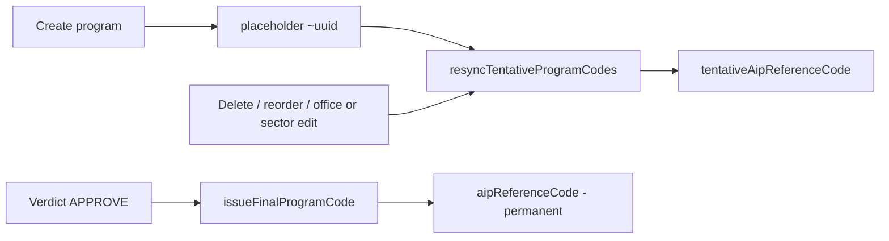

# Module: `aip-codes`

**Folder:** `api/src/aip-codes/`

## Purpose

Builds AIP reference codes for Programs and Project/Activities. It has one public
endpoint; most of its work is invoked internally by [`programs`](programs.md),
[`project-activities`](project-activities.md) and [`reference`](reference.md).

The two phases work differently, and the difference is the thing to hold onto:

- **Tentative codes are derived** — recomputed from current state on every event
  that could change them. No counter.
- **Final codes are issued** — drawn once from an atomic per-scope counter at
  final approval, then immutable.

## Endpoint

| Method | Path | Access | Description |
|---|---|---|---|
| POST | `/aip-codes/preview` | Authenticated | Preview the code a new program in this scope would get |

`previewProgramCode` counts live siblings and adds one. Because it is a count and
not a counter peek, it self-heals after a delete instead of drifting upward.

## Two-phase model



A create cannot compute its own rank before the row exists, so it writes a
`~{uuid}` placeholder and the resync fills in the real code — same transaction,
so nothing ever observes the placeholder.

## Code formats

**LGU** — 7 hyphenated segments, no prefix:

```
{papSector-4}-{lguLevel-1}-{officeType-2}-{officeCode}-{papClass-3}-{programCounter-3}-{paCounter-3}
```

e.g. `1000-2-02-18-001-000-000`. This is the city's own format, as printed in the
Annual Budget. `papClass` is segment 5 and the program counter **restarts inside
each section**; `officeCode` is emitted verbatim and unpadded, whitespace
stripped (`11 (1)` → `11(1)`). The city's `004` component bucket is never
generated — see `docs/design/aip-code-format-realignment.md`.

The **NCPC** 6-segment format (`NCPC-…`) was **removed** with the NCPC proponent
track — `AIPCodesService` builds only the LGU 7-segment format. (Final-counter
scope keys keep the literal `:LGU:` segment so existing counters stay stable.)

A root PA's code copies the parent program's leading segments and fills the final
PA slot; a nested activity appends a 2-digit `-NN` to its parent's code, at any
depth. Full segment sourcing is in
[`api/docs/aip-reference.md` §7](../../api/docs/aip-reference.md).

## How the tentative ordinal is derived

```
ordinal(program) = 1-based rank among live programs sharing
                   (aipCycleId, officeId, papSectorId, papClass),
                   by (papClass, orderIndex, createdAt)
                   — restarts in each papClass; null shares OPERATIONS

ordinal(PA)      = 1-based rank among live siblings sharing
                   (programId, parentProjectActivityId), by (orderIndex, createdAt)
```

`orderIndex` is the user-controlled rank set by the reorder endpoints;
`createdAt` breaks ties for rows never reordered.

`papClass` sorts ascending with nulls last — the enum is declared
`GAS, STO, OPERATIONS`, so ascending is the AIP form's I/II/III section order.
**This must stay identical to `AIPRegistryService.list`'s `orderBy`**: the ordinal
is a rank, so if the two disagree the codes print out of sequence in the table
that shows them.

Three implementation details that are easy to break:

- **Two-pass write.** `tentativeAipReferenceCode` is `@unique`, so renumbering
  `002→001, 003→002` collides mid-update. Every changed row is parked on a
  `~{id}` sentinel first, then written to its real code.
- **The PA park spans every reranked program.** When two programs swap ranks,
  program A's new PA codes are exactly the ones program B's PAs still hold, so
  `resyncTentativeProgramCodes` parks the PAs of *all* changed programs before
  cascading into any of them. Parking one program at a time collides.
- **Frozen rows reserve their ordinal.** `APPROVED` programs, and anything in a
  cycle that is not `OPEN`, keep their code — and their ordinal is skipped rather
  than reused, which would violate the unique index. This leaves permanent gaps
  and is a safe default, not a settled policy; see
  [`docs/design/tentative-aip-code-rework.md`](../design/tentative-aip-code-rework.md) §2.

## Counter scopes (final phase only)

Counters live in `AIPCodeCounter`, keyed by a `scopeKey` string. Increments use
Prisma's atomic `{ increment: 1 }` — no app-level read-modify-write.

| Counter | Scope key |
|---|---|
| LGU program final | `{cycleId}:LGU:{officeId}:{papSectorId}:{papClassCode}:final` |
| Root PA final | `{programId}:final` |
| Nested activity final | `pa-child:{parentProjectActivityId}:final` |

The papClass segment is in the key because the ordinal restarts per section. It
is keyed off the emitted **code**, not the enum, so unclassified programs share
the Operations counter — which they must, since they emit the same segment.

The matching `:tentative` keys are dead, and the migration deleted them along
with the pre-realignment `:final` keys (whose scope no longer matches anything
the service asks for). `prisma/restate-aip-codes.ts` reseeds the new ones.

## Services

**`AIPCodesService`**

| Method | Phase | Notes |
|---|---|---|
| `previewProgramCode` | tentative | Count + 1; consumes nothing |
| `resyncTentativeProgramCodes(scope, tx)` | tentative | Recomputes a whole `(cycle, office, sector)` scope, then cascades into each changed program's PAs |
| `resyncTentativePACodes(programId, tx)` | tentative | Recomputes a program's PA tree at any depth |
| `issueFinalProgramCode` | final | Consumes the counter |
| `issueFinalPACode` | final | Consumes the counter; parent must have a final code |

The resync methods take the caller's transaction client so they participate in
the same transaction as the mutation that triggered them.

> `issueTentativeProgramCode`, `issueTentativePACode` and `peek` were **deleted**
> in the derived-code rework. Two mechanisms writing the same column is how a
> reader ends up guessing which one is authoritative.

## Who calls the resync

| Caller | Trigger |
|---|---|
| `programs` | create, soft-delete, `officeId` / `papSectorId` / `papSubsectorCode` change, `PATCH /programs/reorder` |
| `project-activities` | create, delete, `PATCH /programs/:programId/project-activities/reorder` |
| `reference` | `PATCH /reference/offices/:id` when `officeCode` or `officeType` changes |

## Tables touched

`Program`, `ProjectActivity`, `AIPCodeCounter`, `PAPSector`,
`Office`, `AIPCycle`.

## Dependencies

`PrismaService`, [`reference`](reference.md) data (for code segments).

## Related

- [programs.md](programs.md) — resyncs on create/delete/scope change/reorder
- [project-activities.md](project-activities.md) — resyncs on create/delete/reorder
- [reference.md](reference.md) — office code/type edits cascade into codes
- [`api/docs/aip-reference.md` §7](../../api/docs/aip-reference.md) — full code spec
- [`docs/design/tentative-aip-code-rework.md`](../design/tentative-aip-code-rework.md) — why the counter was replaced
