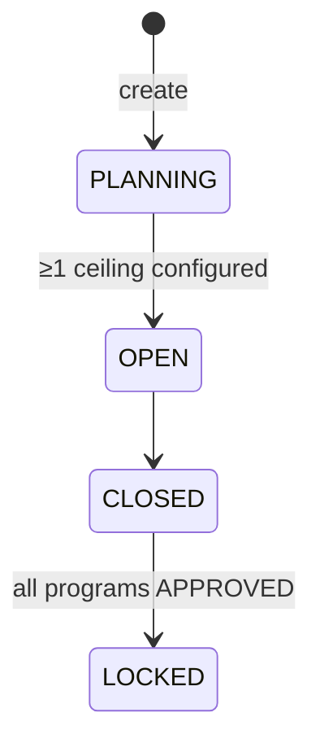

# Module: `aip-cycles`

**Folder:** `api/src/aip-cycles/`

## Purpose

Manages the `AIPCycle` — the AIP stage of a fiscal year's Budget Cycle
([budget-cycles.md](budget-cycles.md), specs/012). The cycle is the container every
program, ceiling, and counter is scoped to, and its status
(`PLANNING → OPEN → CLOSED → ADOPTED`) gates what mutations are allowed. Creating a
cycle creates its Budget Cycle too (`createAipCycle`); `GET /aip-cycles/:id` also
returns `budgetCycle` (stage) and `sections` (the public sections the year is in).

## Endpoints

| Method | Path | Access | Description |
|---|---|---|---|
| GET | `/aip-cycles` | Authenticated | List all cycles, newest fiscal year first, with ceiling & program counts |
| GET | `/aip-cycles/:id` | Authenticated | Get one cycle with its finish-line ceilings |
| POST | `/aip-cycles` | SUPER_ADMIN | Create a cycle (starts in `PLANNING`) |
| PATCH | `/aip-cycles/:id/status` | SUPER_ADMIN | Transition the cycle status |
| PATCH | `/aip-cycles/:id/public-comparison` | SUPER_ADMIN | Show or hide the year-on-year comparison on the public AIP Overview |
| PATCH | `/aip-cycles/:id/public-overview` | SUPER_ADMIN | `{ section: 'AIP' \| 'ANNUAL' \| 'PPMP', enabled }` — show or hide that public section's Overview tab for this year. Columns `public_{aip,annual,ppmp}_overview_enabled`, defaults **off / on / off**. Hidden: the tab is not offered and the Overview URL redirects to Browse |
| PATCH | `/aip-cycles/:id/open-data` | SUPER_ADMIN | Open or close the year's open data (download + `/open-data` API); also drops the public registry cache. See [open-data.md](open-data.md) |
| GET | `/aip-cycles/:id/special-funds` | `aip:read` | Each special fund's stated amount, live program sum and count, the `figure` LBP Form 7 prints, and derived `flags` (`STATED_WITHOUT_PPAS`, `STATED_DIFFERS`). Staff-only |
| PUT | `/aip-cycles/:id/special-funds/:fund` | SUPER_ADMIN (`reference:write`) | `{ statedAmount: "…" \| null, note? }` — set or clear a special fund's stated amount for the cycle. `fund` is `SPA`, `LDF` or `LDRRMF`; 404 for any other; 400 if negative |
| POST | `/aip-cycles/:id/aip-extended/preview` | SUPER_ADMIN (`reference:write`) | Multipart `file` (.xlsx, ≤10MB). Reads the workbook's AIP-Extended sheet and returns each coded row with its exact-code match (`exact` / `ambiguous` / `none`), near-miss `suggestionIds` (same code except the office-type segment), and every program in the cycle as `entries` to choose from. Writes nothing |
| POST | `/aip-cycles/:id/aip-extended/apply` | SUPER_ADMIN (`reference:write`) | `{ fileName?, rows: [{ programId, sheetRow, aipCode, indicator, target, sdgCodes }] }` — fills blank Performance Indicator and Target and adds SDG links on the chosen programs; a different existing value is kept and returned in `conflicts`. One edit-history row per changed program. 400 if an entry is chosen twice or is outside the cycle |

### AIP-Extended upload

The sheet's codes are meant to be the AIP's own, but offices type them by hand (IAS writes office type `02`
where the portal codes NCIASO `03`). So matching is exact only; anything else is a person's choice, made on
`/control-panel/aip-cycles/:id/aip-extended` with the chosen entry's current values on screen. Nothing is held
between preview and apply — apply re-reads every program, so the fill-blanks rule is applied to live values.
The parser is `src/aip-cycles/aip-extended.ts`, shared with the `db:import:aip-extended` / `db:seed:aip-extended`
commands. Like those commands, apply writes the live row of a published program too; the public keeps seeing the
published snapshot until the program is revised and republished.

## Status state machine

| Transition | Precondition |
|---|---|
| `PLANNING → OPEN` | At least one `FinishLineBudgetCeiling` exists for the cycle |
| `OPEN → CLOSED` | None — blocks new program creation and `DRAFT → SUBMITTED` |
| `CLOSED → LOCKED` | No non-rejected, non-deleted program is left un-`APPROVED` |

`SUPER_ADMIN` owns every transition. See
[architecture/workflow.md](../architecture/workflow.md) for how the cycle status
interacts with the program lifecycle.

While a cycle is `OPEN`, `SUPER_ADMIN` may still create missing finish-line
ceilings or update existing ones. Those ceiling changes are blocked once the
cycle reaches `CLOSED`, and deletes remain `PLANNING`-only.

## Services

- **`AIPCyclesService`** — cycle CRUD, the status state-machine validation, and
  cache management.
- **`SpecialFundsService`** — special funds' stated amounts, by fund (specs/008,
  016), and the pure helpers shared with LBP Form 7: `moneyOnSpecialFund` sums
  what every office's rows put on the fund (Form 4/7 attribution, working
  figures), and `specialFundFigure` lets that sum win, the stated amount
  standing in only when it is zero. Never read by public or open-data paths
  (invariant 22).

## Caching

Cycle list and detail reads are cached in Redis via
[`CacheService`](cache-redis.md) (TTL ~600 s). The cache is invalidated on
status change and on ceiling writes.

## DTOs

`CreateAIPCycleDto`, `UpdateCycleStatusDto`, `SetSpecialFundDto`.

## Tables touched

`AIPCycle`, `FinishLineBudgetCeiling`, `Program` (for counts and lock checks),
`FundStatedAmount`.

## Dependencies

`PrismaService`, [`CacheService`](cache-redis.md).

## Related

- [budget-ceilings.md](budget-ceilings.md) — the ceilings a cycle must have before opening
- [manual/administrator.md](../manual/administrator.md) — running a cycle
