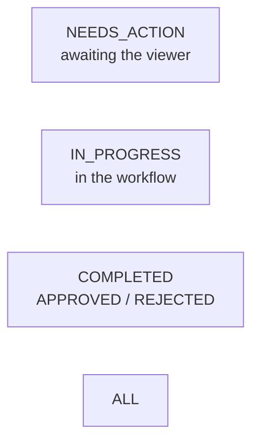
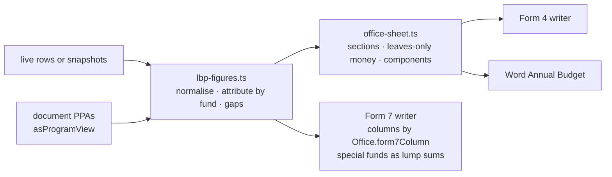

# Module: `aip-registry`

**Folder:** `api/src/aip-registry/`

## Purpose

Serves the **registry feed** — the dashboard view of programs grouped into
workflow tabs, with counts and filters. It also owns the registry's exports: the
cluster-scoped Excel workbook, the whole-city complete AIP workbook, the city's
own Annual Budget sheet as Word, and LBP Forms 4 and 7 (specs/008). The list
endpoint is a read-only, visibility-aware projection over `Program`; every
export is a read-only generator over the same domain data.

## Endpoint

| Method | Path | Access | Description |
|---|---|---|---|
| GET | `/aip-registry` | Authenticated | Tabbed registry feed: tab results + per-tab counts |
| GET | `/aip-registry/exports/cluster` | `aip:export` | Download the selected cluster workbook as `.xlsx` |
| GET | `/aip-registry/exports/complete` | `aip:export` | Download the whole-city AIP as `.xlsx` — an executive summary, a sheet per sector group, then a funding-source breakdown |
| GET | `/aip-registry/exports/annual-budget` | `aip:export` | Download the Annual Budget sheet as `.docx` — one office, or the whole book when `officeId` is omitted |
| GET | `/aip-registry/exports/lbp-form-4` | `aip:export` | LBP Form No. 4 as a protected `.xlsx` for one `fund` (default `GF`) and `figures` (`working` \| `published` \| `document` + `documentId`, required) — one office, or a sheet per office in scope |
| GET | `/aip-registry/exports/lbp-form-7` | `aip:export`, all-offices scope | LBP Form No. 7 (Statement of Fund Allocation by Sector) as a protected `.xlsx` for one fund |

## Tabs

The registry groups programs by where they sit in the workflow:



Which programs land in `NEEDS_ACTION` depends on the viewer's role:

- **Proponent STAFF** — own programs in `DRAFT` or `FOR_REVISION`, plus any of
  the proponent's programs carrying unresolved comment threads.
- **Proponent HEAD** — own-office `FOR_REVISION` programs returned by the LFC,
  `SUBMITTED` programs awaiting head-review, and `HEAD_REVIEWED` programs ready to
  submit for LFC approval.
- **Endorser HEAD** (the office has `canEndorse = true`) — *no* needs-action
  item from endorsement: endorsement is advisory and at-will (non-gating), so
  endorsers use the at-will endorse view rather than an action queue.
- **LFC member HEAD** (the office sits on the LFC `Committee`) —
  `PENDING_APPROVAL` programs with a `PENDING` `ProgramApproval` for that
  office. (LFC STAFF follow the normal proponent filter — an LFC office still
  prepares its own AIP.)
- **`SUPER_ADMIN`** — nothing; the SUPER_ADMIN verdict was removed (NCPC
  endorser pivot OD-3), so SUPER_ADMIN is a configurator/observer with no
  per-program action.

A HEAD whose office is *both* an endorser and an LFC member gets both
condition sets unioned.

## Filters

`tab`, `cycleId`, `finishLineId`, `officeId`, and a free-text `search` over the
program name, expected output, AIP code, or finish line. (The `proponentType`
filter was removed with the NCPC proponent track — every program is now `LGU`.)
The endpoint still accepts `clusterId` for cluster-scoped queries, but the
registry UI filters by finish line. Results are paginated (`pageSize` clamped to
1–1000, default 25); the response includes a count for every tab so the UI can
render tab badges without extra requests.

`officeId` matches the **owning** office only. It used to match owner *or*
supporting office, with the client stripping the supporting matches back out —
but only for HEAD and SUPER_ADMIN, so the same query returned different rows per
role, and an office's total included money it merely helped deliver.

> **Every filter is a conjunct under `AND`, never spread into one object.**
> `buildVisibilityWhere` returns `{ deletedAt: null, OR: [...office scope] }`, and
> the office and search filters carry their own `OR`. Spreading them let the last
> `OR` key win, which silently deleted the caller's office scope: a scoped user who
> typed in the search box saw every office's programs, drafts included. See the
> regression test in `aip-registry.service.spec.ts`.

## Ordering

```
fiscalYear desc → office.acronym asc → papClass asc → orderIndex asc → createdAt asc
```

Deliberately the same order `AIPRegistryExportService` prints in — one office at a
time, with the three appropriation sections inside it — so the screen and the
workbook agree. The registry UI groups by run-length (emit a header when the
office or the section changes) rather than sorting, so this order is a contract:
change it and the UI grows duplicate headers.

`papClass` sorts by enum declaration order, which is already
GAS → STO → OPERATIONS; `nulls: 'last'` puts unclassified rows immediately after
OPERATIONS, where the client folds them in — matching the export, which prints
them under `III. OPERATIONS`.

`orderIndex` before `createdAt`, both ascending: `orderIndex` is the rank within
the code scope that the AIP code's ordinal segment is derived from, so this prints
reference codes in ascending order.

## Presentation (staff registry)

The staff view does not paginate rows. It fetches the cycle in one request
(`pageSize` 1000) and groups client-side into collapsible per-office sections —
`client/src/lib/aip-grouping.ts`, unit-tested — because grouping is only correct
over the complete set: a page boundary splits an office and repeats its header,
and the old 10-row pages cut straight through a program's PPA subtree.

- Default view is one row per office, carrying its program count and total.
- Clicking an office opens its whole tree, programs and projects included.
- Programs needing attention show one amber marker, whose tooltip separates the
  two reasons a row can carry it, so a 241-row registry shows at a glance what
  needs an office's work:
  - **Import decisions to confirm** — stored `importWarnings`. Block publishing
    (`INCOMPLETE_IMPORT`) and clear only via *Mark import reviewed*.
  - **Data gaps** — `dataWarnings`, derived per row by `deriveDataWarnings` over
    the row's leaf PPAs (`leavesOf`), the same sentences `readinessFor` returns
    as advisory `warnings`. Block nothing and clear when the field is filled in.

  Gaps were originally kept off the row for fear of marking half the registry.
  Measured, that lands on one cycle: AB 2026 is already fully marked by import
  decisions and does not move, and 2027 goes from 94 marked rows to 155. One
  consequence is deliberate — *Mark import reviewed* does not always clear the
  marker, because the gaps are still there.

  The three fields the derivation needs and nothing else reads —
  `fundSources`, `implementationStartYear`, `implementationEndYear` — are in the
  PA select purely for it, and `aip-registry.service.spec.ts` pins them there.
- Every imported program and PPA row carries `source: { file, ref, url }` —
  built server-side by `src/common/source-link.ts` from `sourceDocument` +
  `sourceRef` — and the row shows it as a small **ECON r305** link beside the
  code, opening the city's Google Sheet at that row. Null (no link) for rows
  authored in the portal. The 2027 seed fills it from the workbook JSON's
  `sourceRow`. **Internal only** — public routes never return it (see
  `stripProvenance` in `public.md`).
- The public registry still paginates and is user-sortable; it passes neither
  grouping flag.

## Caching

The tab counts and the budget aggregate are cached in Redis under
`reg:counts:<hash>` (TTL 60 s), keyed by visibility scope + filters + `tab` but
**not** `page` — they are identical across every page flip and tab click, yet were
recomputed on each one.

**The rows are never cached.** They carry a per-user `hasUnread` flag, and the
person reading the registry is usually the person editing it, so a stale row would
be visible immediately. `total` is read off the active tab's count rather than a
separate `COUNT`.

Invalidated via `RegistryCacheService.invalidateRegistryCounts()` from program
create / soft-delete, publishing, and revision open / discard. See
[cache-redis.md](cache-redis.md) for the known rollup-drift gap.

## Visibility

The registry reuses the same visibility rules as [`programs`](programs.md) —
proponents see their own cluster, endorsers and admins see more. See
[programs.md → Visibility](programs.md#visibility).

For **cluster export**, the scope is intentionally narrower than read
visibility:

- **`STAFF` and `HEAD`** of a city office export their own organisation's cluster.
- **`LFC`** and **`SUPER_ADMIN`** users must choose the cluster explicitly.
- The generated workbook follows the format of the checked-in reference
  workbook `AIP 2027 - Safe & Secure Communities (1).xlsx`, including the
  template's merged header cells.

### Workbook layout rules

The per-office `Basic AIP Form` sheet renders the proponent's `Program →
Project → Activity` tree under three section headers, printed in this order:

| Section | Holds |
|---|---|
| `I. GENERAL ADMINISTRATIVE SERVICES` | programs with `papClass = GAS` |
| `II. SUPPORT TO OPERATIONS` | programs with `papClass = STO` |
| `III. OPERATIONS` | programs with `papClass = OPERATIONS`, **and** legacy programs with no `papClass` |

A program's whole subtree stays with it — PAs inherit the program's section. An
empty section keeps a single blank row so it still reads as a section. Within a
section:

- **Numbering** is generated as `3.{program}.{project}.{activity}…`, so a 3-tier
  proponent (e.g. CEPPIO's `A.` service → `1.` group → `a.` event) yields
  `3.1 → 3.1.1 → 3.1.1.1`. The stored entry name is used verbatim; only a leading
  outline prefix *followed by whitespace* is stripped, so names that legitimately
  begin with a number (`79th Charter Anniversary`) are preserved.
- **Parent rows** (a program, or a project with child activities) show only the
  AIP code + a **bold** description; schedule, funding and amount columns are left
  blank because their values roll up from the leaf rows below.
- **Leaf rows** carry the implementing office, schedule (`Mmm yyyy`), expected
  output, fund sources, and PS/MOOE/FE/CO/Total amounts (FE is column J; the
  template's Total moved to L, climate to M–N, typology to O). Column G lists the PA's
  `fundSources` in enum order (`GF, SEF`), abbreviated where the column is too
  narrow (`DONATIONS_GRANTS` → `DON/GRANTS`, `TRUST_FUND` → `TF`); rows with none
  print `GF`. Amounts are shown
  **in million pesos** with the `0.00` format; the underlying cell value keeps full
  precision (e.g. ₱25,000 → `0.025`) so the `TOTAL` row sums correctly.
- Sibling order follows `orderIndex`, then `createdAt` as a tiebreak.
- **Row positions are resolved once**, by `buildBasicLayout`, before anything is
  written. Sections are variable-length, and the `Extended AIP Form` sheet points
  at Basic rows *by formula* — deriving those positions as `start + index` drifts
  by one row per preceding section and lands the formula on a section header.
- Exports are capped by `AIP_EXPORT_MAX_ROWS` (default `10000`) before the
  workbook is rendered in memory. Requests over the cap fail with `413` so large
  clusters do not duplicate unbounded workbook buffers in the API process.

### Complete AIP workbook

`GET /aip-registry/exports/complete` is the whole city in one file — the
document the budget office used to maintain by hand, and the AIP document for
P3 (#96). Seven sheets:

| Sheet | Content |
|---|---|
| `Export Info` | Cover page: when it was generated and by whom (name, email, role, office), what it covers, a per-sheet total, and the two rules a reader needs to interpret the numbers |
| `Executive Summary` | The city's "Comparative" for this year only: per sector, each office's PS/MOOE/CO/Total and share of the sector, then the four sectors against the city total |
| `GENERAL PUBLIC`, `ECONOMIC`, `ENVIINFRA`, `SOCIAL` | One per `AipSectorGroup`: offices → `papClass` sections → program/PA rows, with a `SUB-TOTAL, <ACRONYM>` per office and a `TOTAL` |
| `Fund Source` | PS/MOOE/CO/Total per funding source, one block per sector group, then a city-wide `SUMMARY` |

`Export Info` exists because the file gets mailed around and printed: once it
leaves the portal nothing else records which cycle it came from or how old it
is. It is added to the workbook first so it opens as the cover, but **populated
last**, since it reports on the sheets that follow it.

Colour is in two layers, so hue carries information rather than decorating —
see [the design note](../design/aip-complete-export.md#colour):

- **Chrome**, slate `FF1E293B`, the same on every sheet: the frozen column
  header and the grand `TOTAL`. `Export Info` and `Fund Source` take it as their
  tab colour, since neither is a sector.
- **One hue per sector sheet** on its office bands, subtotals, `A2` label,
  matching Fund Source block and Excel **tab colour**: General Public blue
  `FF1447E6` (the portal's `--primary`), Economic amber `FFB45309`,
  Environmental & Infrastructure green `FF15803D`, Social purple `FF7E22CE`.
- **`papClass` headings stay on the city's own grey** `FFCCCCCC` — they repeat
  in every office block on every sheet, so colouring them would compete with the
  office band above and add nothing.

Bands span the sheet's full width and are applied after the row's values, so
empty cells are filled too; a fill that stops at the last written cell reads as a
ragged stripe. Arial throughout, as the city's workbook is, at sizes scaled for
screen rather than for large-format printing.

Rules specific to it — see
[`docs/design/aip-complete-export.md`](../design/aip-complete-export.md):

- **Which sheet an office prints on** is `Office.aipSectorGroup`, falling back
  to its PAP sector (1000/9000 → General Public, 3000/4000/5000 → Social,
  6000/8000 → Economic, uncoded → General Public). The column records only the
  nine offices the budget office files against their sector; the set is pinned
  in `prisma/data/offices.check.ts`.
- **Programs are grouped by `hostOfficeId ?? officeId`**, so a component program
  prints inside its host office's block.
- **Only leaf rows are summed.** `buildProgramRows` zeroes the money on program
  and parent rows, but rolls the climate amounts *up* into parents — summing
  every row gives the right money columns and double-counts CCA/CCM.
- **The grand total adds the `SUB-TOTAL` cells** (`=H11+H24+…`) rather than
  re-summing the data range, so a reader can trace it.
- **Funding source carries no amount unless the row is split by fund.** A PPA's
  total goes wholly to the single fund it cites; PPAs citing none default to
  `GF`; PPAs citing several land on a `MULTIPLE SOURCES` row rather than being
  divided evenly, which would invent a split the data does not contain. A row
  **split by fund** (`FundAllocation`) prints one line per fund — the first with
  the code and description, the rest with only a fund and its money
  (`ExportRow.continuation`) — so each fund's money lands in its own row here.
- **It is city-wide or nothing.** A caller whose office scope is not `ALL` gets
  `403` rather than a "city total" that covers only their offices.
- Unlike the cluster export it is **built directly, not from a template** — a
  plain 14-column grid, so a template would only bring back the `duplicateRow`
  shared-style trap.

### LBP Forms 4 and 7

Read-only workbooks for the technical budget hearings (DBM *Budget Operations
Manual for LGUs, 2023*). Two choices are made at export and printed on the
**Notes** sheet (the first sheet), which also lists every gap that shaped the
form: programs not yet published (working figures), rows with no fund source
(counted as General Fund), unsplit multi-fund rows (left out), offices with no
Form 7 column, and special funds' stated amounts.

| Choice | Meaning |
|---|---|
| `figures=working` | every live program, drafts included; every sheet carries a **DRAFT** banner |
| `figures=published` | each program's last published snapshot; a program being revised prints what the public sees; never-published programs are left out |
| `figures=document` + `documentId` | a **submitted LEP or enacted Ordinance** of the year (specs/012 P6), read through `asProgramView` into the same `SheetProgram` shape; a draft document is refused (400). The Notes sheet names the document |
| `fund` | only money attributed to that fund (invariant 21/23) |

Every form loads through one dispatcher, `loadLbpSource` (`lbp-figures.ts`);
`loadDocumentPrograms` reads a document's PPAs by sheet office. The **Word Annual
Budget** prints the year's enacted Ordinance once there is one (a year whose AIP
rows were retired still exports), otherwise the AIP's programs.



- **Form 4** — one sheet per office (sheet name = acronym): header block, GAS /
  STO / Operations each with a sub-total, the `COMPONENT PROGRAMS` band, TOTAL
  (and GRAND TOTAL with components), PS / MOOE / FE / CO / Total in pesos, and
  blank signature lines (Department Head; LFC: CPDC, CBO, City Treasurer; City
  Mayor — names come with #164). File `LBP4-<year>-<office|ALL>-<fund>[-DRAFT].xlsx`.
- **Form 7** — one sheet: receipts block and per-account-code rows laid out but
  blank (no object-level data yet), A–D class sub-totals per column, TOTAL
  APPROPRIATIONS, the three lump sums in the General Public Services column,
  GRAND TOTAL. On the General Fund form each lump sum (SPA, LDF, LDRRMF) is
  what every office's rows put on that fund, else its stated amount; those rows
  are not General Fund money, so they are in no column. On any other fund's form
  the lump sums print zero and the fund's money is in the office columns
  (specs/016). Refused (403) unless the caller sees every office.
- Every sheet is protected (`selectLockedCells`/`selectUnlockedCells`): copyable,
  not editable without removing protection — a guard against accidents, not
  proof of authenticity.
- Logged as `LBP4_OFFICE`, `LBP4_BOOK` or `LBP7` with `{ cycleId, officeId, fund, figures }`.

## Services

- **`AIPRegistryService`** — tab classification, per-tab counts, visibility
  filtering, pagination.
- **`AIPRegistryExportService`** — validates export scope, loads the workbook
  template from `api/templates/` with path containment checks, populates the
  cluster workbook, and records an export log as `PENDING → GENERATED | FAILED`.
- **`AIPCompleteExportService`** — the whole-city workbook. Asserts `ALL_OFFICES`
  scope, buckets offices by `resolveSectorGroup`, renders the four sector sheets
  and the funding-source sheet, and records the same `PENDING → GENERATED |
  FAILED` log with `type = COMPLETE_AIP`.
- Shared by both `.xlsx` exports: **`export-rows.ts`** (the `ExportRow` shape and
  the recursive `buildProgramRows` flattener) and **`excel-style.ts`** (cell
  styling, `toExcelAmount`, fund-source labels, the row cap). They are shared
  rather than copied so the two exports cannot drift on how an amount reaches a
  cell.
- **`ABExportService`** — the city's Annual Budget sheet as Word: the office
  header block, the three appropriation sections, the `COMPONENT PROGRAMS` band
  grouped by the office each program belongs to, and TOTAL / TOTAL, COMPONENT
  PROGRAMS / GRAND TOTAL. Built with `docx` rather than filled from a template,
  because every row is formatted by *type* (heading, program, activity,
  subtotal, band) and the Major Final Output column merges vertically across the
  run of rows that share a value — neither of which a flat template loop can
  express. Money comes from the estimate/proposed family, never the line-item
  rollups. Scope is enforced in the service: a caller holding part of the city
  exports only their own offices.

  Verified by round-trip — exporting the City Events, Protocol and Public
  Information Office's 2026 sheet reproduces `AB_YEAR_TEMPLATE.docx`, which is
  that office's real FY2026 sheet. Since specs/008 it builds its rows with the
  shared `office-sheet.ts` and carries an FE column; a nested PPA parent now
  prints no amount (its children carry it), which fixed a double count in the
  office TOTAL on nested 2027 programs.

  **Special funds print on their own sheets** (specs/016 US2.3), after the
  offices, in Form 7's order: Special Purpose Appropriation, 20% Development
  Fund, 5% LDRRMF. A program goes there when `specialFundOf` says so (its own
  fund, else a fund every PPA carries); it is left off its office's sheet. The
  header names the fund and cites its `FundRule.legalBasis`. This is
  presentation only: the row is still owned by its office everywhere else. On
  the FY2026 Ordinance the book's sheets add up to ₱2,122,357,059, with SPA
  ₱106,447,471, LDF ₱245,092,055 and LDRRMF ₱106,117,853.
- **`LbpForm4ExportService`**, **`LbpForm7ExportService`** — LBP Forms 4 and 7 on
  `lbp-figures.ts` + `office-sheet.ts` + `lbp-workbook.ts` (Notes sheet, DRAFT
  banner, signatures, protection, export log).

## DTOs

`ListRegistryDto` (tab + filter query params).

## Tables touched

`Program`, `ProjectActivity`, `ClimateChangeTag`, `FundAllocation`,
`ProgramVersion` (published snapshots), `Office`, `FundStatedAmount` (Form 7
only), `AIPExportLog` (append-only audit log).

## Dependencies

`PrismaService`, `exceljs`, workbook template file at the repo root,
[`programs`](programs.md) visibility helpers, [`CacheService`](cache-redis.md).

## Related

- [programs.md](programs.md) — the underlying entity and workflow
- [architecture/frontend.md](../architecture/frontend.md) — how the registry UI consumes this
