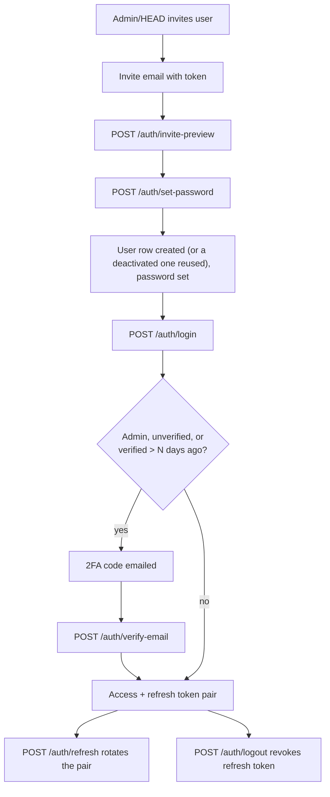

# Module: `auth`

**Folder:** `api/src/auth/`

## Purpose

Owns user identity and the token lifecycle: login, invitation acceptance, email
verification (2FA), password reset, and refresh-token rotation. It also exposes
the public JWKS endpoint so tokens can be verified with the public key.

## Endpoints

All auth endpoints are `@Public()` except change-password. Logout is public because the refresh token in its body is the secret being revoked, and the client logs out after its access token may have expired.

| Method | Path | Access | Description |
|---|---|---|---|
| POST | `/auth/login` | Public | Authenticate; returns an access + refresh token pair |
| POST | `/auth/verify-email` | Public | Submit the 6-digit 2FA code emailed to the user, with the `challenge` the login's 401 returned. The challenge (HS256, 15 min) proves the password step passed, so an email address alone can neither request nor redeem a code. The fixed code `000000` exists only with `AUTH_FIXED_OTP=1`, and never under `NODE_ENV` staging or production |
| POST | `/auth/resend-verification` | Public | Re-send the email 2FA code; needs the login's `challenge` |
| POST | `/auth/set-password` | Public | Accept an invite and set the initial password |
| POST | `/auth/invite-preview` | Public | Preview name, role, and office details for a valid invite token |
| POST | `/auth/forgot-password` | Public | Request a password-reset link |
| POST | `/auth/reset-password` | Public | Set a new password using the reset token |
| POST | `/auth/change-password` | Authenticated | Change password while signed in; verifies the current password, then revokes all other sessions and re-issues a fresh pair for the current device |
| POST | `/auth/refresh` | Public | Rotate the refresh token; returns a new pair |
| POST | `/auth/logout` | Public | Revoke the refresh token in the body |
| GET | `/.well-known/jwks.json` | Public | Public key set for JWT verification |

## Authentication model

- **RS256 (asymmetric) JWT.** The API signs with a private key; consumers verify
  with the public key published at `/.well-known/jwks.json`.
- **Token pair.** A short-lived access token (~15 min) and a longer refresh
  token (~7 days). Refresh tokens are stored as SHA-256 hashes in
  `RefreshToken`; the raw value is shown to the client once.
- **Email verification (2FA).** A 6-digit code (`crypto.randomInt`), bcrypt-hashed
  in `EmailVerification`, valid 15 minutes; sending one voids every earlier unused
  code. **`SUPER_ADMIN` gets a code at every sign-in**; other roles every
  `EMAIL_VERIFICATION_DAYS` (default 30). Expired/used rows are kept for audit.
- **Lockout.** Five `LOGIN_FAILED` audit rows (wrong password or wrong code) for an
  account within 15 minutes → `429` on `login` and `verify-email` until the window
  passes. No extra state: it counts `UserAuditLog`.
- **Rate limit.** `ThrottlerGuard` on the controller, 30 requests per 15 minutes per
  visitor IP (`refresh`, `logout`, `change-password` exempt). The tracker reads
  `X-Real-IP`, which the client's server actions forward (`client/src/lib/visitor-ip.ts`)
  and nginx overwrites at the edge; the module config is in `AppModule`.

`POST /auth/set-password` reuses an existing user row when the invited email
belongs to a **deactivated** account, so a returning staff member keeps their id
and history. See [users.md](users.md#re-inviting-a-deactivated-account) for the
full rule, including the `409` when the account is reactivated mid-flight.

## Token lifecycle

### Rotation sequence

When `POST /auth/refresh` is called the service executes these steps atomically:

1. SHA-256 hash the raw refresh token received from the client.
2. Look up the `RefreshToken` row by hash.
3. Reject (`401`) if the row is missing, `revokedAt` is set, or `expiresAt` is in the past.
4. Set `revokedAt = now` on the old row — token is single-use from this point.
5. Call `issueTokens()` — generates a new RS256 access token and a new 128-byte hex refresh token, persists the hash of the new refresh token, and returns the raw pair to the caller.

The raw refresh token is returned to the client **once** and never stored on the server.

### Client-side auto-refresh (Next.js middleware)

`client/src/middleware.ts` intercepts every request to a protected route:

| Condition | Action |
|---|---|
| `access_token` cookie present and not expired | Pass through immediately |
| `access_token` missing or expired, `refresh_token` cookie present | Call `POST /auth/refresh` server-side; set fresh cookies; redirect to same URL |
| `refresh_token` cookie absent | Clear cookies, redirect to `/login` |
| Refresh call returns non-2xx | Clear cookies, redirect to `/login` |

The refresh token is a random hex string — not a JWT — so it has no embedded expiry. Its validity is checked entirely server-side on the `POST /auth/refresh` call. Client-side expiry is handled by the 7-day `maxAge` of the `refresh_token` cookie; if the cookie is absent the browser never sends it, triggering the "absent" branch above.

### Session scenarios

| Scenario | Middleware behaviour | API behaviour |
|---|---|---|
| Fresh login | Sets both cookies (15 min / 7 day `maxAge`) | — |
| Access token expires, refresh valid | Silent rotation; user stays on page | — |
| Access token deleted/expired, refresh revoked | Calls refresh → 401 → `/login` | `POST /auth/refresh` → 401 |
| Refresh token expired (cookie gone) | Redirect to `/login` (no cookie = no call) | — |
| Logout | Clears both cookies; redirect to `/login` | `POST /auth/logout` → 200, `revokedAt` set |
| Revoked refresh + still-valid access | Access token passes middleware; user keeps working | — |
| Revoked refresh + access expires | Refresh call returns 401 → `/login` | `POST /auth/refresh` → 401 |

### Security properties

- **SHA-256 storage** — `RefreshToken.token` stores only the hash; the raw token is shown to the client once and never logged.
- **Single-use enforcement** — `revokedAt` is set before `issueTokens()` runs; a replayed old token returns 401.
- **Asymmetric signing** — access tokens are RS256-signed; only the API holds the private key.
- **HttpOnly cookies** — both tokens are stored in `httpOnly; SameSite=Lax` cookies; JavaScript on the page cannot read them.

### Tests

| File | What it covers |
|---|---|
| `api/src/auth/auth.service.spec.ts` | Service-layer unit tests: valid rotation, revoked/expired/unknown token rejection, logout idempotency |
| `api/test/auth-token-lifecycle.e2e-spec.ts` | HTTP endpoint tests: login, refresh, revoked-refresh 401, logout |

## Services

- **`AuthService`** — login, email verification and OTP management, token-pair
  generation, invite preview, and the password lifecycle (set / forgot /
  reset). Uses `bcrypt` for password and code hashing and `node:crypto` for
  token generation.
- **Every DTO carrying an email for a `User.email` lookup or write**
  (`LoginDto`, `VerifyEmailDto`, `ResendVerificationDto`, `ForgotPasswordDto`,
  `InviteUserDto`) applies `@NormalizeEmail()`
  (`auth/validators/normalize-email.decorator.ts`) before `@IsEmail()` —
  lowercases and trims the value via `class-transformer`. `User.email` has
  no case-insensitive collation and every Prisma lookup was an exact match,
  so a login typed in different casing than the stored row failed with the
  same "Invalid credentials" message as a wrong password. `seedSuperAdmin`
  lowercases `SEED_ADMIN_EMAIL` the same way, so the seeded row and every
  normalized lookup agree.

## Guards & decorators (consumed app-wide)

- **`JwtGuard`** — global `APP_GUARD`; validates the Bearer token and injects
  the `JwtPayload`.
- **`RolesGuard`** — global `APP_GUARD`; enforces `@Roles(...)`.
- **`@Public()`** — opt a route out of `JwtGuard`.
- **`@Roles(...)`** — restrict a route to specific roles.
- **`@CurrentUser()`** — inject the `JwtPayload` (`sub`, `role`, `email`,
  `officeId`, `civilSocietyOrganizationId`, `identityType`).

## DTOs

`LoginDto`, `VerifyEmailDto`, `ResendVerificationDto`, `InvitePreviewDto`,
`SetPasswordDto`, `ForgotPasswordDto`, `ResetPasswordDto`, `RefreshTokenDto`.

## Tables touched

`User`, `EmailVerification`, `RefreshToken`, `UserInvite`,
`PasswordResetToken`, `LGUUser`, `NCPCUser`.

## Dependencies

`JwtModule`, `PrismaService`, [`MailService`](mail.md), `ConfigService`.

## Related

- [users.md](users.md) — invitation creation
- [`api/docs/aip-reference.md` §5](../../api/docs/aip-reference.md) — RBAC matrix
