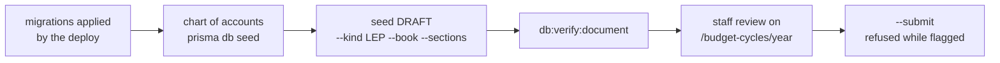

# Module: `budget-documents`

**Folder:** `api/src/budget-documents/` · **Spec:** `specs/012-budget-cycle-model` · ADRs [0001](../adr/0001-budget-documents-share-row-tables.md), [0004](../adr/0004-own-amount-plus-derived-total.md)

## Purpose

The **LEP** (the Executive Budget the Mayor proposes) and the **Ordinance** (the
appropriation ordinance as enacted) of a Budget Cycle — see [`CONTEXT.md`](../../CONTEXT.md).
Both have the same two tables, so they share rows and differ by `kind`:

```
BudgetDocument (cycle, kind LEP | ORDINANCE, status)          one of each kind per cycle
 ├── LepDetail | OrdinanceDetail                               header per kind
 ├── BudgetItem        by-PPA (MVMMFOPIT): own PS/MOOE/FE/CO, total = own + Σ children
 ├── BudgetObjectLine  by-object (PAOO): office × account × fund × budget year (+ past/current years)
 ├── BudgetReceiptLine Receipts Program: GF tree + each enterprise's own sheet   (specs/017)
 ├── BudgetIndebtedness LBP Form 5 · BudgetStatutoryObligation LBP Form 6
 ├── BudgetPrintedTotal Form 7, summaries, PS ceiling, receipts totals — checked, never summed
 ├── BudgetOfficeHeader each office's mandate / vision / mission / outcomes as this book prints it
 └── BudgetDocumentAuditLog
```

```
DRAFT ──finalize──► SUBMITTED (LEP) | ENACTED (Ordinance)        frozen; no reopen
          └─ ENACTED refused while any PPA carries an import warning
```

Documents are created by `db:seed:document` from a year's book JSON (`db:import:2026`, or
`db:import:pdf` for a scanned year) and, for 2026, the ordinance `.xls` (specs/012 P3) or by carry-forward from the AIP (P6), not over HTTP.

**Special-fund sheets (specs/016).** A year with `api/prisma/data/special-fund-offices-<fy>.json`
seeds its SPA, LDF and LDRRMF sheets too: each row gets `fundSource` and an office — the code's own
office if it names a live one, else the file's row entry, else the file's default for the fund (LDRRMF
→ CDRRMO). A row nothing settles stops the seed. SPA's "I. 20% LOCAL DEVELOPMENT FUND" and "J. 5%
LDRRMF" lines are those sheets printed again: checked as totals, not seeded — and not stored as object
lines either, where the .xls letters them "H. 20% …" / "I. 5% LOCAL RISK …" (`isRollUpName`, one rule
for both imports). Before 2026-11-10 the object import stored them and counted ₱351,209,908 twice;
`db:repair:object-rollups -- --dry-run` removes them from an Ordinance seeded earlier. A row the ordinance prints
only a code for is named by its code and flagged, so it blocks enacting until someone names it.
`db:verify:document` ties each fund to its sheet's own printed figure (SPA: `TOTAL, SPA`) and the
document to the cycle's stated total, and fails an Ordinance whose object lines do not sum to its PPAs
(FY2026: ₱2,122,357,059 both) or still hold a roll-up line; an LEP only reports both. The file is checked by `prisma/special-fund-offices.check.ts`.

**The rest of the book (specs/017).** The seed also writes the Receipts Program, Forms 5 and 6, the
totals the book prints, and each object line's past-year and current-year columns: from the same
`.xls` (`budget-book-sections.ts`), or a scanned year's `ab-<fy>-sections.json`. On a document that
already exists, even an enacted one, `--backfill-sections` writes them without touching the PPAs. It
replaces the object lines only if no office's budget-year total changes. Printed codes resolve to
`ChartAccount` (COA's LGU chart) as account + city suffix (`40102-040-01` → `4-01-02-040` + `01`).
Receipt headings come from the sums the book prints, because the markers (`1.`, `A.`) repeat at
different depths. `db:verify:document` checks every receipts program, Form 5 and Form 6 against
its printed total and needs ≥ 98% of codes to resolve. It reports the PS ceiling and printed titles
that don't match their code. `db:check:book` is the parsers' assert check.

**Scanned years (specs/017 phases 5–7).** `db:import:book` reads each by-object sheet, the Receipts
Program and Forms 5–7 through `lib/ocr-grid.py`. That script finds the table's rules and splits each
ruled row into its printed lines. The importer then reads the result into the same sections shape as
the .xls book, and writes a report of what tied: a sheet's lines against its TOTAL, a line's 1st +
2nd semester against its current-year total, and receipt headings against their rows. Offices come
from the sheet's "Office:" line, or from FY2023–24's file names (`data/book-office-aliases.json`
maps the printed names). A program's sheet goes to its parent office. A subtotal whose label OCR set
on another line is recognised by its sum. Because these documents are already public, a sections file
with problems is refused on them unless a reviewer passes `--accept-problems`.
`db:report:cross-year` writes the year-before comparison for several years at once.
`db:mirror:sources` copies the portal's PDFs to DO Spaces under `sources/<year>/<file>`.

## Endpoints

| Method | Path | Access | Description |
|---|---|---|---|
| GET | `/budget-documents?budgetCycleId` | `budget:read` | List documents |
| GET | `/budget-documents/:id` | `budget:read` | Header, root `total`, `flaggedItemCount` |
| GET | `/budget-documents/:id/items?officeId&rootItemId&flagged` | `budget:read` | PPAs in the caller's office scope (office or host office); empty scope reads nothing |
| GET | `/budget-documents/:id/object-lines?officeId` | `budget:read` | By-object lines in scope |
| GET | `/budget-documents/:id/audit` | `budget:read` | History |
| POST | `/budget-documents/:id/items/:itemId/acknowledge-import` | `budget:write` | Clear one PPA's import warnings (DRAFT only) |
| POST | `/budget-documents/carry-forward` | `budget:write` | Start the year's DRAFT LEP from its adopted AIP (`{ aipCycleId }`): every program and PA as a PPA (source links kept), fund-split rows as one PPA per fund, unsplit multi-fund rows flagged and listed, tags copied; object lines from approved Indicative PPMP lines by office × account × fund. 409 `AIP_NOT_ADOPTED` / `AIP_EMPTY` / `LEP_EXISTS` |
| POST | `/budget-documents/:id/finalize` | `budget:write` | LEP → SUBMITTED, Ordinance → ENACTED. 409 `DOCUMENT_HAS_IMPORT_WARNINGS` (with the PPAs) / `DOCUMENT_FROZEN` |

`budget:read` is in the CPDO Head, CPDO Secretariat, CMO, CBO and Office Head
templates; `budget:write` in CPDO Head and CBO.

## Provenance

Every PPA and object line names its file (`sourceDocumentId` → `SourceDocument`), the page when the
file has pages (`sourcePage`), and its place in the file (`sourceRef`). The reads return them as one
`source` link (`common/source-link.ts`), and the staff viewer shows it under each PPA, beside each
object line and in the import review. FY2026: PPAs cite the city's `.doc` (`table N row M`; no
pages, a `.doc` stores none), object lines the `.xls` (`Sheet!rN`). A carried-forward LEP PPA cites
its AIP row's workbook cell; a per-fund child cites its parent's. A year read from the portal's
scans (`import-budget-pdf.ts`) cites each office's own PDF by its portal URL, with the page and the
grid row (`page 2`, `row 14`). In the staff viewer such a reference opens the scan in a side panel at
that page (the browser's own PDF viewer, framed from the client route `/api/source-pdf`, which proxies
only the portal's uploads: the portal sends no CORS headers and our CSP frames only our own origin).
Other references (Google Sheets cells, the 2026 `.doc`) still open in a new tab.

## Scanned years (P7)

The portal's FY2011–2025 budgets are scanned PDFs. `import-budget-pdf.ts` reads them by OCR
(`lib/ocr-table.py`) into the same book JSON the 2026 `.doc` produces, and the same seed and gate
take it from there. Nothing OCR reads is trusted on its own:

| Check | Fails → |
|---|---|
| a row's PS + MOOE + CO = its Total (re-read cropped at 2× and 3× first) | that row is flagged |
| a printed sub-total / total = the lines above it | those lines are flagged |
| the sheet's lines = its printed grand total | every line on the sheet is flagged |
| a code had to be repaired or completed | that row is flagged |

Flags are import warnings, so the Ordinance cannot be enacted until a person has checked each one
against the scan. A year with no AIP gets an empty, adopted AIP cycle at seed time (the public site
keys years on it); the interim historical rule needs a public program, so that year shows nothing
publicly until its Ordinance is enacted. Progress and per-year results:
`docs/design/ocr-import-progress.md`, `docs/design/ab-<year>-ocr-report.md`.

**Office headers.** Each sheet's first page prints the office's mandate / legal basis, vision,
mission and organizational outcome. `lib/ocr-header.py` reads that block with positions: a value
line goes to the last label (in the leftmost column) whose top is level with or above the line's
top, because labels are centred beside values that start higher and a height-sorted list put
values under the wrong label. RapidOCR drops spaces; long runs are re-spaced (wordninja) only when
every short piece is a common word, so a run with a misread word stays as read. The seed stores
them in `BudgetOfficeHeader`, one row per document and office (several sheets of one office: each
field from the first that prints it), cited to the sheet's page 1. It never writes the office's own
header. The import report's **Office headers** section lists every one for checking against the scan.
Known gap: a box RapidOCR draws over two printed lines reads only the first (CPDO FY2025's outcome).

## Loading a year onto an environment (specs/017 T081)

The book JSON and sections files are committed (`api/prisma/data/ab-<year>-{book,sections}.json`),
so loading needs no OCR. Order, per environment (dev first; staging and prod take a backup first):



```bash
pnpm --filter api db:seed:document -- --year 2025 --kind LEP \
  --book prisma/data/ab-2025-book.json --sections prisma/data/ab-2025-sections.json [--dry-run]
pnpm --filter api db:verify:document -- --year 2025 --kind LEP --book prisma/data/ab-2025-book.json
pnpm --filter api db:seed:document -- --year 2025 --kind LEP --submit   # after review
```

- **`chart_accounts` comes only from `prisma db seed`** (`seedChartOfAccounts`). The deploy pipelines run
  migrations only, so on an environment that has not been reseeded since 2026-11-08 the table is empty and
  every book line seeds unresolved. Seed it first.
- A DRAFT is visible to staff with `budget:read` and nowhere public, so a DRAFT on dev is the place for
  others to review. Re-seeding a DRAFT replaces it — and **drops any rows already marked reviewed** — so
  fix and re-seed before review starts, not during.
- Run seeds against a remote database detached (`nohup … & disown`); a year takes minutes in one transaction.

## Staff UI (P4)

| Path | What |
|---|---|
| `client/src/app/budget-cycles/page.tsx` | Every document by year (Budget Documents in the staff nav, shown with `budget:read`) |
| `client/src/app/budget-cycles/[year]/documents/[id]/page.tsx` | One document: By PPA, By object of expenditure, Import review, History (`?tab=`); the Enact / Submit panel on a DRAFT for `budget:write` |
| `client/src/app/budget-cycles/_actions.ts` | `acknowledgeBudgetItem`, `finalizeBudgetDocument` |
| `client/src/lib/budget-document-tree.ts` | Office groups and depth-first PPA order (the public registry's order) |

`/budget-cycles` is in `PROTECTED_PREFIXES`. An adopted AIP year with no live
programs (FY2026 after the re-import) points to it from the AIP Registry. Not built
yet: the per-PPA drawer route, staff comments on PPAs, and the AIP → LEP → Ordinance
comparison, which waits for a real LEP (#95).

## Services

- `BudgetDocumentsService`: reads, `finalize`, `acknowledgeImport`, `recomputeTotals`
  (own + Σ children for every PPA; refuses an inconsistent `rootItemId`),
  `assertDraft` (every write calls it), `record` (audit).
- `budget-item-view.ts`: `subtreeAmounts` (the tree math) and `asProgramView`, which
  presents a root PPA and its tree in the `ProgramVersion.snapshot` shape the AIP
  readers consume (public registry, open data `mapProgram`, LBP `toSheetProgram`), with
  a synthetic `<id>~own` leaf for a parent's own money so leaf-summing readers
  count it once.

## Tables

`budget_documents` (unique `(budget_cycle_id, kind)`), `lep_details`,
`ordinance_details`, `budget_items` (CHECKs: one source at most, root consistency,
non-negative own amounts, `total ≥ own`), `budget_object_lines`,
`budget_document_audit_logs`, `budget_item_thematic_tags`;
`program_comments.budget_item_id` (CHECK: exactly one target).
