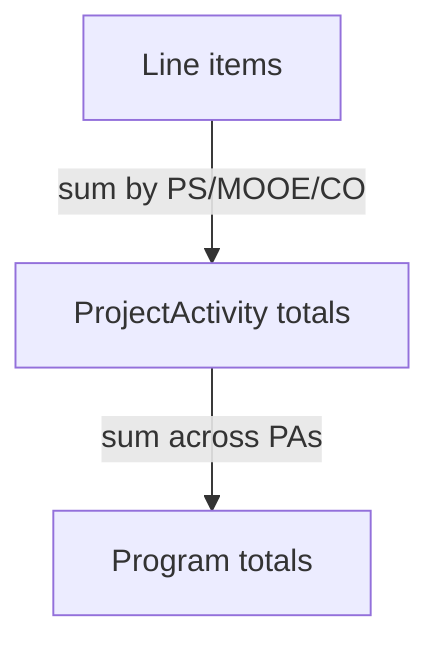

# Module: `budget-rollup`

**Folder:** `api/src/budget-rollup/`

## Purpose

A cross-cutting service with **no controller**. It maintains the denormalised
budget totals (`psTotal`, `mooeTotal`, `coTotal`, `grandTotal`) cached on every
`ProjectActivity` and `Program`. Those totals exist so the registry and drawers
can show budgets without summing line items on every read.

## Why it exists

`Program` and `ProjectActivity` totals are **caches**. They are correct *only*
because every line-item mutation flows through a service that recomputes them in
the same transaction. Direct DB writes that bypass the services break this
invariant — see [`api/docs/aip-reference.md` §6 invariant 5](../../api/docs/aip-reference.md).

## Service

**`BudgetRollupService`** — three methods, all transaction-aware:

| Method | What it does |
|---|---|
| `recomputeProjectActivity(paId, tx)` | Sums the PA's line items by expense class, stamps the PA's totals |
| `recomputeProgram(programId, tx)` | Sums the program's PAs, stamps the program's totals |
| `forceRecomputeProgram(programId)` | Rebuilds the entire tree from scratch — drift repair |



## Phase 1 cost estimates

**`EstimateRollupService`** is a deliberately separate service in the same folder
(`estimate-rollup.service.ts`). `BudgetRollupService` owns the line-item
invariant; this one owns the Phase 1 estimate family, so a change to either
cannot silently move the other.

| Row | Derived how |
|---|---|
| PA, `DIRECT_COSTS` | `proposedBudget = ps + mooe + co` (all three `NULL` ⇒ the manual figure is preserved — legacy imports) |
| PA or program split by fund | `ps/mooe/co` = **Σ** `FundAllocation` lines; `fundSources` = their funds (invariant 21) |
| PA, `ACTIVITY_CHILDREN` | each estimate and `proposedBudget` = **Σ** children's; `fundSources` = **∪** children's |
| Program | `ps/mooe/coProposedTotal` = Σ root PAs' estimates; `proposedTotal` = Σ root PAs' `proposedBudget` |

The fund-source union is the one non-arithmetic derivation: a derived parent
draws on whatever its children draw on, so the Add Project form does not ask for
it. `aggregate` cannot union arrays, hence the extra child read; the result is
ordered by the `FundSource` enum so the list reads identically everywhere.

## Transaction discipline

`recomputeProjectActivity` and `recomputeProgram` **always** participate in the
caller's transaction — they accept a `tx` client and never open their own. The
typical caller pattern (from `line-items.service.ts`):

```ts
await this.prisma.$transaction(async (tx) => {
  await tx.lineItem.create({ ... });
  await this.rollup.recomputeProjectActivity(paId, tx);
  await this.rollup.recomputeProgram(programId, tx);
});
```

`forceRecomputeProgram` is the exception — it is the standalone repair path,
exposed through the [`admin`](admin.md) module.

## Consumers

[`line-items`](line-items.md), [`project-activities`](project-activities.md),
[`programs`](programs.md) (workflow service), [`admin`](admin.md).

## Tables touched

`Program`, `ProjectActivity`, `LineItem` (read).

## Related

- [admin.md](admin.md) — the drift-repair endpoint
- [line-items.md](line-items.md) — the rollup cascade in action
