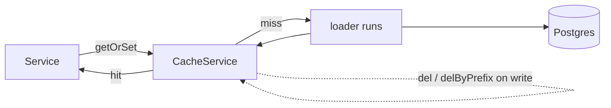

# Modules: `cache` & `redis`

**Folders:** `api/src/cache/`, `api/src/redis/`

Two small foundational modules. `redis` owns the connection; `cache` is a JSON
cache facade built on top of it. Neither has a controller.

## `redis`

- **`RedisModule`** — provides separate command and subscriber Redis clients.
  Other modules that need raw Redis (notably [`events`](events.md) for pub/sub)
  consume those providers.
- Connection is configured from `REDIS_URL`. In the Compose stack it is
  `redis://redis:6379` (set in `docker-compose.yml`).
- If `REDIS_URL` is unset, Redis providers resolve to `null` and the API falls
  back to in-process cache/SSE behavior.

## `cache`

- **`CacheService`** — a typed JSON cache facade over Redis:

  | Method | Purpose |
  |---|---|
  | `getOrSet<T>(key, ttlSeconds, loader)` | Return the cached value or run `loader`, cache it, return it |
  | `del(key)` | Invalidate one key |
  | `delByPrefix(prefix)` | Invalidate every key under a prefix |

- It is **defensive** — store errors are swallowed and logged as warnings, so a
  Redis hiccup degrades to a cache miss rather than a request failure.
- The backing store is resolved through a `CACHE_STORE` injection token (a
  Redis-backed store with key-prefix isolation).
- **`cacheKey(prefix, parts)`** (`cache-key.ts`) — builds `prefix` + a SHA-1 of a
  deterministic serialization of `parts`. Object keys **and arrays** are sorted,
  and `undefined` properties are dropped, so logically identical queries share
  one entry. Array order is normalized on purpose: a visibility clause's
  office-id list comes from an unordered `findMany`, so an order-sensitive key
  would silently stop hitting. Callers must lower-case anything the query matches
  with Prisma `mode: 'insensitive'`. Do not reuse it where array order matters.
  Pinned by `cache-key.spec.ts` — a bad key never throws, it just quietly stops
  helping, so the invariants need a test.
- **`RegistryCacheService`** — write-side invalidation for the two registry
  caches, so write paths never need to know a key prefix:

  | Method | Drops |
  |---|---|
  | `invalidatePublicRegistry()` | `pub:registry:*` |
  | `invalidateRegistryCounts()` | `reg:counts:*` |
  | `invalidateAll()` | both |

## Who uses the cache

| Consumer | Key(s) | TTL | Invalidated by |
|---|---|---|---|
| [`aip-cycles`](aip-cycles.md) | `aip-cycles:list`, `aip-cycles:<id>` | 300 s | Status and ceiling changes |
| [`reference`](reference.md) | `ref:*` (clusters, offices, finish lines, PAP sectors, `ref:active-office-count`) | 3600 s | Any reference mutation, as a group |
| [`permissions`](../../api/src/permissions/office-scope.service.ts) | `office-scope:<userId>` | 300 s | Grant changes |
| [`public`](public.md) | `pub:registry:<hash>` | 300 s | Publishing, public feedback |
| [`aip-registry`](aip-registry.md) | `reg:counts:<hash>` | 60 s | Program create / soft-delete, publishing, revision open / discard |

### What the registry caches hold — and deliberately do not

- **`pub:registry:`** caches the **whole** `/public/registry` response. It is
  anonymous and identical for every visitor, so one entry per filter combination
  serves everyone — including the homepage's `limit: 1` stat-tile call.
- **`reg:counts:`** caches **only** the internal registry's tab counts and budget
  aggregate — never the page rows. Those carry a per-user `hasUnread` flag, and
  the person reading the registry is usually the person editing it, so they must
  stay live. The key covers visibility scope + filters + `tab`, but **not `page`**:
  the counts are identical across every page flip, which is where the saving comes
  from. `tab` is in the key because the aggregate is scoped to the active tab.
- **Known gap:** the rollup services (`budget-rollup`, `estimate-rollup`) do not
  invalidate `reg:counts:`. They move only the aggregate footer figure, and
  covering them would mean threading invalidation through two more transactional
  services — the 60 s TTL absorbs that drift instead. Wire them up if the footer
  lag ever becomes noticeable.

Because `delByPrefix` is a `SCAN` over the keyspace, the portal should not share a
Redis instance with another project.

## Tables touched

None directly — these modules sit beside the data layer, not in it.

## Related

- [events.md](events.md) — uses `RedisService` for pub/sub
- [architecture/overview.md](../architecture/overview.md) — where Redis sits in the system
