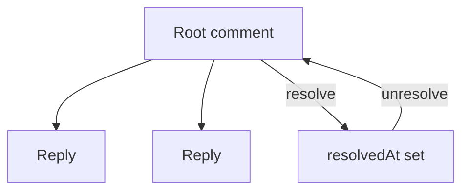

# Module: `comments`

**Folder:** `api/src/comments/`

## Purpose

Threaded discussion on Programs: internal staff comments and public feedback.

## Endpoints

| Method | Path | Access | Description |
|---|---|---|---|
| POST | `/programs/:programId/comments` | `comments:write` + office in scope | Post a comment on a program |
| GET | `/programs/:programId/comments` | Authenticated | List comments (filter by version, stage) |
| GET | `/programs/:programId/comments/permission` | Authenticated | `{ canComment }` — whether the caller may post; drives composer visibility in the program/PA drawers |
| PATCH | `/comments/:id/resolve` | Proponent / author / admin | Resolve a comment thread |
| PATCH | `/comments/:id/unresolve` | Proponent / author / admin | Reopen a resolved thread |
| DELETE | `/comments/:id` | Author / admin | Soft-delete a comment + its reply subtree (restorable) |
| PATCH | `/comments/:id/restore` | SUPER_ADMIN | Restore a soft-deleted comment + its reply subtree |

## Threading & resolution

A **thread** is a root `ProgramComment` (`parentCommentId = null`) plus one
level of replies. Resolution is per-thread — `resolvedAt` / `resolvedByUserId`
are stamped on the **root** only; replies cannot be resolved independently.

A thread may be resolved or reopened by the owning proponent office (STAFF or
HEAD), the original commenter, or a `SUPER_ADMIN`.

## Soft delete

`DELETE /comments/:id` is **non-destructive**: it stamps `deletedAt` (and
`deletedByUserId`) instead of dropping the row, and cascades to the comment's
direct replies (replies are capped at one level). All comment reads filter
`deletedAt: null`, so deleted comments vanish from program drawers, the public
program/PA pages, the LGU dashboard, and admin feedback lists. `PATCH
/comments/:id/restore` (SUPER_ADMIN) clears `deletedAt` on the comment and its
reply subtree.

## Comments on document PPAs (specs/012)

A comment hangs off an AIP program **or** a PPA in an LEP or Ordinance
(`ProgramComment.budgetItemId`; a DB CHECK keeps exactly one). Every path that
touches an existing comment checks `assertCanReadTarget`, which uses the program
read rule on the PPA's office or host office (`ProgramsService.canReadOffice`).
Resolving, deleting or restoring a document-PPA comment is recorded in the
document's history (`BudgetDocumentAuditLog`, action `COMMENT`) instead of the
program audit log, and emits no SSE nudge.

Public feedback on an enacted Ordinance's PPAs (P2) is stored with
`budgetItemId`. The staff lists read both targets: the LGU office list and its
analytics (`officeFeedbackWhere`, plus a `UNION ALL` in the analytics SQL) and the
admin moderation inbox. `comments/item-feedback.ts` gives an item comment its root
PPA in the `program` shape (status `ENACTED`, `budgetItemId` set), and the
dashboard drawers open the public page for it instead of the program drawer.
Staff comment create/list on PPAs arrives with the document viewer (P4).

## Who may comment

A staff comment needs the same two things as any other write in the publish model
(`phase-1-publish-scope.md` §5): the
**`comments:write`** permission, and the program's **office in the caller's scope**
(`OfficeScopeService.assertOfficeInScope`), on top of being able to read the
program. Role and program status play no part. A same-cluster peer who can read
but whose scope does not include the office sees no composer.

`CommentsService.canComment` runs the same check without throwing; the
`comments/permission` endpoint uses it so the frontend hides the composer instead
of letting a read-only user submit and hit a `403`.

## Stages

Every staff comment is stored as **`GENERAL`**; public feedback is
**`PUBLIC_FEEDBACK`**. The client does not send a stage. `SECTOR_FEEDBACK`,
`HEAD_REVIEW`, `ENDORSEMENT` and `APPROVAL` belonged to the archived approval
workflow: they remain in the enum because old rows carry them, and nothing creates
them any more.

## The feedback gate

`DRAFT | FOR_REVISION → SUBMITTED` is rejected while any unresolved **internal**
root thread exists; `PUBLIC_FEEDBACK` threads are civic input and never block the
gate. Because an LFC committee return (`FOR_REVISION`) spawns an `APPROVAL`-stage
thread, this turns reviewer feedback into a hard gate on resubmission after a
return. (Terminal rejection is deprecated — see [programs.md](programs.md).) See
[architecture/workflow.md](../architecture/workflow.md#the-feedback-gate).

## Services

- **`CommentsService`** — CRUD, `deriveStage`, `assertCanWriteStage`, `canComment`
  (non-throwing permission check), thread resolution, and the unresolved-thread
  count used by the submit gate.

## DTOs

`CreateCommentDto` (`content`, optional `stage`, `parentCommentId`,
`targetType`/`targetId`).

## Tables touched

`ProgramComment`, `Program`, `ProgramVersion`, `CommitteeMembership` (to verify
LFC-member HEADs may post `APPROVAL` comments).

## Dependencies

`PrismaService`, [`programs`](programs.md) RBAC helpers.

## Related

- [programs.md](programs.md) — the submit gate
- [events.md](events.md) — comments emit an activity nudge
