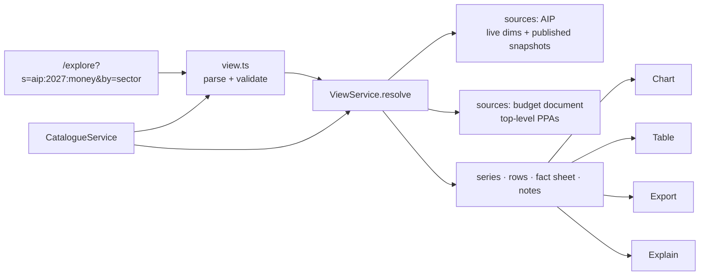
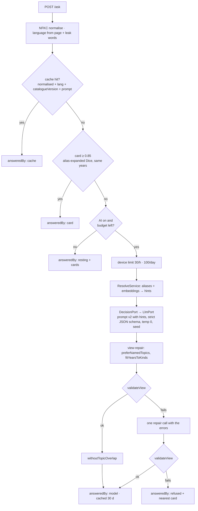
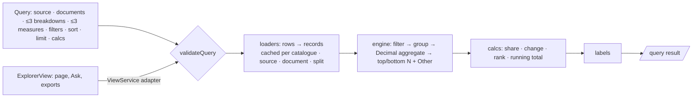
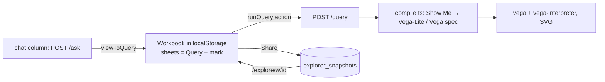
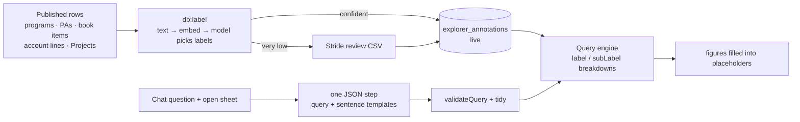

# Data Explorer (`explorer`)

The public chart builder (specs/018): anyone can build, share and, when switched on, ask for and
have explained a chart over every public year of the AIP, the LEP and the enacted Annual Budget.
Spec and design: `specs/018-data-explorer/`.



## The rules it keeps

- **One computation per figure.** Every number the explorer shows comes from `ViewService.resolve`.
  The AIP reads dimensions from the live program and money from the published snapshot through
  `lbp-figures.ts` (`publishedProposedTotal`, FE snapshot-only); a budget document reads its
  top-level PPAs' rolled-up `total`, with expense classes and funds summed from the tree's own
  amounts. `src/explorer/explorer.check.ts` proves it through the query engine (redesign P2):
  for every catalogue document (drafts too unless `EXPLORER_INCLUDE_DRAFTS=0`) it runs each
  source and prints a table (source × document × check × expected × got × difference):

  | Source | Must equal | Fails the run |
  |---|---|---|
  | AIP programs: total, by sector, office, fund, class | Σ `publishedProposedTotal` (the public headline) | public year |
  | Budget PPAs: total, by office, fund, class | Σ top-level `BudgetItem.total` (the book) | public document |
  | Accounts: total | the PPA total | enacted ordinance only (a draft LEP's difference is reported) |
  | Accounts / income: every split | the source's own unsplit total | public document |
  | Over time: each year × kind cell | that document's own total | public document |
  | Printed: Form 7 grand total, each office's object-sheet totals, receipts totals | — | never (`=`/`≠`, the book's own figures) |

  Form 7 is the book's largest printed grand total (a scanned book can print one per fund file;
  the note names the file). Receipts compare leaf lines with the printed receipts totals except
  the GA/EE split sheets, which restate part of the General Fund.

  A split always sums back to the expected figure; what it could not place shows as a note
  ("not specified ₱…", "several funds ₱…"). Run it with `DATABASE_URL` set:
  `pnpm --filter api exec tsx src/explorer/explorer.check.ts` (exit 1 = a gated mismatch).
- **A series never mixes document kinds** (R8); kinds sit side by side only as labelled series with
  a context note, never stacked or added (R9); **themes are non-additive** (R12): shares are of the
  rows, never a grand total, and a theme stack is refused.
- **Public = published** (R6, amended 2026-11-09: the open-data switch no longer gates it): the same visibility filters as the public registry
  (`PUBLICLY_VISIBLE`; an ENACTED ordinance). `CatalogueService.publicDocuments` is the one place
  that says which kinds a year shows; LEP years join it with specs/017.
- **Only values with public data** (redesign P0, 2026-11-09): the catalogue's dimension values come
  from the public rows of every catalogue document (`usedValues`), so a picker never offers an empty
  sector or an unused tag; a breakdown with no values is hidden from "by". Offices read by **name**,
  the acronym is the sublabel and stays the code.
- **Years are never added together**: on a by-year series `total` and every row's `share` are
  `null`; the table drops its Total row, Explain leads with the latest year, exports leave the total out.
- **Topics are rules, membership is derived** (redesign W16): `explorer_topics` /
  `explorer_topic_rules` say what "education", "youth", "farmers" mean (office, cluster, sector,
  finish line, fund, theme, or a keyword on the row's name; any rule matches). `topics.ts`
  derives a row's topics on every read — never stored per row. A keyword never fires inside a
  reviewed compound listed against that topic (`prisma/data/explorer-compounds.json`: "capacity
  building" is not infrastructure; specs/020 decision #16), and question aliases treat those
  compounds as one unit (`match.ts`). `pnpm --filter api db:report:compounds` lists the candidates.
  The label gold set has a compound sheet (`explorer-gold/gold-compounds-v1.csv`, drawn with
  `db:label:review -- export … --compounds 5`), which `db:label:calibrate` reports as a slice
  beside the fit, never fitting on it. `topic` is a dimension like
  `theme`: a row can be in several, so a by-topic chart has no grand total and no stack. Only
  `approved` topics show, plus `draft` ones where `EXPLORER_INCLUDE_DRAFTS=1`. Source:
  `api/prisma/data/explorer-topics.json` → `pnpm --filter api db:seed:topics` (keeps a topic's
  status; `topics.spec.ts` checks every code exists).
- **Drafts on dev only** (W15): `EXPLORER_INCLUDE_DRAFTS=1` adds every LEP and ordinance that is
  not public (the FY2023–26 books on dev), each `draft: true`; any series that reads one says
  "(draft)" in its label. Public LEPs/ordinances come from `PUBLIC_ANNUAL_DOCUMENT`, as on every
  public read.
- **Codes, not ids, in URLs**: `office:CHO`, `fund:GF`, `finishLine:fl-3`, `sector:3000`. An office
  keeps one code across years through `offices.lineage_id` (R7).

## Endpoints (`/api/v1/public/explorer`, anonymous, throttled per IP)

| Method | Path | Returns |
|---|---|---|
| GET | `/catalogue` | public documents × years, dimension values with aliases, cards; `ETag` = content version |
| GET | `/capabilities` | which switches are on (`ai`, `stt`, `mode`, `logQuestions`) |
| GET | `/view?v=1&s=<kind>:<years>:<measure>&f=<dim>:<codes>&by=<dim>&chart=<type>&top=<n>` | `{ catalogueVersion, view, series[], facts, notes[] }`; 400 `{ errors[], fallback }` for a view that breaks a rule; 404 for a year that is not public |
| GET | `/default` | the landing view: latest public AIP by sector |
| GET | `/sources` | the workspace's field list: each source, its grain, kinds, fields (dimension / money, kinds each exists on, glossary term) |
| POST | `/query` `Query` | `{ columns, rows: [{ keys: [{ code, label }], values, calcs }], other, totals, n, documents }` — one engine for every figure; 400 `{ errors[] }` for a query that breaks a rule |
| POST | `/query/rows` `{ query, offset?, size ≤ 200 }` | the data grid: the records behind a query, labelled, sorted (`query.sort.by` may be any field of the source), paged; nothing added up |
| POST | `/snapshots` `{ workbook }` | `{ id }` — stores a workspace workbook for a share link (redesign P3): named fields only, every sheet through `validateQuery`, ≤ 64 KB; `id` = hash of the state, so the same workbook gets the same id; 30 / 10 min |
| GET | `/snapshots/:id` | `{ workbook }` or 404; immutable, cached a day |
| GET | `/resolve?q=` | `{ candidates: [{ dim, id, label, score, via: alias\|vector }] }` — the catalogue values the words most likely mean (≤ 8); what Ask hands the model |
| POST | `/ask` `{ q ≤ 300, lang?, deviceKey? }` | `{ recordId, answeredBy: cache\|card\|model\|refused\|resting, view?, understood?, guessed?, refusal?, suggestions?, lang, mode }` — never an unvalidated view; 429 + `Retry-After` when the device is over its limit |
| POST | `/chat` `{ q ≤ 300, lang?, sheet?: { query, mark }, turns?: [{ q, reading }] ≤ 4, deviceKey? }` | the workspace chat (redesign P5): `{ recordId, mode, answeredBy, lang, action: answer\|askBack\|refuse, reading, query?, mark?, sentences[], coverage?, ppas?: { total, items[≤5] }, steps[], alternatives[], askBack?, refusal? }` — `query` always passed `validateQuery`; every figure in `sentences` is the engine's; 429 + `Retry-After` when the device is over its limit |
| POST | `/feedback` `{ recordId \| view, lang?, verdict, reason?, text? ≤ 500, deviceKey? }` | 204; one verdict per device per answer. `view` (the URL query) rates a template explanation: the first verdict on a view creates one `explorer_questions` row (`answered_by = template`, no text) per view, language and catalogue |

Staff: `GET /api/v1/explorer/log?lang&answeredBy&from&to&page&pageSize` (permission
`explorer:read-log`, in the CPDO Head template) → `{ items: [question + calls + feedback], total }`;
`GET /api/v1/explorer/spend` (same permission) → model calls, tokens and cost per UTC day by kind
(`ask`, `chat`, `label`) and model, and answers by `answeredBy` (W7). Counts only.

## Ask (P3)



- **Ports.** `ports/llm.port.ts` (`LlmPort.complete`) is any OpenAI-compatible
  `/chat/completions`: `adapters/openai-compatible.ts` sends `response_format: json_schema`
  strict, temperature 0, seed 0; `LLM_AUTH=entra` takes an Azure token from
  `DefaultAzureCredential` (managed identity, or `az login` locally), `key` sends `LLM_API_KEY`
  (`api-key` on `*.azure.com`, bearer elsewhere). `ports/decision.port.ts` (`DecisionPort.decide`)
  builds the prompt from `prompts/ask.v<EXPLORER_PROMPT_VERSION>.md` + the catalogue in the
  asker's language + 6 default cards; every id in the answer schema is a catalogue enum.
- **Budget (R19).** Each call's cost (`LLM_PRICE_{IN,OUT}_PER_MTOK`, usage tokens or chars/4) is
  added to a UTC-day counter; at `EXPLORER_DAILY_BUDGET_USD` Ask rests (cards, cache) and
  `capabilities.mode` says `resting`. Counters live in the cache store (Redis when set) via `CacheService.incrBy`; a store outage fails open, the IP throttle still holds.
- **Limits (design §12).** Per IP: ask 60 / 10 min, feedback 30 / 10 min, log 60 / min. Per
  device (salted hash of `deviceKey`): ask 30 / h and 100 / day — model calls only — and
  feedback 10 / h. `explorer.controller.spec.ts` fails if a route lacks `@Throttle`.
- **Log (R15, R16).** `log.service.ts` writes one `explorer_questions` row per ask with its
  `explorer_model_calls` (prompt hash, user turn, raw output, validated view, latency, tokens).
  `EXPLORER_LOG_QUESTIONS=0` stores no visitor text anywhere. A daily in-process job nulls
  question/feedback text and the call's user turn after 12 months. Personal-data tables
  (`AGENTS.md`).
- **Eval.** `pnpm --filter api exec tsx src/explorer/eval/run.ts --api http://localhost:8000`
  scores `specs/018-data-explorer/eval/{en,fil,bcl}.jsonl`: exact match, field F1, rung counts,
  invented figures, answers that change on a second run.

Contract: `specs/018-data-explorer/contracts/explorer-api.md`.
With `EXPLORER_ENABLED` unset every route is a 404.

## Semantic layer (redesign P1, 2026-11-09)

The model chooses among what the portal already knows instead of the whole catalogue, and
code settles what it chose differently run to run. Measured on dev data in a real browser:
two cold runs of 16 questions (EN/FIL/BCL) gave 14 identical views; the other two showed the
same figures (one redundant filter, one series order).

| Step | Where | What it settles |
|---|---|---|
| Aliases | `match.ts` `aliasHits` | values the question names, any language; a topic wins a tie with a same-named cluster/tag |
| Vectors | `resolve.service.ts` | nearest labels/topics/aliases by meaning (`EMBED_MODEL`); index and question vectors cached by content, so the same question gets the same hints. In the cache, not pgvector: ~200 values search in memory, and the prod/staging Postgres images have no `vector` extension. Once a value is named, only vector matches ≥ 0.38 are added |
| Hints | prompt v2 (`{{HINTS}}`) | "named in the question" vs "possibly related"; generic words never filter |
| `preferNamedTopics` | `view-repair.ts` | a tag/cluster the named topic covers becomes the topic (Youth tag ₱205K → youth topic ₱3.0M) |
| `fitYearsToKinds` | `view-repair.ts` | by year: each kind gets the asked years it has (AIP 2026–27 + LEP 2023–26), AIP first; "over the years" = every kind with ≥ 2 years |
| `withoutTopicOverlap` | `topics.ts` | drops a filter the topic already covers (office NCYDO + topic youth showed nothing); also on cached answers |

## Query engine (redesign P2)

`api/src/explorer/query/` — design: `specs/018-data-explorer/redesign-p2-query.md`.



- **One computation.** `ViewService` (the old URL grammar, Ask, Explain, exports) builds a `Query`
  per series and reads `QueryService.aggregate`; the workspace and chat will too.
- **Sources** (`fields.ts`): AIP programs, budget PPAs (LEP / ordinance), accounts (object
  lines), income (receipts, leaf lines only), budget over time, AIP projects and activities
  (leaf PAs only, so a parent is never counted with its children), climate change spending
  (one record per CCET tag from the published snapshot; codes are multi-valued, so no totals
  across them) and Projects (published PPMPs, money from line items). A field says which
  document kinds have it.
- **Money splits.** Fund and expense class are splits, not row dimensions: one record per part,
  and what a row leaves unsplit is "Not specified", so a split adds back to the rows exactly.
  Only one split per query, never with themes or topics.
- **Never added together:** years (break down by year) and document kinds (by document);
  themes and topics have no grand total. Receipts are their own source and never mix with
  spending.
- **Barangay** (specs/020 A3; `query/barangay.ts`, gazetteer `api/prisma/data/naga-barangays.json`):
  a multi-valued `barangay` breakdown on AIP programs, AIP projects and activities and budget PPAs,
  **read from each row's name at query time and never stored** (it is attached in
  `QueryService.records`, after the record cache, so a better gazetteer takes effect at once).
  27 barangays with PSGC codes (OCHA COD-AB v03) and PSA 2020 population; whole-word matching
  without accents; Peñafrancia and San Francisco count only after Brgy./Bgy./Barangay (the
  festival, the avenue). A row naming several counts in each, so there is no total; a row naming
  none is `_citywide` ("City-wide or no barangay named"). Names it cannot place stay city-wide
  until B3's model decides them (A3.6).
- **Words** (specs/020 A4.1; `query/terms.ts`): source `terms`, built at read time from the
  document's own rows (AIP programs, or a book's PPAs). Words and two-word phrases of the row
  name after an en/fil + budget-boilerplate stop-list (a phrase never spans a stop word), kept
  when class-based TF-IDF (each label a class; Grootendorst 2022) ranks them in their home
  label's top 40 and they occur in ≥ 2 rows. One record per (row, word), carrying the row's own
  amount: `term` is multi-valued, so no total and no share, and a terms query must break down by
  `term`. `termLabel` is the label the word is most typical of. `explorer.check.ts`: rows with a
  word + rows with none = the source total, each row once at its own amount.
- **`perCapita`** aggregation: the group's Decimal sum ÷ the barangay's PSA 2020 population; the
  city-wide bucket and totals divide by the city's 209,170. Valid only with a `barangay`
  breakdown and no Top N ("Other" has no population). `explorer.check.ts` holds the partition:
  one barangay + several + city-wide = the source total, and Σ by barangay = one + Σ several × n
  + city-wide.
- **One field, one accumulation:** two measures on the same field (sum and average of the amount)
  read one running sum. Before specs/020 each measure added the row again, so `[sum, avg]` of one
  field doubled both.
- **Accounts:** SPA's sheet repeats the LDF and LDRRMF sheets as two code-less lines; the loader
  skips them until the importer stops storing them. Special-fund sheets carry their fund, not an
  office.

## Workspace (redesign P3 + P4)

Design: `specs/018-data-explorer/redesign-p3-workbook.md`. The desktop `/explore` (≥ 1024 px);
below that the page above stays (W19).



- **State is one workbook** (`api/src/explorer/workbook/workbook.ts`, copied byte for byte to
  `client/src/lib/explore/workbook.ts`; `workbook.test.ts` fails when they differ). A sheet is a
  P2 `Query` plus a mark; the shelves are a view on the query. `fitQuery` (`lib/explore/sheets.ts`)
  refits a query after a hand edit: drops fields the source lacks, and puts Document / Fiscal
  year on Colour when there are several documents or years.
- **Charts:** `lib/explore/compile.ts` (bar, stacked, line, area, scatter, heat map, treemap, KPI
  tiles; Show Me; draft hatching; labels formatted from the decimal strings). specs/020 A1–A2:
  - **One look**, `lib/explore/theme.ts`: a Vega config from `readTheme()` (paper, ink, a fine
    dashed grid, one thin rule on each axis, Figtree for big figures, Mona Sans for the rest), on
    every spec; schemas are v6. Sequential and diverging ramps come from the dataviz palette.
  - **Titles are generated, never written by a model:** the title is `sheetTitle`, the subtitle
    is the query (documents, filters, unit, records, top N), and value axes carry the unit
    (`axisTitle`: "Estimated cost (₱)").
  - **Small multiples** past four series (bar, line, area; never stacked), on one shared scale.
  - **`kpi`**: a colour block per value, text colour from `readableOn` (`lib/finish-lines.ts`).
    Show Me picks it for a sheet with no breakdown.
  - **Heat map**: rows and columns ordered by total, labels where cells have room, diverging
    (red ↔ grey ↔ blue around 0) for a change calc, one hue otherwise, with a gradient key.
  - **`map`** (A3.4): Vega-Lite `geoshape` over `client/public/geo/naga-barangays.topo.json` (HDX
    COD-AB admin-4, Naga only, simplified, 18 KB, CC BY-IGO), joined by PSGC code, one-hue
    sequential ramp; the city-wide figure and the source credit sit beside it, inside the SVG, so
    an export carries them. Show Me picks it for a `barangay` breakdown; a map of plain totals
    falls back to the table (`mapTotals`). No tile server, no CSP change.
  - **`words`** (A4.2): Vega's built-in `wordcloud` transform (no new library), words sized by
    pesos (not frequency, Hearst et al. 2020), coloured by `termLabel`, never rotated, with a
    ranked bar list of the top 12 beside it for exact reading. The word travels in its own field
    because the transform overwrites `x`/`y`. "Keep only" on a word becomes a `contains` filter
    on the row name (`narrow` in `sheets.ts`).
  - **Linter** `lint(mark, result)`: 14 rules (empty, too many categories / series, mixed units,
    stacked ratios, negative area, rank as length, line over an unordered breakdown, one point,
    a scatter under three points, a one-row heat map, too many KPI tiles, Other bigger than the
    rest, a map of totals). A failing chart shows as the table with the reason (`explore.lint.*`). Zero-based bars
    and no 3D hold by construction.
  - **Export** (`lib/explore/export-frame.ts` + `picture()` in `workspace.tsx`): title, subtitle,
    numbered legend, sources, date, the portal's mark, the snapshot link and a 12-hex SHA-256 of
    the query; the page's `@font-face` files are inlined (`inlineFonts`, `share-menu.tsx`) so a 2×
    PNG matches the screen. Drawn by
  `components/explore/workspace/vega-chart.tsx` through `vega-interpreter`, because the CSP has no
  `unsafe-eval`. Vega loads with the workspace only (`workspace-gate.tsx`), never on phones.
- **Share:** `POST /snapshots` → `/explore/w/<id>` (noindex) opens a copy, asking first when the
  browser holds its own workbook; then the address is `/explore`. Old `/explore?v=1…` links open
  as a new sheet (`viewToQuery`, the mirror of `ViewService.resolveSeries`).
- **Chat column** (`chat-column.tsx`): the P5 chat (below). An answer replaces the sheet it was
  asked on (and opens it) as one undo step; *See all N* opens Records of exactly the rows counted.
  **One thread per sheet** (P7, owner's ask): the column keeps `sheetId → messages`, stays mounted
  while hidden, and its eraser clears the open sheet's thread only. The transcript is never
  stored; the agent sees the last four turns of that sheet's thread. A blank sheet is sent as no
  open sheet (`openSheet: null`), or the agent's "keep what the question does not change" kept its
  missing breakdown and the answer drew nothing.
- **Drag and drop** (W21): the browser's own drag events; a field from the list drops on
  Columns, Rows, Colour or Filters (Filters opens the filter set to that field). Every drop has a
  click or menu that does the same, which is the keyboard path; no drag library.
- **Click a mark** (`pick-menu.tsx`), or a row's name in the Table view: *Keep only*, *Exclude*,
  *Drill down to …*, *Show its records*. `narrow` / `drillField` (`lib/explore/sheets.ts`) turn it
  into filters and the next breakdown down a fixed path (cluster → sector → office → program →
  projects or accounts). Years and documents are never picked.
- **Records** (`records.tsx`): Chart | Table | Records; the rows behind the sheet from
  `POST /query/rows`, 50 a page, sorted by a clicked header. Since specs/020 (owner feedback) it
  shows only the row's name, office and money (`recordColumns` in `lib/explore/records.ts`; year
  and document only when the page mixes them). An AIP program opens into its projects and
  activities (`children` in the response, from `aip-activities` by `parentId`). Clicking a name
  opens a sheet with every field of the city's data, the projects, a link to its page, and the
  explorer's own readings (fields marked `derived: true`: label, sub-label, topic, barangay, word)
  under "How the explorer reads it". The words source lists each row once.
- **Dashboards** (`dashboard.tsx`): `Workbook.dashboards` (≤ 10, each 1–4 sheet ids) and `board`
  (the one on screen). A click in a tile filters every other tile whose source has that field
  (`linked`); the selection is not saved. Both keys are absent when empty, so a workbook without
  dashboards keeps its snapshot id.
- **Theme:** `workspace.css` puts its tokens on `<html data-ws>` while mounted, so Base UI menus
  (portalled to `<body>`) follow light / dark; `explorer-theme` in localStorage remembers a pick.
  The site's own nav and footer are `display: none` while it is mounted: they sit under the
  full-screen workspace, and must not be in the tab order or the accessibility tree.
- **Guide** (redesign P7, W13/W22; `guide.tsx`): the `?` button (or the `?` key) opens a side
  panel with two tabs. *How to use it*: three ways to start, the starter workbooks, how-tos, what
  each source holds (its `grain` from `GET /sources`), keyboard. *About the data*: which documents
  and years the catalogue holds (drafts marked), the three money words (AIP estimated cost, LEP
  proposed budget, ordinance appropriation), what a draft is, caveats, links to Learn and open
  data. No first-visit tour.
- **Blank sheets:** a new workbook and **+** (new sheet) open a sheet with no breakdown
  (`blankQuery`, `isBlank` in `lib/explore/sheets.ts`). The canvas shows the total and three ways
  to start instead of a one-row table. Empty shelves and an empty result say what to do.
- **Starter workbooks** (`lib/explore/starters.ts`): built from the catalogue, so each names only
  documents this deployment holds, newest published first (a draft only when nothing else exists):
  the latest AIP (office, finish line, expense class, as a dashboard), its climate tags, the
  latest book's income, and every document over time. P2 sources only. Opening one replaces the
  workbook as one undo step; `starters.test.ts` runs each through `checkWorkbook`.

## Labels and the chat (redesign P5)

Decisions W22–W30; plan `specs/018-data-explorer/redesign-p5-plan.md`; run report
`docs/design/explorer-labels-report.md`.



- **Labels say what a row IS** (W22), from its own text, not its office. Two levels in
  `explorer_labels` (`prisma/data/explorer-labels.json`: 18 labels, 50 sub-labels, each mapped to
  the DBM functional group, COFOG and a finish line; `db:seed:labels` keeps a label's status).
  Every row is labelled: AIP programs and PAs, every budget book item, account lines and Projects
  (W25). `explorer_rows` keeps each row's text, its hash and its vector (`real[]`, any Postgres).
- **`db:label`** (W30): ~20 rows a call, the whole taxonomy in the prompt (`prompts/label.v1.md`),
  label ids as an enum; incremental by text hash; `--max-usd` (default 10); logged as `kind = label`
  model calls, outside the chat's daily budget. A label goes live unless its confidence is below
  0.35, or below 0.6 and the vectors do not rank its label near the row (`gate`). Review rows count
  nowhere until `db:label:review -- apply <csv>`, and a reviewed row is never relabelled (W23).
  First run on the scratch DB (2,392 rows): US$1.28, 17 rows Not classified.
- **Gold set, calibration and the review queue** (specs/020 B1, `labels/calibration.ts`).
  `db:label:review -- export <file> --gold 400` draws a gold set: labelled, unreviewed rows,
  stratified by office (largest remainder, at least one per office, seeded so it can be drawn
  again), with `proposed` left blank so Stride decides from the text. Filled sheets live in
  `api/prisma/data/explorer-gold/` (committed: budget text only). `db:label:calibrate` fits an
  isotonic curve of "pick was right" on stated confidence and sets the review threshold to the
  lowest confidence whose calibrated precision meets `--target` (default 10% error), written to
  `prisma/data/explorer-calibration.json`; `db:label` then uses it in place of 0.35 and prints the
  curve and ECE (in-sample and 5-fold, 95% bootstrap CIs over rows) in the labels report. Without
  the file the fixed 0.35 stays. A plain `export` (rows in review) comes in queue order: rows most
  of whose 10 nearest neighbours carry none of their labels first, then the least certain, then
  diversified by vector (MMR, λ 0.7).
- **What the taxonomy misses** (specs/020 B5.1, `tools/topics/propose.py`): BERTopic over the rows
  left in review or Not classified (mE5 embeddings → UMAP → HDBSCAN → c-TF-IDF keywords) writes
  `docs/design/explorer-topic-proposals.md`: each cluster's size, keywords, most typical rows and
  the nearest existing label. Proposals only: a label is added by editing
  `prisma/data/explorer-labels.json` after Stride's review. Run it from the labelling exports
  (`uv run --project services/inference --group research python tools/topics/propose.py --data <dir>`).
- **Unusual-change flags** (specs/020 B5.2, `flags.ts`, staff `GET /explorer/flags?kind=&from=&to=`,
  `explorer:read-log`): a PPA at least three times last year's (by ₱1M+), a rise of half or more to
  a round ₱5M+ figure, an expense class an office spent under 5% on the year before now holding
  ₱1M+. Deterministic, each flag names its rule and figures, worded "Unusual change — ask the
  office", never an accusation. Staff only; no UI yet.
- **Training capture** (specs/020 B4, `training.service.ts`). `POST /ask` and `/chat` take
  `trainingConsent` (the resident's "help improve" box, unticked); `GET /capabilities` returns
  `trainingCapture` so the client shows the box only where the LGU opted in
  (`EXPLORER_TRAINING_CAPTURE=1` with AI on, off until the privacy notice is updated). The box
  (`components/explore/training-consent.tsx`) sits under the workspace chat and the phone Ask box,
  unticked, kept for the tab only; `consentField` sends the field only when shown and ticked. After the answer is
  sent, a consented question with an answer is scrubbed (regex, then a LAYA yes/no "names a
  private person?", dropped at P ≥ 0.2, fail closed) and stored in
  `explorer_training_questions` with its spec. Never blocks or changes an answer. SECURITY.md has
  the rules.
- **Feedback carries the answer it rates** (B1.1). `explorer_questions.spec` holds what was
  answered on every rung (the view for Ask, `{ query, mark }` for chat, cache hits included);
  a verdict copies it with its SHA-256 over canonical JSON (`explorer_feedback.spec`,
  `spec_hash`). Budget-side, but the rows stay on the personal-data list with their tables.
- **In the engine** `label` and `subLabel` are multi-valued fields on every source but climate tags
  and income: non-additive like themes. A row with no label is `unclassified` (*Not classified*,
  its own bar, W25). A program or top-level PPA keeps **its own** labels when it has any and takes
  its children's only when it has none (one drainage activity must not make a whole office
  program infrastructure money). Under a `label in [...]` filter a label or sub-label breakdown
  shows only that label's values (`scopeLabels`), so the chart has no stray Health bar.
- **Prompt `chat.v3`** (specs/020 A5.3, 2026-11-13): adds the `kpi`, `map` and `words` marks; `map` and `words` only when the catalogue lists a `barangay` field / a `terms` source, else `auto`. The version is in the chat cache key, so v2 answers are not reused.
- **The chat** (`chat/chat.service.ts`, `prompts/chat.v3.md`): resolve the words (topic hits are
  passed as the label of the same id), one JSON-schema step (W7: no vendor tool calls), one repair
  call with the validator's errors and the documents that exist. The model writes a query and 1–2
  sentence templates with placeholders (`{total}`, `{share}`, `{top1}`…); `fill` puts the engine's
  figures in and drops a sentence with any digit of the model's own beyond the years asked about
  (W26). `tidy` runs on fresh and cached steps alike: topic → label, a label named in words →
  its id, a sub-label written as a label → `subLabel`, one label by label → by sub-label.
- **What an answer carries:** the reading, sentences, a coverage line (counted by labels, Not
  classified rows and money, review rows left out, draft documents), the top five PPAs with links
  (`/budget/<id>` for programs and book PPAs) and the total, next steps the result allows (`by
  office`, `by sub-label`, `by fund`, `over the years`), the model's other readings, or an
  ask-back with options (W28). "Spent", "budget" and "allocated" read as the year's ordinance
  (else its LEP), never an ask-back just because the year also has an AIP; an ask-back with one
  option is answered (`soleOption`, on cached steps too). A year or kind the data lacks → `refusal: no-data` with the
  documents that exist; nothing matching → `refusal: empty`, never ₱0.00.
- **Language** (W29): the reply is in the question's language; the coverage line, buttons and
  terms follow the page. Budget terms in a reply are marked from `client/src/lib/glossary.ts`
  (`lib/explore/gloss.ts`, first use per reply), the definition on hover, tap or focus.
- **Logging** (W27): as Ask, plus `scrub` removes emails, PH phone numbers and long digit runs
  before a question is stored. Cached 30 days by question, sheet, turns, catalogue and prompt
  version; not cached while the embedding index is down.

## Files

| File | Role |
|---|---|
| `view.ts` | `ExplorerView` type, URL grammar parser, validator, `defaultView` |
| `catalogue.service.ts` | documents, dimensions (lineage, aliases, cards), content-hash version; cached under `pub:registry:` |
| `sources.ts` | `Row[]` per document year: `loadAipRows`, `loadDocumentRows` |
| `view.service.ts` | `resolve(view, visibility)`: filters, grouping, top-N + Other, shares, fact sheet, caveats |
| `explorer.config.ts` | every switch below |
| `ask.service.ts` | the Ask ladder; `decideValidated` (shared with the eval) |
| `match.ts` | normalise, language detection, card ranking |
| `explorer-limits.ts` | device limits and the daily budget |
| `log.service.ts`, `explorer-log.controller.ts` | question / call / feedback log, staff `GET /explorer/log`, retention |
| `ports/`, `adapters/`, `prompts/ask.v1.md` | model ports, OpenAI-compatible adapter, versioned prompt |
| `eval/run.ts` | the Ask eval |
| `workbook/workbook.ts`, `workbook/snapshot.service.ts` | the workbook check (shared with the client), share-link snapshots |
| `chat/chat.ts`, `chat/chat.service.ts`, `prompts/chat.v3.md` | the P5 chat: output schema, `tidy`, `fill`, next steps; orchestration |
| `labels/taxonomy.ts`, `labels/labelling.ts`, `prompts/label.v1.md` | the taxonomy check; row text, gate, review CSV (pure) |
| `labels/calibration.ts` | gold-set draw, isotonic calibration, review threshold, ECE, review-queue order (pure; specs/020 B1) |
| `prisma/label-rows.ts`, `prisma/label-review.ts`, `prisma/label-calibrate.ts`, `prisma/seed-explorer-labels.ts` | `db:label`, `db:label:review`, `db:label:calibrate`, `db:seed:labels` |
| `prisma/data/explorer-labels.json` | the label taxonomy (two levels, official mappings) |
| `prisma/data/explorer-cards.json` | curated question cards (EN/FIL/BCL) as views; a card whose year is not public is dropped |
| `prisma/data/explorer-aliases.json` | optional extra aliases per dimension value code and language |
| `prisma/data/office-lineage.json` | optional CPDO map `[{ from, to }]` seeding `offices.lineage_id` |

## Switches

```
EXPLORER_ENABLED=1          # the feature
EXPLORER_AI_ENABLED=1       # Ask, model Explain, mic (P3–P5)
EXPLORER_LOG_QUESTIONS=1    # store question text (P3); 0 in the open-source default
EXPLORER_DAILY_BUDGET_USD=5 # model spend per UTC day; then Ask rests (dev: 20)
EXPLORER_DEVICE_SALT=…      # salt for device-key hashes (random per process when unset)
EXPLORER_PROMPT_VERSION=1   # prompts/ask.v<n>.md; part of every answer cache key
LLM_BASE_URL=https://<your-resource>.openai.azure.com/openai/v1
LLM_MODEL=…                 # deployment / model name
LLM_AUTH=entra|key          # entra: DefaultAzureCredential; key: LLM_API_KEY
LLM_PRICE_IN_PER_MTOK=3 LLM_PRICE_OUT_PER_MTOK=15   # USD, for the budget counter
EMBED_MODEL=text-embedding-3-small   # unset: words match by alias only
EMBED_BASE_URL / EMBED_AUTH / EMBED_API_KEY   # default to the LLM_* values (a self-hosted server sets its own)
EXPLORER_INCLUDE_DRAFTS=1   # dev only: draft LEPs/ordinances, draft topics and draft labels join the catalogue
LLM_TIMEOUT_MS=30000        # per model call; the labelling run sets 120000 (20 rows a call)
```

**Dev** (`terraform/envs/dev/main.tf`): `LLM_MODEL=gpt-5.4-mini` on the deployment's Azure AI resource, `LLM_AUTH=entra`
with `AZURE_CLIENT_ID` = the app identity, which holds **Cognitive Services OpenAI User** on that
account. Without the role every model call fails and Ask quietly answers with the nearest card.
The prices above over-count gpt-5.4-mini, so the cap errs on the safe side. Staging and prod: no `LLM_*`.

## Client (P1)

`client/src/app/(public)/explore/page.tsx` resolves the view on the server from the URL; the
controls (`components/explore/explore-controls.tsx`) only rewrite the URL. Charts are hand-written
SVG (`components/explore/charts.tsx`) with the table (`explore-table.tsx`) always rendered;
shaping in `lib/explore/chart-data.ts`, the grammar in `lib/explore/view-url.ts`. PNG/SVG/CSV are
made in the browser; XLSX by the public route handler `app/api/explore/export/route.ts`, exempted
from the login redirect by `PUBLIC_API_PREFIXES` in `lib/protected-routes.ts`. The nav, footer and
staff navbar show **Explore** only with `NEXT_PUBLIC_EXPLORER_ENABLED=1`.

## P1 additions (2026-11-09)

- **Live count**: the filters sheet calls `previewView` (server action, visitor IP forwarded) 300 ms
  after the last tap and labels its button "Show N items · ₱X".
- **Explore this**: `components/explore/explore-this.tsx` under the AIP and Annual Overview tables
  (finish line, cluster, office, fund) and on both Browse pages (by office). It renders only when
  the explorer is on and the catalogue holds that document year.
- **Share image**: `app/api/explore/og/route.tsx` (`next/og` `ImageResponse`, 1200×630, the top six
  rows and the total; an unresolvable view gets a relative 307 to `/og-image.png`).
  `generateMetadata` points `og:image` at it whenever the URL holds a view.
- **e2e**: `client/e2e/explore.spec.ts`, 12 tests including axe (WCAG 2.2 AA) on the page, Explain
  and the filters sheet. They pass against the fixture API, and the axe run found and fixed the
  language switcher's name (WCAG 2.5.3).
- **Known risk**: the page's server-side `/view`, `/default` and `/catalogue` reads send no
  `X-Real-IP`, so every visitor shares the client container's allowance (300 per 10 min on
  `/view`). The 60 s fetch cache keeps that far off for repeated views; many distinct filtered
  views at once could still hit it.

## Explain from templates (P2)

`lib/explore/explain.ts` (pure, `explain.test.ts`) turns the API's fact sheet into a headline, up
to four bullets, limits (one per caveat; a default when none says the money was not spent) and
sources. It returns `en.json` keys and slots, so the sentences go through `pnpm translate` and
review like any copy, and numbers are put in by code. A figure links to `#row-<id>` in the table
(the fact sheet's `top`/`bottom` carry the row id). `components/explore/explain-panel.tsx` is a
native `<details>`; `feedback.tsx` posts through the server action in
`app/(public)/explore/_actions.ts` so the API's limits key on the visitor's IP. The device key is a
random id in `localStorage` (`explore-device`), no cookie. `POST /explain` is not built: the page
already has the fact sheet, and the endpoint arrives with model-written Explain (P5).

## Ask on the page (P3 client)

`components/explore/ask-box.tsx`: a native `<textarea>` with a `<label>` (voice typing and screen
readers need one — `source-guards.test.ts` pins it) posting through `askExplorer` in
`app/(public)/explore/_actions.ts`, which forwards the visitor IP. A view answer is
`router.push`ed like any control change, so the readout menus below edit it; the box keeps the
answer and shows "Understood as …", the `guessed` fields in words, "Not what you meant?" (refocuses
the question) and a verdict keyed to `recordId`. `refused` and `resting` answers show the
suggested cards. The question never enters the URL. The staff log is
`/control-panel/explorer-log` (permission `explorer:read-log`, linked in the control-panel nav
only with `NEXT_PUBLIC_EXPLORER_ENABLED=1`); it lists text, language, answer, chart link, verdicts
and model calls, and never a device or IP.

## Voice (P4)

`POST /public/explorer/transcribe` (multipart `audio` ≤ 1 MB + `lang` + `deviceKey`; per IP
30 / 10 min, per device 20 / h) → `{ text, lang, by }`. 404 unless `EXPLORER_AI_ENABLED=1` and
`STT_PROVIDER` is set and hears that language. The clip lives in memory for the request only and is
never logged. `ports/stt.port.ts`; `adapters/stt.ts` has `OmnilingualStt` (HTTP to the
`explorer-stt` container: `STT_BASE_URL`, `STT_API_KEY`) and `AzureSpeechStt` (fast transcription,
`AZURE_SPEECH_REGION`, `AZURE_SPEECH_KEY`; en/fil only). `capabilities.stt.languages` comes from
the provider. Client: `components/explore/mic-button.tsx` (MediaRecorder, opus at 32 kbps,
auto-stop at `maxSeconds`) posts through `transcribeQuestion`; the words land in the Ask box,
editable, and nothing is asked until the visitor presses Ask. The browser's own
`SpeechRecognition` is not used (it sends the voice to Google or Apple). `next.config.ts` allows
`microphone=(self)` on `/explore` and `/{fil,bcl}/explore` only. The container: see
`specs/018-data-explorer/explorer-stt-brief.md`.

## Phases

P0 catalogue + view engine (this page) · P1 page · P2 Explain templates · P3 Ask · P4 voice ·
P5 model Explain · P6 kit — `specs/018-data-explorer/plan.md`.
