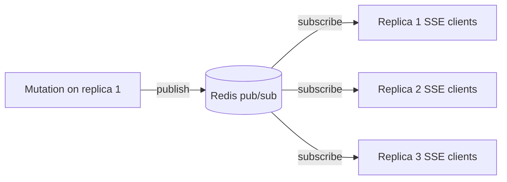

# Module: `events`

**Folder:** `api/src/events/`

## Purpose

Pushes real-time **activity nudges** to connected clients over Server-Sent
Events (SSE). When a comment is posted or a program's status changes, the API
emits a lightweight event so every viewer's registry refetches and updates.

## Endpoints

| Method | Path | Access | Description |
|---|---|---|---|
| POST | `/events/ticket` | Authenticated | Issue a short-lived, single-use ticket to open the stream |
| GET | `/events?ticket=...` | Public (ticket-gated) | The SSE stream |

The SSE stream cannot carry an `Authorization` header from an `EventSource`, so
auth is two-step: the client gets a single-use ticket from the authenticated
`POST /events/ticket`, then opens `GET /events?ticket=...`.

## The nudge payload

Events are intentionally thin — `{ type, programId, actorUserId, ts }`. They
carry no business data; the client treats a nudge as "something changed,
refetch". Relevance filtering is the client's job (it refetches what it is
showing).

## Cross-replica fan-out

The API runs multiple replicas. A nudge originating on one replica must reach
SSE clients connected to *any* replica, so events are fanned out over **Redis
pub/sub**:

Each replica subscribes to the channel and forwards received events to its own
connected SSE clients.

## Services

- **`EventsService`** — ticket issuance/validation, the per-connection SSE
  subscription, and publishing/subscribing nudges via Redis.

## Dependencies

[`redis`](cache-redis.md) (pub/sub), `PrismaService`.

## Related

- [cache-redis.md](cache-redis.md) — the Redis client
- [architecture/frontend.md](../architecture/frontend.md#real-time-updates) — the `useProgramEvents` hook
