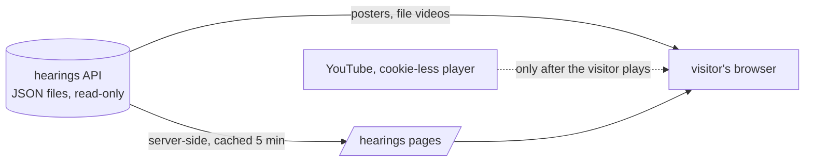

# Hearings

The council's recorded sessions as public pages: a session list, a transcript that follows the video, the
issues discussed under the LGU's goals, and the members. **Off unless a hearings API is configured.** The
portal stores nothing: every page is read from that API ([`../hearings-api.md`](../hearings-api.md)).



| Route | What it is |
|---|---|
| `/hearings[?body=]` | The sessions of one body, each with its headline and the goals its issues fall under |
| `/hearings/session/<id>[?t=<seconds>]` | The video, the transcript beside it, search, and the summary with timestamps to check every claim. The line and the word being said are marked as the video plays |
| `/hearings/issues[?by=cluster]` | Every issue of every session, grouped by goal or by cluster |
| `/hearings/councilors`, `/hearings/councilors/<slug>` | The members, and what each did on the floor once a reviewer confirmed it |

## Turning it on

`NEXT_PUBLIC_HEARINGS_API_URL=https://hearings.example.gov.ph` when the client is **built** (it is a
`NEXT_PUBLIC_*` setting: `docker compose build client` after changing it). Unset, the routes answer 404 and
the navigation has no Hearings link.

To see the pages without an API of your own, serve the made-up sample and point the setting at it:

```bash
python3 -m http.server 8765 --bind 127.0.0.1 --directory services/hearings/sample
NEXT_PUBLIC_HEARINGS_API_URL=http://127.0.0.1:8765 pnpm dev:client
```

The sample has no video file, so its player says so; the transcript, summary and other pages work.

## Making your own data

`services/hearings` is the pipeline: from a recording to this API's files, on one machine, with open
models you choose. [`services/hearings/README.md`](../../services/hearings/README.md) has the
settings, the rules it holds, and what has and has not been run.


From a video link to a page, on the production stack ([`../deployment.md`](../deployment.md)):

1. **Settings.** Copy `services/hearings/example/` somewhere of your own and edit `hearings.toml`:
   your council's name, your members, goals, glossary and documents, the speech model, and (if you
   want summaries) a model endpoint. Set `output = "/var/www/hearings"`, a folder you make first
   (`sudo mkdir -p /var/www/hearings && sudo chown "$USER" /var/www/hearings`).
2. **Run it** on a machine with Python 3.11+, `ffmpeg` and `uv`:

   ```bash
   uv run --with faster-whisper python services/hearings/hearings.py --config /path/to/hearings.toml run "https://www.youtube.com/watch?v=VIDEO_ID"
   ```

   This need not be the server. YouTube refuses downloads from many cloud servers; if yours is
   one, run the pipeline on an office computer and copy the folder over
   (`rsync -a out/ server:/var/www/hearings/`).
3. **Read what it wrote** before anyone else does (the README's "Read it before you publish").
4. **Serve it.** The stack's nginx already serves `/var/www/hearings` at
   `https://<SITE_HOST>/hearings-data/`, read-only, with `noindex`. Another folder: set
   `HEARINGS_DIR` in `.env`. Until the folder has files, every path there answers 404.
5. **Turn the pages on.** In `.env`:

   ```bash
   NEXT_PUBLIC_HEARINGS_API_URL="https://budget.example.gov.ph/hearings-data"
   ```

   Then rebuild the client and bring the stack up (add `--profile local-db` if you use the bundled
   database, as in the deployment guide):

   ```bash
   docker compose build client && docker compose up -d
   ```

6. Open `/hearings`. A new session appears within five minutes of the pipeline finishing (the
   portal caches each answer that long); nothing is rebuilt.

Any web server can stand in for step 4, on any host: the API is only files. It must answer byte-range
requests, or a `file` session's video cannot be seeked: nginx, Caddy and Apache do; Python's
`http.server` does not, so use that one for a look at the transcript only.

## Rules

- **The API is another party's data.** Text is rendered as text. A link from it reaches an `href` only if it
  is `http(s)` (`safeUrl`), and an id reaches a path only if it is plain (`safeId`). `lib/hearings/format.test.ts`
  holds both.
- **The content-security policy follows the setting.** With it set, `client/next.config.ts` allows the API's
  origin for images and media, `i.ytimg.com` for posters, and YouTube's script and cookie-less frame. Unset,
  the policy is unchanged. This is why the setting is read at build time.
- **Nothing of YouTube's loads until the visitor plays a video** or picks a line. Before that the page shows a
  poster image, which does come from YouTube's image host. Say so in your privacy policy.
- **Not indexed.** These are machine transcripts of named people; every hearings page sends `noindex`.
- **Machine-made, and labelled so.** Every page carries the notice. Lines a person corrected are marked
  "reviewed" when the API offers them.
- **Attendance is not shown**, and `services/hearings` does not produce it: a roll call heard by a machine is
  too easy to get wrong about a named person.
- **A member's page lists actions only from an API that has reviewers.** `services/hearings` writes the roster
  and no actions: each one needs a person to confirm it first.
- Page labels are English until translated; a summary shows in Filipino or Bikol when the API has one.

## Not here

A reviewer workspace (corrections, confirmed actions), attendance, and a pipeline that runs on more than one
machine. The nginx location has been checked in the stock nginx image with a test certificate, not yet on a
live server.

Code: `client/src/lib/hearings/` (types, reads, helpers), `client/src/components/public/hearings/`,
`client/src/app/(public)/hearings/`; the pipeline is `services/hearings/`.
