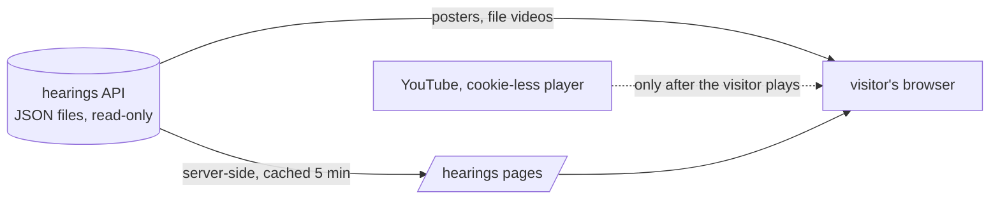

# Hearings

The council's recorded sessions as public pages: a session list, a transcript that follows the video, the
issues discussed under the LGU's goals, and the members. **Off unless a hearings API is configured.** The
portal stores nothing: every page is read from that API ([`../hearings-api.md`](../hearings-api.md)).



| Route | What it is |
|---|---|
| `/hearings[?body=]` | The sessions of one body, each with its headline and the goals its issues fall under |
| `/hearings/session/<id>[?t=<seconds>]` | The video, the transcript beside it, search, and the summary with timestamps to check every claim. The line and the word being said are marked as the video plays |
| `/hearings/issues[?by=cluster]` | Every issue of every session, grouped by goal or by cluster |
| `/hearings/councilors`, `/hearings/councilors/<slug>` | The members, and what each did on the floor once a reviewer confirmed it |

## Turning it on

`NEXT_PUBLIC_HEARINGS_API_URL=https://hearings.example.gov.ph` when the client is **built** (it is a
`NEXT_PUBLIC_*` setting: `docker compose build client` after changing it). Unset, the routes answer 404 and
the navigation has no Hearings link.

To see the pages without an API of your own, serve the made-up sample and point the setting at it:

```bash
python3 -m http.server 8765 --bind 127.0.0.1 --directory services/hearings/sample
NEXT_PUBLIC_HEARINGS_API_URL=http://127.0.0.1:8765 pnpm dev:client
```

The sample has no video file, so its player says so; the transcript, summary and other pages work.

## Rules

- **The API is another party's data.** Text is rendered as text. A link from it reaches an `href` only if it
  is `http(s)` (`safeUrl`), and an id reaches a path only if it is plain (`safeId`). `lib/hearings/format.test.ts`
  holds both.
- **The content-security policy follows the setting.** With it set, `client/next.config.ts` allows the API's
  origin for images and media, `i.ytimg.com` for posters, and YouTube's script and cookie-less frame. Unset,
  the policy is unchanged. This is why the setting is read at build time.
- **Nothing of YouTube's loads until the visitor plays a video** or picks a line. Before that the page shows a
  poster image, which does come from YouTube's image host. Say so in your privacy policy.
- **Not indexed.** These are machine transcripts of named people; every hearings page sends `noindex`.
- **Machine-made, and labelled so.** Every page carries the notice. Lines a person corrected are marked
  "reviewed" when the API offers them.
- **Attendance is not shown**, though a pipeline may produce it: a roll call heard by a machine is too easy to
  get wrong about a named person.
- Page labels are English until translated; a summary shows in Filipino or Bikol when the API has one.

## Not here yet

The pipeline that makes these files from a recording (`services/hearings`, on open models) and the recipe for
serving its output from the production stack. Until then the API is one you already have, or the sample.

Code: `client/src/lib/hearings/` (types, reads, helpers), `client/src/components/public/hearings/`,
`client/src/app/(public)/hearings/`.
