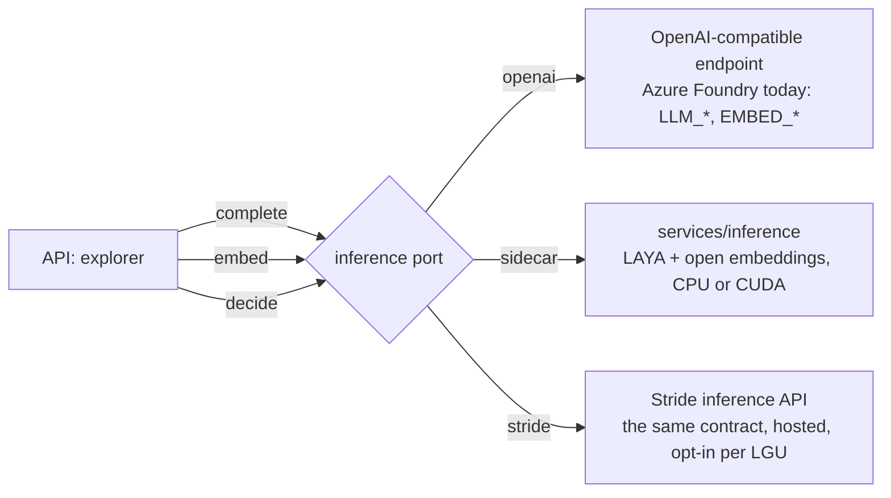

# Inference sidecar and the inference port (specs/020 B3)

The Data Explorer calls models for three things: **complete** (a chat model answering in JSON: the
chat, Ask, labelling), **embed** (vectors for matching words to catalogue values and for the label
gate), and **decide** (typed decisions: a choice among options, a yes/no probability, a score). Each
capability picks one of three backends, so a city can run the explorer with no hosted AI at all.



| | `openai` | `sidecar` | `stride` |
|---|---|---|---|
| complete | yes (default) | **no** (no chat model on CPU) | yes (`/v1/chat/completions`) |
| embed | yes (default) | yes | yes |
| decide | **no** | yes | yes |

## Settings

```bash
EXPLORER_INFERENCE=openai|sidecar|stride        # every capability; default openai
EXPLORER_INFERENCE_COMPLETE=…                   # one capability (also _EMBED, _DECIDE)
SIDECAR_URL=http://inference:8100               # default; SIDECAR_API_KEY if it is exposed
SIDECAR_TIMEOUT_MS=30000
EMBED_MODEL=intfloat/multilingual-e5-base       # with embed=sidecar: one the sidecar serves
STRIDE_API_URL=…  STRIDE_API_KEY=…  EXPLORER_STRIDE_OPT_IN=1   # all three, or stride is refused
```

A global `EXPLORER_INFERENCE=sidecar` means "what the sidecar serves": chat stays on `openai`. Any
setting a backend cannot honour (decide on `openai`, complete on `sidecar`, `stride` without the
opt-in or the key) **fails at boot**, never mid-request (`ports/inference.port.ts backendFor`).
`decide` is null unless a setting names the sidecar or Stride: nothing in the explorer requires it yet.

## The HTTP contract

Both the sidecar and the Stride API serve it; Stride adds `Authorization: Bearer <STRIDE_API_KEY>`
(the sidecar checks `SIDECAR_API_KEY` the same way when set).

| Method | Path | Body | Answer |
|---|---|---|---|
| POST | `/v1/embeddings` | OpenAI's `{ model?, input: string \| string[] }` plus `input_type: query \| passage` | OpenAI's `{ model, data: [{ index, embedding }] }`, unit length |
| POST | `/v1/decide` | `{ state: object \| string, questions: { <id>: { type: choice \| noul \| score, instructions, criteria? } } }` (1–32 questions) | `{ model, answers: { <id>: { type, choice, probabilities, p, score, confidence } }, latency_ms }` |
| GET | `/health` | | `{ ok, device, embed_models, decide_model, loaded }` |

`input_type` matters to E5 models (trained with `query: ` / `passage: ` prefixes); a question is a
query, a catalogue value or a budget row a passage. OpenAI ignores the field, so the API sends it
only to the sidecar contract. At most 256 texts of 8,000 characters per embedding call.

## The service

`services/inference/` (Python 3.12, uv, FastAPI): `app.py`, `test_app.py` (contract tests with fake
models: `uv run pytest`), `Dockerfile`.

- **Models download on first use** into `/models` (a volume), so the image carries none: ~1.7 GB
  for the CPU build (the lock's CUDA wheels are dropped for `DEVICE=cpu`; they made it 8.9 GB).
  `EMBED_MODELS` (comma-separated, first is the default) and `LAYA_MODEL` (`repo:subfolder` or a
  fine-tuned directory from `tools/laya/finetune.py`) choose them.
- **GPU**: the same Dockerfile, `--build-arg DEVICE=cuda --build-arg BASE=nvidia/cuda:12.4.1-runtime-ubuntu22.04`.
- **Compose**: an `inference` service under the `inference` profile in `docker-compose.yml` and
  `deploy/dev/docker-compose.yml`, so a plain `up` never starts it. The image is not built by the
  pipelines yet: build and push it by hand (`docker build -t <registry>/budget-portal-inference services/inference`).
- Writes nothing but the model cache; logs no request bodies.
- **Hardening:** an `internal` compose network that only the API joins (client, nginx and the tunnel
  cannot reach it); no `/docs` or `/openapi.json`; the bearer key compared in constant time;
  `SIDECAR_REQUIRE_KEY=1` (set on the hosted Stride API) refuses to start without a key; state ≤
  16,000 characters, ≤ 64 options per question; the Stride URL must be https. The API logs a
  failing call's status only, never its body.

Measured on 2026-11-13 (Apple M5, Docker Desktop, linux/arm64, CPU, warm): an embedding call
90–220 ms for one short text (multilingual-e5-base), a two-question LAYA decision 170–190 ms;
first call per model 30–50 s while it downloads and loads.

## Models and the swap rule

An open model replaces a hosted step only when the eval shows it equal or better, with the margin
fixed before running (`specs/020-explorer-intelligence/decisions.md` #11). Results so far are in
that spec's `progress.md` (Track B). Today every capability stays on `openai`: neither open
embedder met the margin on hint recall, and LAYA's label decisions cannot be judged until Stride
has reviewed the gold set (`api/prisma/data/explorer-gold/`).

Vectors carry the model that made them (`explorer_rows.embedding_model`): after switching
`EMBED_MODEL`, run `pnpm --filter api db:label:embed` to re-embed every row with raw SQL (labels
untouched). The resolver's cache is keyed by model already.
