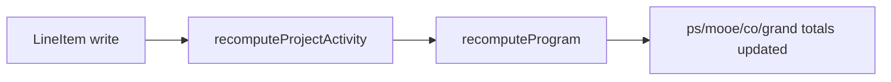

# Module: `line-items`

**Folder:** `api/src/line-items/`

## Purpose

Manages `LineItem` rows — the atomic unit of budget. Each line item belongs to a
Project/Activity, references a UACS object, and carries
`quantity × unitCost = lineTotal`.

## Endpoints

| Method | Path | Access | Description |
|---|---|---|---|
| POST | `/project-activities/:paId/line-items` | Authenticated | Add a line item; recomputes rollups |
| PATCH | `/line-items/:id` | Authenticated | Update a line item (parent program must be `DRAFT`) |
| DELETE | `/line-items/:id` | Authenticated | Hard-delete a line item (parent program must be `DRAFT`) |

## Line total & UACS coherence

- `lineTotal` is **always recomputed server-side** as `quantity × unitCost`; any
  client-provided value is ignored.
- The UACS code and description are **snapshotted onto the row** at write time
  (`uacsCode`, `uacsDescription`) so historical line items survive catalog edits.
- `LineItem.expenseClass` must match the referenced `UACSObject.expenseClass`.

## The rollup cascade

Every line-item mutation runs in a transaction that walks the rollup up the
tree:

This is what keeps the denormalised `ProjectActivity` and `Program` totals
truthful. See [budget-rollup.md](budget-rollup.md).

## Services

- **`LineItemsService`** — CRUD with transactional rollup recomputation. Edits
  and deletes are allowed only while the parent program is `DRAFT`.

## DTOs

`CreateLineItemDto`, `UpdateLineItemDto` (`quantity`, `unitCost` arrive as
decimal strings).

## Tables touched

`LineItem`, `UACSObject`, `ProjectActivity`, `Program`.

## Dependencies

[`budget-rollup`](budget-rollup.md), `PrismaService`.

## Related

- [project-activities.md](project-activities.md) — the parent PA
- [budget-rollup.md](budget-rollup.md) — how totals stay correct
