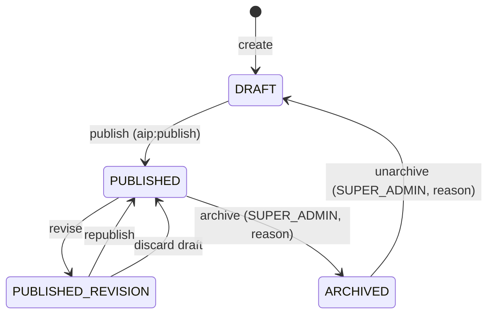

# Module: `programs`

**Folder:** `api/src/programs/`

## Purpose

The core module. It owns the `Program` entity and its lifecycle under the
**publish model** — create, edit, reorder, publish, open a revision, discard a
draft, version snapshots, publish readiness, import acknowledgement — plus
visibility and read-state tracking. Most other AIP modules exist to support it.

The older submit → head review → LFC **approval workflow** is archived on
`archive/full-approval-workflow` and will be replaced, not restored. Its read
endpoints (`approvals`, `endorsements`, `activity-stream`) remain and return
whatever rows exist; nothing writes new ones.

## Endpoints

Every route is behind `JwtGuard` → `RolesGuard` → `PermissionGuard`; the
permission key is listed. Ownership and office scope are enforced **in the
service layer**. Authoritative list: [`api-routes.md`](../../api/docs/api-routes.md).

| Method | Path | Permission | Description |
|---|---|---|---|
| GET | `/programs` | `aip:read` | List programs the caller can see (office scope), with filters |
| GET | `/programs/:id` | `aip:read` | One program with PAs and rollups |
| POST | `/programs` | `aip:write` | Create a `DRAFT` program in an `OPEN` cycle; derives its tentative code |
| PATCH | `/programs/:id` | `aip:write` | Update an editable program (`DRAFT`, `FOR_REVISION`, `PUBLISHED_REVISION`) |
| PATCH | `/programs/reorder` | `aip:write` | Reorder programs within one code scope, renumbering tentative codes |
| DELETE | `/programs/:id` | `aip:delete` | Soft-delete a never-published program (`DRAFT`/`FOR_REVISION`; SUPER_ADMIN may override) |
| GET | `/programs/:id/publish-readiness` | `aip:read` | Blockers, advisory warnings, ceiling warnings, unresolved-comment count |
| POST | `/programs/:id/publish` | `aip:publish` | Publish or republish: snapshot → `ProgramVersion`, advance `publishedVersionId`, final AIP code on first publish |
| POST | `/programs/:id/revise` | `aip:write` | `PUBLISHED → PUBLISHED_REVISION` (idempotent) |
| POST | `/programs/:id/discard-draft` | `aip:write` | Restore live rows from the published snapshot; back to `PUBLISHED` |
| POST | `/programs/:id/archive` | `aip:publish` + SUPER_ADMIN | `PUBLISHED → ARCHIVED` with a required reason: out of every list, total and export; history, comments and the public link kept; tentative code released (specs/013) |
| POST | `/programs/:id/unarchive` | `aip:publish` + SUPER_ADMIN | `ARCHIVED → DRAFT` with a required reason; must pass readiness to publish again |
| POST | `/programs/:id/acknowledge-import` | `aip:publish` | Confirm the import's decisions; clears `importWarnings` and the `INCOMPLETE_IMPORT` blocker; logs `IMPORT_REVIEWED`. Idempotent. Data gaps are derived and clear only when the data is fixed |
| GET | `/programs/:id/versions` | `aip:read` | List published snapshots |
| GET | `/programs/:id/versions/compare` | `aip:read` | Side-by-side compare (`?from=N&to=M\|current`) |
| GET | `/programs/:id/draft-diff` | `aip:read` + read access to the program | Field-level diff of the working copy against the published snapshot |
| GET | `/programs/:id/edit-history` | `aip:audit` | Field-level history of the program and its PAs (see [program-audit](program-audit.md)) |
| POST | `/programs/:id/mark-seen` | `aip:read` | Clear the unread dot for the caller |
| GET | `/programs/:id/approvals`, `/endorsements`, `/activity-stream` | `aip:read` | Archived-workflow reads (see Purpose) |

Cycle-wide publishing (`publishCluster`, preview, publishable counts) is exposed
through [`aip-cycles`](aip-cycles.md).

## The lifecycle

`ARCHIVED` is read-only and counts nowhere. Queries that mean "live" use
`LIVE_PROGRAM` / `PUBLICLY_VISIBLE` from `program-filters.ts`, never a bare
`deletedAt: null` ([aip-reference invariant 27](../../api/docs/aip-reference.md)).
In bulk (the 2027 launch's 12 legacy programs):
`tsx prisma/archive-programs.ts --published 2027 --expect 12 --reason "…" [--dry-run]`.

`APPROVED` (archived-workflow data, e.g. the enacted 2026 corpus) is also
publishable. See [architecture/workflow.md](../architecture/workflow.md) and
`design/phase-1-publish-scope.md`.

## Services

- **`ProgramsService`** — CRUD, reorder, soft delete, visibility, read state. Hosts
  the reusable RBAC helpers `assertOwner`, `assertOwningHead`, `assertCanRead`,
  `buildVisibilityWhere`; other modules import them.
- **`ProgramPublishService`** — `publish` / `publishCluster`, `openRevision`,
  `discardDraft`, `readinessFor`, `acknowledgeImport`, `publishPreview`,
  `publishableCounts`. `readinessFor` computes the blockers and runs
  `deriveDataWarnings` against live rows, so data-gap sentences clear themselves
  when the data is fixed ([`import-warnings-revalidation.md`](../design/import-warnings-revalidation.md)).
- **`ProgramVersionsService`** — snapshot creation, version listing, compare.
- **`ProgramWorkflowService`** — read-only: `listApprovals`, endorsements, `activityStream`.

## Editable statuses

`program-status.constants.ts` exports `EDITABLE_PROGRAM_STATUSES =
[DRAFT, FOR_REVISION, PUBLISHED_REVISION]` / `isEditableStatus()` and
`DELETABLE_PROGRAM_STATUSES = [DRAFT, FOR_REVISION]`. `PUBLISHED` is absent from
both on purpose: it guarantees live rows equal the published snapshot. Every
"can edit" check — programs, `project-activities`, `line-items`, `climate-tags` —
keys off these. The client mirrors them in `client/src/lib/program-status.ts`.

## Relation-array tags

`supportingOfficeIds` and `sdgGoalIds` (SDG goals, an optional multi-tag against
the UN 2030 Agenda) are junction tables, not scalars, and both behave the same
way on write: **the field replaces the whole set**. Omit it to leave the set
alone, send `[]` to clear it. Ids are checked against the *unique* count before
the transaction opens, so a duplicated id 404s instead of hitting a composite-PK
violation mid-write.

Both sit outside `PROGRAM_AUDIT_FIELDS` and outside the version snapshot, so
changing them writes no History row and is untouched by a discarded revision.
See [`aip-reference.md` §6 invariant 19](../../api/docs/aip-reference.md).

## Visibility

Who can read which programs (`buildVisibilityWhere`):

| Reader | Sees |
|---|---|
| `SUPER_ADMIN`, or a user with all-offices scope | All programs |
| `IdentityType.LFC` user | All programs |
| User with explicit office-scope grants | Programs of those offices |
| User with no explicit grants | Home office + same-`Cluster` offices (read-only) |

`assertOwner` (writes) uses grants + home office only, never the cluster.

## Versioning

Every publish writes an immutable `ProgramVersion` — a JSON snapshot of the
program, its PAs, line items, fund splits and climate tags — and points
`publishedVersionId` at it. The public site reads only that snapshot, so a
revision in progress never leaks. Discard-draft restores live rows from it:
the program's fields **including its own cost columns** (`costMode`,
`fundSources`, PS/MOOE/FE/CO) and fund split, its climate tag, and the PA
subtree with each PA's fund split and climate tag. The PA rebuild cascades
those away, so anything not restored from the snapshot is lost; until 2026-10-15
a discarded direct-cost program kept its draft figures, and every PA lost
its split and tag.

## Key invariants enforced here

- **Comments never block publishing** — unresolved threads are counted in
  readiness but are advisory.
- **Ceilings are advisory** — readiness reports finish-line ceiling overruns as
  warnings (see [budget-ceilings](budget-ceilings.md)); a ceiling of zero is a real cap.
- **Cycle guard** — a program can only be created in an `OPEN` cycle.
- **Editable scope** — `DRAFT`, `FOR_REVISION`, `PUBLISHED_REVISION`; only the
  first two are deletable.
- **Publishable scope** — `DRAFT`, `PUBLISHED_REVISION` and `APPROVED`.
  `APPROVED` is the end of the workflow, so publishing it is the natural next
  step; without it the enacted 2026 corpus could not be made public at all.
- **`hostOfficeId` is a printing decision, not a code segment** — it names the
  office whose AB sheet this program appears under, in that sheet's COMPONENT
  PROGRAMS band. It may equal `officeId` (the city's `004` bucket), the host
  must be an active office, and setting it triggers **no** resync: the program
  keeps its own office's code.
- **Tentative codes are derived** — create, soft-delete, a `officeId` /
  `papSectorId` / `papClass` change, and reorder all run
  `resyncTentativeProgramCodes` in the same transaction. A delete closes its gap;
  a scope change resyncs the **old** scope first (freeing the vacated ordinal)
  and then the new one. `papSubsectorCode` is no longer a code input and no
  longer triggers a resync. See [aip-codes](aip-codes.md).
- **Reorder is single-scope and complete** — `PATCH /programs/reorder` requires
  every program in one `(cycle, office, papSector)` scope exactly once. A
  cross-scope payload is rejected: the ordinal restarts per scope, so the codes
  could not follow the drag. A partial payload is rejected because omitted rows
  would keep stale ranks and jump on the next unrelated resync.
  The registry's **Reorder** button on an office section
  (`components/aip/program-reorder-dialog.tsx`) loads the office's programs fresh
  with `GET /programs?cycleId&officeId` (the list on screen may be filtered),
  lets a program move only within its PAP sector, and sends the sector's whole
  scope — the section's new order followed by the sector's programs in the other
  sections, whose relative order it keeps (`lib/program-reorder.ts`). papClass
  ranks before `orderIndex`, so their position after the section is harmless.

## DTOs

`CreateProgramDto`, `UpdateProgramDto`, `ListProgramsDto`, `ReorderProgramsDto`.

## Tables touched

`Program`, `ProjectActivity`, `LineItem`, `ClimateChangeTag`, `FundAllocation`,
`ProgramVersion`, `ProgramAuditLog`, `ProgramComment`, `ProgramReadState`,
`AIPCycle`, `Office`. Reads only: `ProgramApproval`, `ProgramEndorsement`,
`ProgramVerdict` (archived workflow).

## Dependencies

[`aip-codes`](aip-codes.md), [`budget-ceilings`](budget-ceilings.md),
[`budget-rollup`](budget-rollup.md), [`events`](events.md), `PrismaService`.

## Related

- [project-activities.md](project-activities.md) / [line-items.md](line-items.md) — the program's children
- [comments.md](comments.md) — internal threads and public feedback
- [aip-registry.md](aip-registry.md) — how programs surface in the dashboard
- [`manual/phase-1-encoding.md`](../manual/phase-1-encoding.md) — the encoder's view
