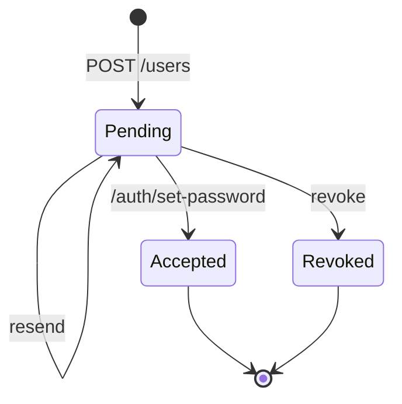

# Module: `users`

**Folder:** `api/src/users/`

## Purpose

Manages user accounts and the invitation flow. New users are never created
directly — an admin or HEAD issues an **invite**, and the `User` row is created
only when that invite is accepted via `/auth/set-password`.

## Endpoints

| Method | Path | Access | Description |
|---|---|---|---|
| GET | `/users/me` | Any authenticated | The caller's own profile (with resolved office/org label) |
| PATCH | `/users/me` | Any authenticated | Self-service profile edit — **first/last name only**; logs `PROFILE_UPDATED` |
| GET | `/users/me/audit-logs` | Any authenticated | The caller's own account activity, newest first (capped at 200) |
| POST | `/users` | SUPER_ADMIN, HEAD | Invite a new user |
| POST | `/users/invites/:inviteId/resend` | SUPER_ADMIN, HEAD | Re-send a pending invite |
| POST | `/users/invites/:inviteId/revoke` | SUPER_ADMIN, HEAD | Revoke a pending invite |
| GET | `/users` | SUPER_ADMIN, HEAD | List users (HEAD sees own office only) |
| GET | `/users/:id` | SUPER_ADMIN, HEAD | Get one user |
| GET | `/users/:id/audit-logs` | SUPER_ADMIN, HEAD | Audit trail for a user (newest first) |
| PATCH | `/users/:id` | SUPER_ADMIN, HEAD | Update a user (name, role, office, activation) |
| DELETE | `/users/:id` | SUPER_ADMIN | Delete a user |

## Scoping rules

- A **HEAD** can invite and list users **only within their own office**, and
  can invite only `STAFF`.
- A **SUPER_ADMIN** has no scope restriction and is the only role that can
  invite another `SUPER_ADMIN` or delete a user.
- The **`/users/me*` self-service routes** carry no `@Roles` restriction — any
  authenticated user reaches them (they back the `/account` page). `me` routes
  are declared **before** the `:id` routes so `/users/me` is not captured as an
  `:id` param.

### Audit-log actions (`UserAuditLog`)

The `UserAuditAction` enum is written from two places. `users.service` records
admin-initiated changes (`ROLE_CHANGED`, `OFFICE_CHANGED`, `ACTIVATED`,
`DEACTIVATED`, `PROFILE_UPDATED`). The **auth module** additionally records
self-initiated account events with `actor = target = self`: `LOGIN`,
`LOGIN_FAILED` (only when the email resolves to a real user), `PASSWORD_CHANGED`,
`PASSWORD_RESET_REQUESTED`, and `PASSWORD_RESET`. All of these surface in the
`/account` activity feed via `GET /users/me/audit-logs`.

### Editing an existing user (`PATCH /users/:id`)

- Editable fields: **first/last name**, **role** (`STAFF` ⇄ `HEAD`),
  **office** (LGU city office / NCPC organisation), and **activation**
  (`isActive`).
- A **HEAD** may only assign the `STAFF` role and may **not** reassign a user's
  office — office reassignment is SUPER_ADMIN-only.
- `SUPER_ADMIN` accounts cannot be edited through this endpoint.
- An admin cannot deactivate or change the role of **their own** account
  (lock-out guard).
- Office reassignment must stay within the user's identity type (an LGU/LFC
  user moves between city offices; an NCPC user between CSOs) and the target
  must be active. The matching `LGUUser` / `NCPCUser` junction row is swapped in
  a transaction.
- Deactivation (`isActive = false`) blocks login (and 2FA verification) and
  revokes the user's active refresh tokens.

### Audit trail

Every role change, office change, (de)activation, and name edit writes a row to
`UserAuditLog` (one row per changed field), capturing the actor, their role, a
human-readable `summary`, and structured `before`/`after` `metadata`. The log is
read back via `GET /users/:id/audit-logs` and surfaced in the edit dialog's
"Change history" panel.
- An invite carries the target `role`, `identityType`, and the proponent
  organisation (`officeId` or `civilSocietyOrganizationId`). When accepted,
  the corresponding `LGUUser` / `NCPCUser` junction row is created.
- `SUPER_ADMIN` invites intentionally carry no `identityType` or organisation;
  accepted admin accounts are global portal administrators.

## Invitation lifecycle

### Re-inviting a deactivated account

An email is rejected as "already in use" only when it belongs to an **active**
account. A deactivated one can be invited again — staff leave and come back, and
the admin wants a fresh invite (new password, possibly a new office, role, and
grants) rather than flipping the old row back on.

Acceptance then **reuses that user row** instead of creating a second one: its
programs, comments, and audit trail point at that id and must keep pointing at
the same person. The invite is the new source of truth, so the stale
`LGUUser` / `NCPCUser`, `UserPermission`, and `UserOfficeScope` rows are cleared
inside the acceptance transaction before the invited ones are written, and
`isActive` flips back to true, with an `ACTIVATED` row in `UserAuditLog`
attributed to the admin who sent the invite. If an admin reactivates the account
in the window between invite and acceptance, `/auth/set-password` refuses with
`409` — a live account's password is not an invite link's to set.

Delivery is part of invite creation:

- New invite: the invite row is created, the email is sent, and if delivery
  fails the invite is immediately revoked and the API returns `503`.
- Invite emails include the target role and office/organisation display name
  when one applies.
- Resend: the replacement invite is created and sent before the old invite is
  revoked. If delivery fails, the replacement is revoked and the old invite
  remains pending.

## Services

- **`UsersService`** — invite creation/resend/revoke, user listing with
  office-scoped filtering for HEADs, role/name/office/activation updates with
  audit logging, and audit-trail reads.

## DTOs

`InviteUserDto`, `UpdateUserDto` (name, role, `officeId`,
`civilSocietyOrganizationId`, `isActive`).

## Tables touched

`User`, `UserInvite`, `UserAuditLog`, `LGUUser`, `NCPCUser`, `RefreshToken`,
`Office`, `CivilSocietyOrganization`.

## Dependencies

`PrismaService`, [`MailService`](mail.md) (sends the invite email).

## Related

- [auth.md](auth.md) — how an invite is accepted and the account activated
- [manual/administrator.md](../manual/administrator.md) — the admin's view of user management
