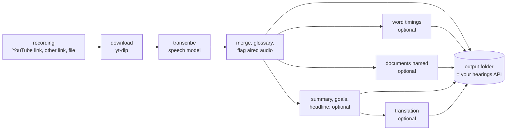

# Hearings pipeline

Turns a recording of a council session into the files the portal's hearings pages read
([`docs/hearings-api.md`](../../docs/hearings-api.md)). One machine, one command, open models. The
output is a folder: serve it with any web server and point `NEXT_PUBLIC_HEARINGS_API_URL` at it
([`docs/modules/hearings.md`](../../docs/modules/hearings.md)).



## Try it

You need Python 3.11 or later, `ffmpeg`, and [`uv`](https://docs.astral.sh/uv/) (or `pip install
faster-whisper` yourself). From this folder:

```bash
uv run --with faster-whisper python hearings.py --config example/hearings.toml run /path/to/recording.mp4 --title "1st Regular Session" --date 2027-01-12
```

The first run downloads the speech model (about 460 MB for `small`). The result is in
`example/out/`. To see it on the pages:

```bash
docker run --rm -p 127.0.0.1:8765:80 -v "$PWD/example/out:/usr/share/nginx/html:ro" nginx:alpine
```

```bash
NEXT_PUBLIC_HEARINGS_API_URL=http://127.0.0.1:8765 pnpm dev:client
```

Then open `http://localhost:3000/hearings`. A YouTube link works the same way in place of the file
(yt-dlp also needs a JavaScript runtime such as `node` for YouTube).

## The command

```text
python3 hearings.py [--config hearings.toml] run <recording> [--id ID] [--title T] [--date YYYY-MM-DD] [--body ID]
python3 hearings.py [--config hearings.toml] run <id> [--redo transcribe|summary|translate]
python3 hearings.py [--config hearings.toml] remove <id>
python3 hearings.py [--config hearings.toml] site
```

| | |
|---|---|
| `run <recording>` | A YouTube link (the page plays YouTube's copy; only the sound is downloaded), any other link yt-dlp can read or a local audio or video file (both become a `file` session: the video and a poster go to `video/`) |
| `run <id>` | A session already processed, by its id. Every stage keeps its result, so this only does what is missing: use it after a run stopped, or after you edit the glossary |
| `--redo` | Do a stage again, and the ones after it. A new transcript needs a new summary, because a summary points at line numbers |
| `remove <id>` | Takes a session off the list and deletes its public files. The recording stays in the work folder until you delete it |
| `site` | Rewrites only the goals, members, glossary and bodies files, after you edit them |

A YouTube session's id is the video's id. A file's id is its name unless you pass `--id`.

## Settings

Everything specific to your LGU is in one settings file and the data files it names. Start from
[`example/hearings.toml`](example/hearings.toml): every setting is explained there.

| Section | What it sets |
|---|---|
| `output`, `work` | The public folder, and the private one (recordings, half-done work, what the model answered). `work` may not be inside `output` |
| `[speech]` | The speech model: `engine`, `model`, `language` (the engine's own code), `line_seconds` |
| `[align]` | Word timings on or off |
| `[summary]` | Any OpenAI-compatible endpoint: `base_url`, `model`, and `api_key_env`, the **name** of the environment variable that holds the key. Also `max_tokens`, `temperature`, `timeout_seconds`, `token_limit_field`. Empty `base_url`: no summary |
| `[translate.tl]`, `[translate.bcl]` | The summary in Filipino or Bikol: the language's `name` and the `register` you want |
| `[data]` | Your files, below |
| `[[bodies]]` | Who meets: `id`, `name`, `about`, and `describe`, which is how the summary model is told what it is reading |

| Data file | Shape | Used for |
|---|---|---|
| `glossary` (a list of text files) | One term per line, written the way it should appear; or `heard = Right spelling` | Correcting how the speech model wrote names, places, offices and acronyms |
| `roster` | `[{ slug, name, role? }]` | The members page (`councilors.json`); the names are glossary terms too |
| `goals` | `{ finishLines: { "1": name, … }, clusters: [name] }` | Tagging issues (`portal.json`). The model may choose from these lists only |
| `documents` | `[{ kind, no?, title, url }]` | Linking an ordinance or resolution when a session names it |
| `reader_glossary` | `[{ term, short?, definition, url? }]` | Terms the session page explains (`glossary.json`) |

## Rules the code holds

- **A claim cites lines.** Every summary item carries `refs`, the transcript lines that support it. A
  ref to a line that does not exist, or to aired audio, is dropped; a claim left with no ref is
  dropped with it; a summary with no cited claim is refused.
- **The model is told never to invent a name, a vote or an amount.** No code can check that. The refs
  are how a reader does, and why the pages put a timestamp beside every claim.
- **Goals and clusters come from your lists.** Anything else the model answers is dropped.
- **A translation changes strings only.** Shape, refs and goals are copied from the English. A
  translation with a string added, dropped or merged is refused.
- **A line is never removed after the fact.** An ad or a jingle in the broadcast is flagged
  (`skip: "aired"`), not deleted, so line numbers keep meaning the same thing.
- **A document links only if it is in your list.** A misheard number links nothing.
- **The key is never in the settings file**, and nothing private is written to the output folder.

## Read it before you publish

This pipeline writes machine-made text about named people straight into the folder you serve.
Nobody reviews it for you.

- To read first, set `output` to a folder that is not served, read the transcript and the summary,
  then copy the folder to the served one (`rsync -a out/ /var/www/hearings/`).
- A summary you fix by hand is kept: a later run does not overwrite `sessions/<id>.summary.json`
  unless you ask with `--redo summary`.
- To take a session down: `hearings.py remove <id>`.
- The pages label everything as machine-made and unreviewed, and ask search engines not to index it.

## The speech model

| `engine` | Runs on | Languages | Notes |
|---|---|---|---|
| `faster-whisper` | A CPU, or a GPU | Whisper's list: English and Tagalog are on it, most other Philippine languages are not | `model`: `tiny`, `base`, `small`, `medium`, `large-v3`. Bigger is more accurate and slower. `language` is `en`, `tl`, or empty to let it guess |
| `omnilingual` | A GPU in practice | Meta's Omnilingual ASR: more than 1,600 languages, many Philippine ones among them | `model`: `omniASR_LLM_3B_v2` (about 10 GB of GPU memory). `language` is like `bcl_Latn` or `tgl_Latn`. A line must stay under 40 seconds. Install with `--with omnilingual-asr` |

A transcript line is a fixed stretch of the recording (`line_seconds`, 30 by default), not a
sentence: a word can be cut at a line's edge. Check each model's licence before you use it.

Word timings (`[align] enabled = true`) add `--with torch==2.8.0 --with torchaudio==2.8.0`, a
1.2 GB model download, and run on a CPU.

## The summary model

Any server that answers `POST <base_url>/chat/completions` the OpenAI way: a hosted open model, or
one on your own machine (Ollama, llama.cpp's server, vLLM, MLX). The whole transcript goes in one
request, about 10,000 tokens per hour of recording, so **the model needs a context window that holds
the session**. Session transcripts are public speech, but they do go to whoever runs that endpoint.

How good the summary is depends on the model. See what two small ones did, below.

## What was run, and what was not

On an Apple M5 laptop (16 GB, no GPU used for speech), 2026-11-20, with a four-minute recording made
with text-to-speech from a made-up script (English, three voices, an ad looped twice).

| Stage | Run for real? | What happened |
|---|---|---|
| Local video file to a `file` session | Yes | `video/<id>.mp4` and its poster written; the page played and seeked it through nginx |
| Local audio file, no picture | Yes | A sound-only `video/<id>.mp4` and a plain poster written, with the "Try it" command exactly as written above (Python 3.12) |
| YouTube link | Yes | A 19-second public video: sound downloaded, transcribed, listed with `source: "youtube"` |
| Speech, `faster-whisper` `small` on the CPU | Yes | The script came back readable, with mistakes ("barangay" heard as "baron k"). About 2 minutes for the 4-minute recording while the laptop was busy |
| Glossary, merge, document links | Yes | Both documents named in the script were linked; office names got their capitals |
| Word timings on the CPU | Yes | All 6 lines aligned; the page followed the video word by word |
| Summary, goals, headline on an open model | Yes, two local models | **Qwen2.5 7B (4-bit)**: a usable summary, every claim cited, goals from the lists; it left the ad out, and it filed a health item under the wrong goal. **Phi-4-mini (4-bit)**: malformed JSON with no citations, refused twice by the checks, no summary written |
| Translation to Filipino | Yes, and it was bad | Qwen2.5 7B returned the right shape and the wrong meaning (it turned "Sample City" into "Ten Percent City"). The checks cannot see that. Translate only with a model whose Filipino or Bikol a speaker has read |
| Flagging aired audio | Tests only | The looped ad in the test recording was thrown out earlier, by the filter for invented text. The thresholds come from real council broadcasts, not from this repo |
| `omnilingual` engine | **No** | Needs a GPU this machine does not have. The call is the one Stride's own pipeline makes; it has not been run from this repo |
| Another link (Facebook and others) | **No** | The code path is there; it was not run |
| A long recording (hours) | **No** | The longest run here was four minutes. Shards make a stopped run continue, which the tests cover |
| Languages other than English | **No** | |
| Translation to Bikol | **No** | |

## Not in this pipeline

- **Attendance.** A roll call heard by a machine is too easy to get wrong about a named person, and
  the pages do not show it.
- **What each member did on the floor.** That needs a person to confirm each item before it is
  public, and this repo has no reviewer workspace. The members page lists the roster only.
- **Corrections by reviewers**, a queue, notifications, cloud storage, running on more than one
  machine. The contract has two optional endpoints for reviewed text and confirmed actions
  ([`docs/hearings-api.md`](../../docs/hearings-api.md)); a static folder does not answer them, and
  the pages work without them.
- **Summarising a session longer than the model's context window.**

## Tests

```bash
python3 -m unittest discover -s services/hearings
```

Standard library only, no model, no network, no ffmpeg; CI runs it. It covers joining shards, the
glossary, aired audio, document links, the summary's shape and citation checks against a stand-in
model, translation, the settings file, the index, and the whole command on stand-ins. All sample
data is made up.

## Files

| | |
|---|---|
| `hearings.py` | The command: settings, download, video, the site's files, the index |
| `text.py` | The stages with no model: merge, glossary, aired audio, document links |
| `speech.py` | The speech engines and word timings |
| `summary.py` | The summary, goals, headline, translation, and their checks |
| `example/` | Settings and made-up data to start from |
| `sample/` | A made-up output folder, for trying the pages without running anything |
